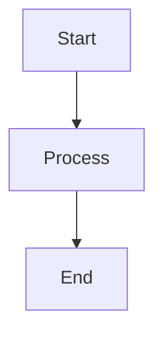

# dev-playground

A personal learning website for notes, cheat sheets, and quick references built with Vite + React + TypeScript.

## Features

- Notes stored as Markdown files in `content/notes` with frontmatter
- Topic-based notes navigation with automatic topic discovery
- Cheat sheets stored in `content/cheatsheets`
- Glossary terms stored in `content/glossary`
- Instant client-side search with topic and tag filtering
- Glossary practice mode with flashcards and local progress tracking
- Copy button for code blocks
- **Mermaid diagram support**: render diagrams from code blocks with live theme support
- Favorites saved in localStorage
- Dark/light mode with browser persistence
- Responsive layout for desktop and mobile
- GitHub Pages deployment workflow included

## Local development

```bash
npm install
npm run dev
```

## Production build

```bash
npm run build
```

## Deploying to GitHub Pages

1. Push the repository to GitHub.
2. In the repository settings, enable GitHub Pages using the GitHub Actions deployment method.
3. The workflow in `.github/workflows/deploy.yml` will build and deploy the site automatically when changes are pushed to `main`.

## Adding new content

Create a markdown file inside one of the content folders:

- `content/notes/*.md`
- `content/cheatsheets/*.md`
- `content/glossary/*.md`

Each file uses frontmatter like:

```md
---
title: My Note
topic: Frontend
tags: [react, javascript]
date: 2026-10-10
---
```

Notes are grouped by `topic` automatically. Any new topic name appears on the `/notes` overview without code changes.

Glossary terms are loaded automatically from `content/glossary`. Adding a new term only requires a new `.md` file.

### Glossary frontmatter

Each glossary file should use:

```md
---
term: CI/CD
fullName: Continuous Integration / Continuous Delivery
category: Workflow & DevOps
tags: [devops, github, automation]
date: 2026-10-29
---
```

Required body sections:

- `## In short`
- `## What it means for a .NET Full Stack developer`
- `## Example`
- `## Related terms`

### Glossary routes

- `/glossary` term cards with search and category filter
- `/glossary/:slug` term detail page with favorites
- `/glossary/practice` flashcards with category filtering, shuffle, and missed-term review mode

### Mermaid diagrams

Render Mermaid diagrams directly in Markdown by using a fenced code block with the `mermaid` language:



The diagram renders with the current theme (light or dark) and re-renders automatically when you switch themes. If there's a syntax error, you'll see a helpful message and the source code.

### Notes structure

- `/notes` shows topic cards with note counts.
- `/notes/:topic` shows all notes for that topic.
- `/notes/:topic/:slug` shows the note detail view.

### Optional topic metadata

You can customize topic cards with optional metadata in `content/topics.json`:

```json
[
  {
    "name": "HTML",
    "description": "Core HTML structure and semantics.",
    "icon": "🌐",
    "sortOrder": 10
  }
]
```

- `name` must match the note frontmatter `topic` exactly.
- `description`, `icon`, and `sortOrder` are optional.
- Topics not listed still work with default display values.
