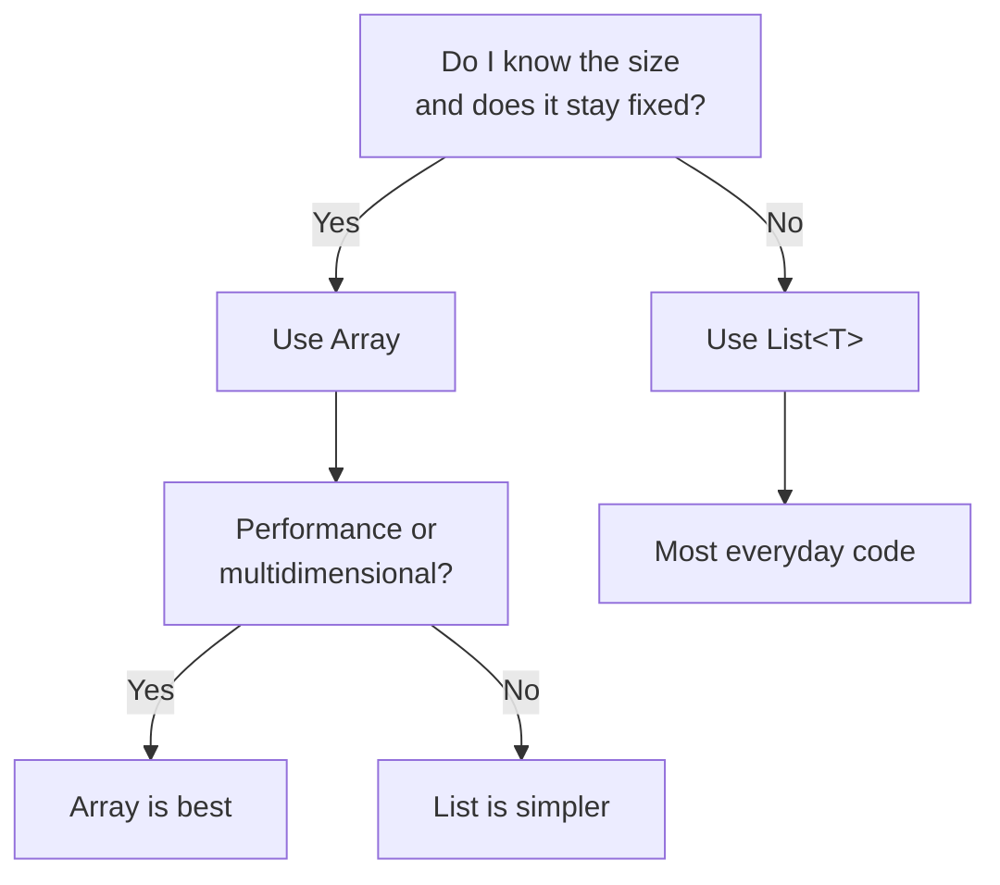

# C# Array & List Cheatsheet

Quick reference for the most common array and list operations, comparisons, and exceptions.

## Array vs List<T> at a glance

| Aspect | Array | List<T> |
|--------|-------|---------|
| **Size** | Fixed | Dynamic |
| **Syntax** | `int[]` | `List<int>` |
| **Access** | `arr[0]` | `list[0]` |
| **Count** | `.Length` | `.Count` |
| **Add item** | Not possible | `.Add(item)` |
| **Remove** | Not possible | `.Remove(item)`, `.RemoveAt(i)` |
| **Multidim** | Yes: `int[,]` | No, use `List<List<T>>` |
| **When to use** | Fixed size, performance, grids | Dynamic, most everyday code |

**Rule of thumb**: When unsure, use `List<T>`.

## Creating arrays and lists

| Operation | Syntax | Example |
|-----------|--------|---------|
| **Array: fixed size** | `new T[size]` | `new int[5]` |
| **Array: with values** | `new T[] { ... }` | `new int[] { 1, 2, 3 }` |
| **Array: modern** | `[ ... ]` (C# 12+) | `[1, 2, 3]` |
| **List: empty** | `new List<T>()` | `new List<int>()` |
| **List: with capacity** | `new List<T>(capacity)` | `new List<int>(10)` |
| **List: with values** | `new List<T> { ... }` | `new List<int> { 1, 2, 3 }` |
| **List: from array** | `new List<T>(array)` or `.ToList()` | `new List<int>(arr)` |

## Common operations

### Add/Insert

| Method | Syntax | Purpose |
|--------|--------|---------|
| **Add** | `list.Add(item)` | Add to end |
| **AddRange** | `list.AddRange(collection)` | Add multiple |
| **Insert** | `list.Insert(index, item)` | Add at specific index |

### Remove/Clear

| Method | Syntax | Purpose |
|--------|--------|---------|
| **Remove** | `list.Remove(item)` | Remove first occurrence (returns bool) |
| **RemoveAt** | `list.RemoveAt(index)` | Remove at index |
| **RemoveAll** | `list.RemoveAll(x => condition)` | Remove all matching |
| **Clear** | `list.Clear()` | Remove all items |

### Search

| Method | Syntax | Returns | Purpose |
|--------|--------|---------|---------|
| **Contains** | `list.Contains(item)` | bool | Exists? |
| **IndexOf** | `list.IndexOf(item)` | int | Index or -1 |
| **Find** | `list.Find(x => cond)` | T | First match or default |
| **FindIndex** | `list.FindIndex(x => cond)` | int | Index or -1 |
| **FindAll** | `list.FindAll(x => cond)` | List<T> | All matches |
| **Exists** | `list.Exists(x => cond)` | bool | Any match? |

### Sort

| Method | Syntax | In-place? | Purpose |
|--------|--------|----------|---------|
| **Array.Sort** | `Array.Sort(arr)` | Yes | Sort ascending |
| **Array.Reverse** | `Array.Reverse(arr)` | Yes | Reverse order |
| **List.Sort** | `list.Sort()` | Yes | Sort ascending |
| **List.Reverse** | `list.Reverse()` | Yes | Reverse order |
| **OrderBy** | `list.OrderBy(x => x).ToList()` | No | Returns new, ascending (LINQ) |
| **OrderByDescending** | `list.OrderByDescending(x => x).ToList()` | No | Returns new, descending (LINQ) |

### Count & Length

| Property | On | Returns | Notes |
|----------|----|---------|---------  |
| `.Length` | Array | int | Read-only |
| `.Count` | List<T> | int | Read-only |
| `.Capacity` | List<T> | int | Internal array size |

## Indexing

| Operation | Syntax | Example | Returns |
|-----------|--------|---------|---------|
| **By index** | `arr[i]` | `arr[0]` | Element at i |
| **Last element** | `arr[^1]` | `arr[^1]` | Last element (C# 8+) |
| **Slice** | `arr[start..end]` | `arr[1..3]` | Elements from start to end (C# 8+) |

## Accessing: LINQ (requires `using System.Linq`)

| Method | Returns | Throws if... | Example |
|--------|---------|--------------|---------|
| **First** | T | No match | `arr.First(x => x > 5)` |
| **FirstOrDefault** | T or null | — | `arr.FirstOrDefault(x => x > 5)` |
| **Single** | T | 0 or >1 matches | `arr.Single(x => x == 5)` |
| **SingleOrDefault** | T or null | >1 matches | `arr.SingleOrDefault(x => x == 5)` |
| **Where** | IEnumerable | — | `arr.Where(x => x > 5).ToList()` |
| **Any** | bool | — | `arr.Any(x => x > 5)` |

## Common exceptions with one-line fixes

| Exception | Cause | Fix |
|-----------|-------|-----|
| **IndexOutOfRangeException** | Array access out of bounds | Check `index < arr.Length` before access |
| **ArgumentOutOfRangeException** | List access out of bounds | Check `index < list.Count` before access |
| **InvalidOperationException** | `First()` or `Single()` on empty sequence | Use `FirstOrDefault()` / `SingleOrDefault()` |
| **NullReferenceException** | Using null from `FirstOrDefault()` | Check `if (result != null)` before use |
| **InvalidOperationException** | Modify list during `foreach` | Use `for` loop backward or `RemoveAll()` |
| **CS1061** | Calling `.Add()` on array | Use `List<T>` instead |

## Decision flowchart: Array or List?



## Sorting: which method?

| Need | Use | In-place? | Example |
|------|-----|----------|---------|
| Sort array ascending | `Array.Sort()` | Yes | `Array.Sort(arr)` |
| Sort array descending | `Array.Sort()` + `Reverse()` | Yes | `Array.Sort(arr); Array.Reverse(arr);` |
| Sort list ascending | `List.Sort()` | Yes | `list.Sort()` |
| Sort list descending | `List.Sort()` + `Reverse()` | Yes | `list.Sort(); list.Reverse();` |
| Sort, keep original | `OrderBy()` | No | `arr.OrderBy(x => x).ToList()` |
| Sort by property | `OrderBy(x => x.Prop)` | No | `list.OrderBy(p => p.Score).ToList()` |
| Custom comparator | `List.Sort((a, b) => ...)` | Yes | `list.Sort((a, b) => a.Score.CompareTo(b.Score));` |

## Converting between Array and List

| Conversion | Syntax | Example |
|-----------|--------|---------|
| **Array → List** | `new List<T>(array)` or `.ToList()` | `new List<int>(arr)` or `arr.ToList()` |
| **List → Array** | `.ToArray()` | `list.ToArray()` |

## Quick search reference

```csharp
int[] arr = [10, 20, 30, 40, 50];
List<int> list = [10, 20, 30, 40, 50];

// Contains
arr.Contains(30);              // true (LINQ)
list.Contains(30);             // true

// IndexOf
Array.IndexOf(arr, 30);        // 2
list.IndexOf(30);              // 2

// First match with LINQ
arr.First(x => x > 25);        // 30
arr.FirstOrDefault(x => x > 100);  // 0 (default)

// List-specific methods
list.Find(x => x > 25);        // 30
list.FindIndex(x => x > 25);   // 2
list.Exists(x => x > 25);      // true
```

## Quick sort reference

```csharp
int[] arr = [3, 1, 4, 1, 5, 9];
List<int> list = [3, 1, 4, 1, 5, 9];

// In-place sort (modifies original)
Array.Sort(arr);               // [1, 1, 3, 4, 5, 9]
list.Sort();                   // [1, 1, 3, 4, 5, 9]

// Non-destructive sort (LINQ, needs using System.Linq)
var sorted = arr.OrderBy(x => x).ToList();        // New list
var reversed = list.OrderByDescending(x => x).ToList();  // Descending

// Sort by property
list.Sort((a, b) => a.CompareTo(b));
var byProp = list.OrderBy(p => p.Score).ToList();
```

## Useful LINQ imports

```csharp
using System.Linq;  // Required for: OrderBy, First, Any, Where, etc.
```

## Links to detailed notes

- [C# Arrays](/content/notes/csharp-arrays.md)
- [C# Lists](/content/notes/csharp-lists.md)
- [Array vs List](/content/notes/csharp-array-vs-list.md)
- [Accessing Items](/content/notes/csharp-accessing-items.md)
- [Sorting](/content/notes/csharp-sorting.md)
