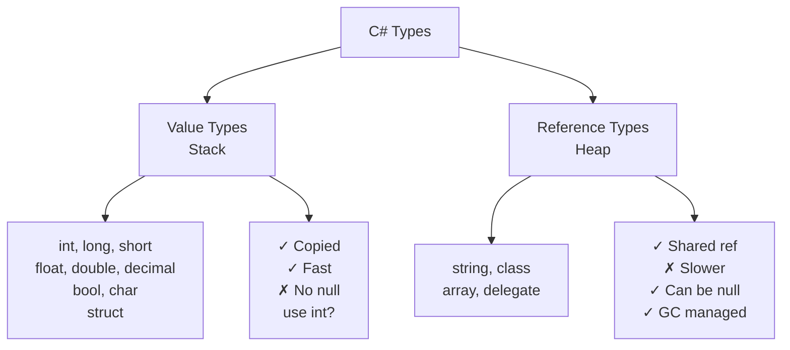

# C# Data Types Cheatsheet

Quick reference for C# built-in types, literals, conversions, string methods, and common errors.

## All built-in types at a glance

| Keyword | .NET Type | Bytes | Signed? | Range/Purpose | Literal Suffix | Example |
|---------|-----------|-------|---------|---------------|----------------|---------|
| `bool` | Boolean | 1 | — | true/false | — | `true` |
| `byte` | Byte | 1 | No | 0 to 255 | — | `255` |
| `sbyte` | SByte | 1 | Yes | -128 to 127 | — | `-50` |
| `short` | Int16 | 2 | Yes | -32K to 32K | — | `1000` |
| `ushort` | UInt16 | 2 | No | 0 to 65K | — | `5000` |
| `int` | Int32 | 4 | Yes | -2.1B to 2.1B | — | `42` |
| `uint` | UInt32 | 4 | No | 0 to 4.3B | `U` | `42U` |
| `long` | Int64 | 8 | Yes | -9.2E18 to 9.2E18 | `L` | `42L` |
| `ulong` | UInt64 | 8 | No | 0 to 1.8E19 | `UL` | `42UL` |
| `float` | Single | 4 | Yes | ±3.4E38 | `f` | `3.14f` |
| `double` | Double | 8 | Yes | ±1.7E308 | `d` or none | `3.14` or `3.14d` |
| `decimal` | Decimal | 16 | Yes | ±7.9E28 (28 digits) | `m` | `19.99m` |
| `char` | Char | 2 | — | Single UTF-16 char | — | `'A'` |
| `string` | String | Variable | — | Text (immutable) | — | `"Hello"` |
| `object` | Object | Variable | — | Any value/reference | — | `(object)42` |

## Type defaults

| Type | Default |
|------|---------|
| Numeric (int, long, etc.) | 0 |
| `float` / `double` | 0.0 |
| `decimal` | 0m |
| `bool` | false |
| `char` | '\0' |
| Reference types (string, class, array) | null |
| Nullable types (int?, bool?) | null |

## Literal suffixes

| Suffix | Type | Example |
|--------|------|---------|
| `L` | long | `1000L` |
| `U` | uint | `42U` |
| `UL` | ulong | `1000UL` |
| `f` | float | `3.14f` |
| `d` | double | `3.14d` (optional) |
| `m` | decimal | `19.99m` |
| None | int (default) | `42` |

**Key:** Decimal literals default to `double`. Always use `m` suffix for money: `19.99m`, not `19.99`.

## Conversion rules: implicit vs explicit

| From | To | Implicit? | Method | Example |
|------|----|-----------|---------|---------| 
| `int` | `long`, `double`, `decimal` | ✓ | Auto | `long x = 42;` |
| `long` | `int` | ✗ | Cast | `int x = (int)big;` |
| `double` | `decimal` | ✗ | Cast | `decimal x = (decimal)d;` |
| `string` | `int` | ✗ | Parse/TryParse | `int.Parse("42")` |
| Any | `string` | ✗ | ToString | `42.ToString()` |
| `object` | Any value type | ✗ | Unbox | `(int)obj` |

### Quick conversion examples

```csharp
// Implicit (no cast)
int x = 100;
long y = x;                  // ✓

// Explicit (requires cast)
long big = 1000;
int small = (int)big;        // ✓

// String conversions
int num = int.Parse("42");   // Throws if invalid
double d = double.Parse("3.14");

if (int.TryParse("42", out int n))  // Safe (no throw)
{
    Console.WriteLine(n);
}

// ToString
int value = 42;
string text = value.ToString();  // "42"
```

## String methods (most common)

| Method | Purpose | Example |
|--------|---------|---------|
| `Length` | Character count | `"hello".Length` → 5 |
| `[index]` | Get character at index | `"hello"[1]` → 'e' |
| `Substring(start, length)` | Extract substring | `"hello".Substring(1, 3)` → "ell" |
| `Contains(str)` | Check if contains | `"hello".Contains("ll")` → true |
| `Replace(old, new)` | Replace all | `"hello".Replace("l", "L")` → "heLLo" |
| `Split(delimiter)` | Split into array | `"a,b,c".Split(',')` → ["a", "b", "c"] |
| `Trim()` | Remove whitespace | `" hello ".Trim()` → "hello" |
| `ToUpper()` | Convert to uppercase | `"hello".ToUpper()` → "HELLO" |
| `ToLower()` | Convert to lowercase | `"HELLO".ToLower()` → "hello" |
| `StartsWith(str)` | Check if starts with | `"hello".StartsWith("he")` → true |
| `EndsWith(str)` | Check if ends with | `"hello".EndsWith("lo")` → true |
| `IndexOf(str)` | Find index of | `"hello".IndexOf("ll")` → 2 |
| `string.Join(sep, array)` | Join array to string | `string.Join(",", new[]{"a","b"})` → "a,b" |
| `string.IsNullOrEmpty(s)` | Check null or empty | `string.IsNullOrEmpty("")` → true |
| `string.IsNullOrWhiteSpace(s)` | Check null, empty, or spaces | `string.IsNullOrWhiteSpace("  ")` → true |

## Common compiler errors and one-line fixes

### CS0266: Cannot implicitly convert type 'X' to 'Y'

**Cause:** Missing cast when converting from larger to smaller type.

```csharp
long value = 1000;
int x = value;              // ❌ CS0266

// Fix: Add explicit cast
int x = (int)value;         // ✓
```

### CS0221: Constant value out of range for 'Y'

**Cause:** Numeric literal exceeds the target type's range.

```csharp
byte b = 300;               // ❌ CS0221 (max 255)

// Fix 1: Use a value that fits
byte b = 255;               // ✓

// Fix 2: Cast a variable (runtime decision)
int temp = 300;
byte b = (byte)temp;        // ✓ (wraps to 44)
```

### FormatException: Input string was not in a correct format

**Cause:** Trying to parse an invalid string.

```csharp
int x = int.Parse("abc");   // ❌ FormatException

// Fix 1: Use TryParse (no throw)
if (int.TryParse("abc", out int result))
    Console.WriteLine(result);
else
    Console.WriteLine("Invalid");  // ✓

// Fix 2: Ensure valid input
int x = int.Parse("42");    // ✓
```

### InvalidCastException: Cannot unbox object to target type

**Cause:** Unboxing to a type different from the original boxed type.

```csharp
object boxed = 42;          // Boxed int
long x = (long)boxed;       // ❌ InvalidCastException

// Fix: Unbox to the correct type
int x = (int)boxed;         // ✓
```

### OverflowException: Value is too large or too small

**Cause:** Converted value exceeds the target type's range.

```csharp
long big = long.MaxValue;
int x = checked((int)big);  // ❌ OverflowException

// Fix: Use unchecked or handle carefully
int x = unchecked((int)big);  // Wraps silently ✓
```

## Value types vs reference types

| | Value Type | Reference Type |
|---|----------|-----------------|
| **Stored in** | Stack | Heap |
| **Copy behavior** | Copied on assignment | Shared (reference) |
| **Null allowed** | Only with `?` (nullable) | Yes |
| **Speed** | Fast | Slower |
| **GC** | Automatic (stack) | Garbage collected |
| **Examples** | int, bool, struct | string, class, array |

## Nullable types: `int?`, `bool?`, etc.

```csharp
int? age = null;           // Nullable int
int? count = 5;            // Can hold int value

// Check and access safely
if (age.HasValue)
    Console.WriteLine(age.Value);

// Use ?? to provide default
int result = age ?? 0;     // 0 if age is null

// Use ?. to call methods safely on nullable objects
string? text = null;
int? len = text?.Length;   // null (no exception)
```

## Mermaid: Value vs Reference



## Integer division and modulo

```csharp
int a = 7 / 2;         // 3 (truncates, not rounds)
int b = 7 % 2;         // 1 (remainder)

// Negative: sign follows dividend
int c = -7 / 2;        // -3
int d = -7 % 2;        // -1
```

## Boolean operators and short-circuit

| Operator | Name | Example | Short-circuit? |
|----------|------|---------|----------------|
| `&&` | AND | `true && false` | ✓ Stops if first is false |
| `\|\|` | OR | `true \|\| false` | ✓ Stops if first is true |
| `!` | NOT | `!true` | — |

```csharp
if (false && ExpensiveCheck())  // ExpensiveCheck() never runs
{
}

if (true || ExpensiveCheck())   // ExpensiveCheck() never runs
{
}
```

## Escape sequences in strings

| Sequence | Meaning |
|----------|---------|
| `\\` | Backslash |
| `\"` | Double quote |
| `\'` | Single quote |
| `\n` | Newline |
| `\r` | Carriage return |
| `\t` | Tab |
| `\0` | Null character |
| `\u0041` | Unicode (e.g., 'A') |

```csharp
// Regular string: use escapes
string path = "C:\\Users\\Alice\\file.txt";

// Verbatim string: backslashes are literal
string path = @"C:\Users\Alice\file.txt";

// Multiline
string text = @"Line 1
Line 2";
```

## Links to detailed notes

- [C# Data Types Overview](/content/notes/csharp-data-types-overview.md)
- [Integer Types in C#](/content/notes/csharp-integer-types.md)
- [Floating-Point and Decimal Types](/content/notes/csharp-floating-point-and-decimal.md)
- [Char and String Types](/content/notes/csharp-char-and-string.md)
- [Bool, Null, and Nullable Types](/content/notes/csharp-bool-null-and-nullable.md)
- [Type Conversion in C#](/content/notes/csharp-type-conversion.md)
