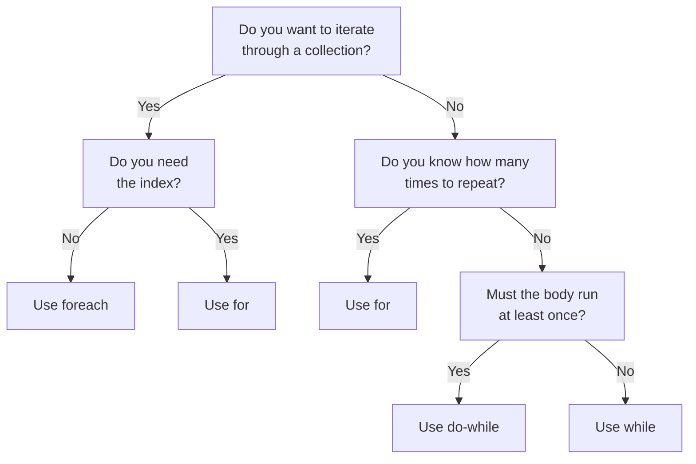

# C# Loops Cheatsheet

Quick reference for C# loop syntax, patterns, and common errors.

## Loop syntax at a glance

| Loop | Syntax | Condition checked | Runs at least once? | Best for |
|------|--------|-------------------|---------------------|----------|
| **while** | `while (condition) { }` | Before each run | No | Unknown repetitions, condition-based |
| **do-while** | `do { } while (condition);` | After each run | **Yes** | Input validation, menus |
| **for** | `for (init; cond; incr) { }` | Before each run | No | Known count, index needed, arrays |
| **foreach** | `foreach (T item in collection) { }` | (automatic) | No | Iterate all items, no index needed |

## Loop examples: syntax

### while

```csharp
int x = 0;
while (x < 5)
{
    Console.WriteLine(x);
    x++;
}
```

### do-while

```csharp
int x = 0;
do
{
    Console.WriteLine(x);
    x++;
} while (x < 5);  // ⚠️ Semicolon is required
```

### for

```csharp
for (int i = 0; i < 5; i++)
{
    Console.WriteLine(i);
}
```

### foreach

```csharp
int[] arr = [1, 2, 3];
foreach (int num in arr)
{
    Console.WriteLine(num);
}
```

## Which loop to use: decision flowchart



## Looping through collections

| Collection | Loop | Code | Syntax notes |
|-----------|------|------|--------------|
| **Array** | for | `for (int i = 0; i < arr.Length; i++)` | Use `.Length` |
| **Array** | foreach | `foreach (int num in arr)` | No index |
| **List<T>** | for | `for (int i = 0; i < list.Count; i++)` | Use `.Count` |
| **List<T>** | foreach | `foreach (var item in list)` | No index |
| **string** | foreach | `foreach (char c in "hello")` | Iterate characters |
| **Dictionary** | foreach | `foreach (var kvp in dict)` | `kvp.Key`, `kvp.Value` |

## break vs continue

| Statement | Effect | Use case |
|-----------|--------|----------|
| **break** | Exits the loop | Found what you want, stop searching |
| **continue** | Skips to next iteration | Skip invalid/unwanted items |
| **return** | Exits the method | Exit method and loop at once |

### Examples

```csharp
// break: search and exit
for (int i = 0; i < arr.Length; i++)
{
    if (arr[i] == target)
    {
        Console.WriteLine($"Found at index {i}");
        break;  // Exit loop
    }
}

// continue: skip invalid items
foreach (int score in scores)
{
    if (score < 0 || score > 100)
    {
        continue;  // Skip invalid
    }
    sum += score;
}
```

## Common loop patterns

### Sum all items

```csharp
int sum = 0;
foreach (int num in numbers)
{
    sum += num;
}
// sum now contains total
```

### Count matches

```csharp
int count = 0;
foreach (int num in numbers)
{
    if (num > 10)
    {
        count++;
    }
}
// count contains matches
```

### Find maximum

```csharp
int max = numbers[0];
foreach (int num in numbers)
{
    if (num > max)
        max = num;
}
// max contains largest value
```

### Build a new list

```csharp
List<int> evens = new List<int>();
foreach (int num in numbers)
{
    if (num % 2 == 0)
        evens.Add(num);
}
// evens contains filtered items
```

### Input validation loop

```csharp
int age;
while (true)
{
    Console.Write("Enter age (1-120): ");
    age = int.Parse(Console.ReadLine());
    
    if (age >= 1 && age <= 120)
        break;  // Valid, exit loop
    
    Console.WriteLine("Invalid. Try again.");
}
```

### Search and exit nested loops

```csharp
bool found = false;
for (int i = 0; i < rows && !found; i++)
{
    for (int j = 0; j < cols; j++)
    {
        if (grid[i, j] == target)
        {
            found = true;
            break;
        }
    }
}
```

## Common errors and one-line fixes

| Error | Cause | Fix |
|-------|-------|-----|
| **Infinite loop** | Condition never becomes false or loop variable never changes | Always update the loop variable; ensure condition will eventually be false |
| **Off-by-one error** | Using `<=` with `.Length` or `.Count` | Use `i < arr.Length`, never `i <= arr.Length` |
| **IndexOutOfRangeException** | Accessing index outside valid range (0 to Length-1) | Check `i < arr.Length` before access |
| **CS1656: Cannot assign to foreach iteration variable** | Trying to assign to the iteration variable in `foreach` | Use `for` loop instead, or modify object properties |
| **InvalidOperationException: Collection was modified** | Adding/removing items during `foreach` | Use `for` loop backwards, `RemoveAll()`, or iterate a copy with `.ToList()` |
| **Missing semicolon in do-while** | Forgetting `;` after `while (...)` in `do-while` | Always end `do-while` with `while (condition);` |

## Loop efficiency tips

| Pattern | Efficient? | Notes |
|---------|-----------|-------|
| Sum with `foreach` | ✓ | Simplest and fast |
| Loop backwards with `for` to remove | ✓ | Safe when modifying lists |
| `foreach` then `Remove()` | ❌ | Throws exception |
| Nested loops | ✓ | Runs outer × inner times |
| `continue` with updated variable | ✓ | Safe when var updated before |
| Nested loops without `break` for exit | ⚠️ | Only breaks innermost; use flag or method |

## Looping over arrays vs lists

| Task | Array | List |
|------|-------|------|
| Loop all items | `foreach` or `for` | `foreach` or `for` |
| Access by index | `arr[i]` | `list[i]` |
| Count items | `arr.Length` | `list.Count` |
| Modify items | `arr[i] = value` (for loop) | `list[i] = value` (for loop) |
| Add items | Not possible | `list.Add(item)` |
| Remove items | Not possible | `list.Remove(item)` |
| Iterate backwards | `for (i = Length-1; i >= 0; i--)` | `for (i = Count-1; i >= 0; i--)` |

## when to use each loop?

**foreach** → Iterate every item in a collection, no index needed
```csharp
foreach (string name in names)
    Console.WriteLine(name);
```

**for** → Need index, fixed count, go backwards, step by n
```csharp
for (int i = 0; i < items.Length; i++)
    items[i] = 0;
```

**while** → Unknown repetitions, condition-based, user input
```csharp
while (input != "exit")
    input = Console.ReadLine();
```

**do-while** → Body must run at least once (validation, menu)
```csharp
do
{
    choice = GetUserChoice();
} while (!IsValid(choice));
```

## LINQ alternatives (requires `using System.Linq`)

| Traditional loop | LINQ |
|------------------|------|
| `foreach` to sum | `numbers.Sum()` |
| `foreach` to count | `numbers.Count(x => x > 10)` |
| `foreach` to find max | `numbers.Max()` |
| `foreach` to filter | `numbers.Where(x => x > 10).ToList()` |
| `foreach` to search | `numbers.FirstOrDefault(x => x == 5)` |

## Loop variable scope

| Loop | Variable scope | Example |
|------|----------------|---------|
| `for` | Only inside loop | `for (int i = 0; i < 5; i++)` → `i` exists only in loop |
| `while` | Outside loop (must declare before) | `int x; while (x < 5) { ... }` → `x` still exists after |
| `foreach` | Only inside loop | `foreach (int num in arr)` → `num` exists only in loop |

## Links to detailed notes

- [Loops Overview](/content/notes/csharp-loops-overview.md)
- [while & do-while Loops](/content/notes/csharp-while-loop.md)
- [for Loop](/content/notes/csharp-for-loop.md)
- [foreach Loop](/content/notes/csharp-foreach-loop.md)
- [break, continue & Nested Loops](/content/notes/csharp-break-continue-and-nested-loops.md)
