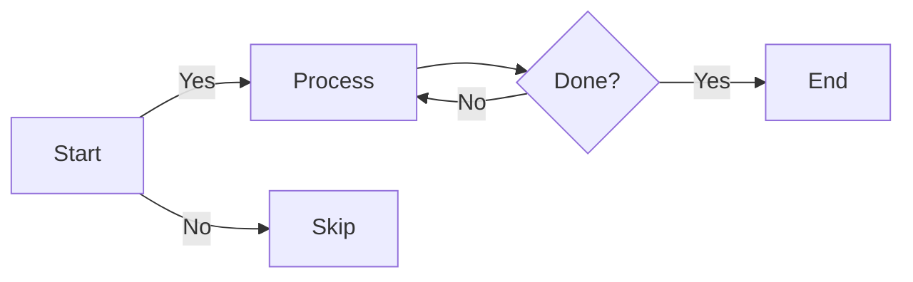
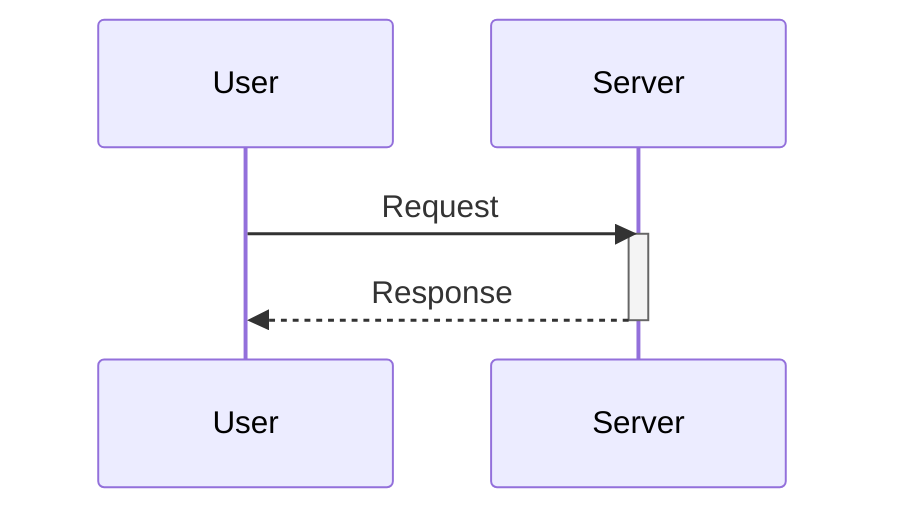
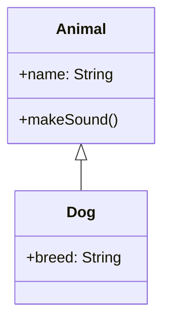
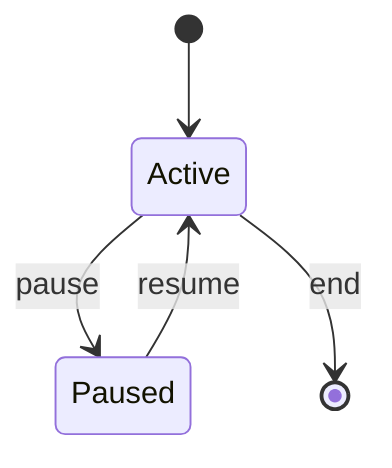
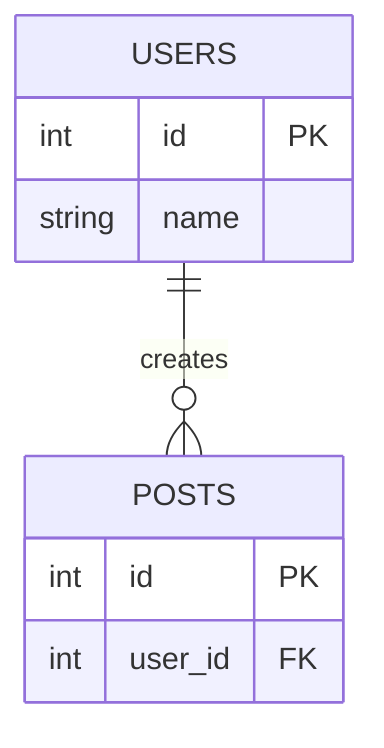
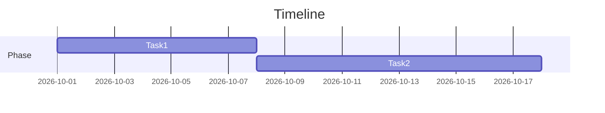
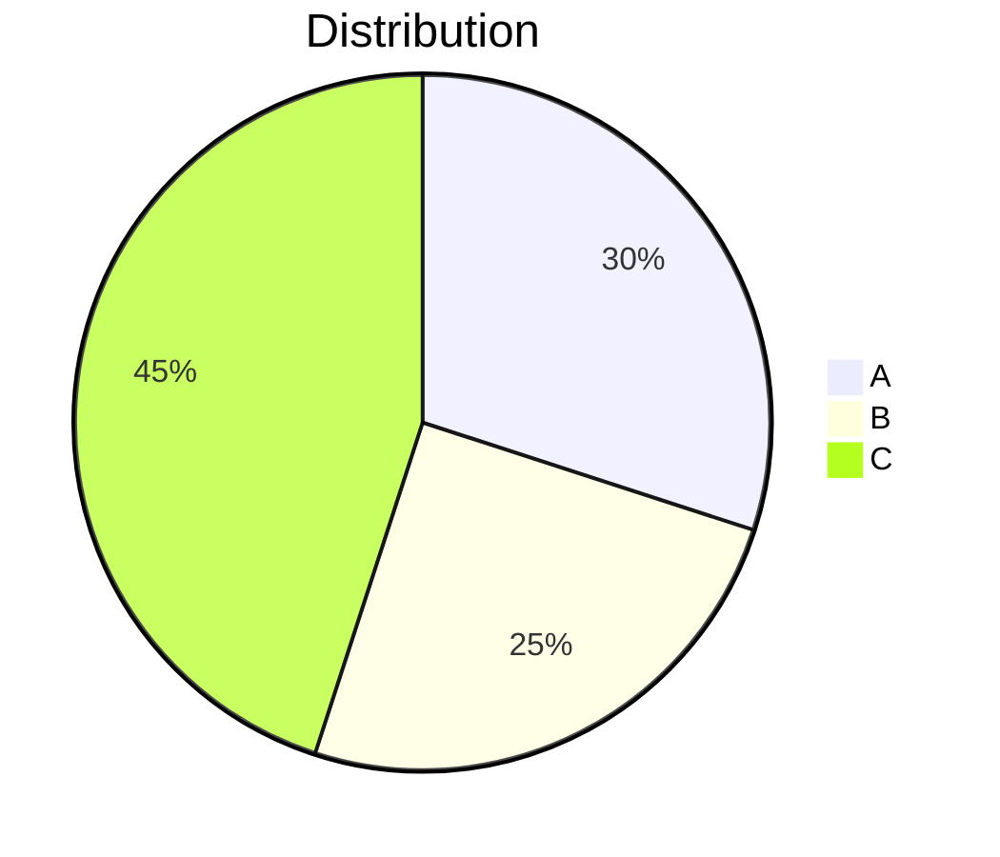

# Mermaid Cheatsheet

Quick reference for Mermaid diagram syntax and common examples.

## Basic syntax

All Mermaid diagrams start with a diagram type in a code block:

```markdown
\`\`\`mermaid
graph TD
    A[Node]
\`\`\`
```

## Flowcharts

| Syntax | Node shape |
|--------|-----------|
| `[text]` | Rectangle |
| `(text)` | Rounded |
| `{text}` | Diamond |
| `([text])` | Stadium |
| `[[text]]` | Subroutine |
| `[/text/]` | Parallelogram |

Directions: `TD` (top-down), `LR` (left-right), `BT`, `RL`

Example:



## Sequence diagrams



| Element | Purpose |
|---------|---------|
| `participant Name` | Define actor |
| `->` | Solid arrow (call) |
| `-->` | Dashed arrow (return) |
| `activate` / `deactivate` | Show processing |
| `Note over X,Y: text` | Add note |

## Class diagrams



| Symbol | Meaning |
|--------|---------|
| `<\|--` | Inheritance |
| `*--` | Composition |
| `o--` | Aggregation |
| `-->` | Association |
| `+` | Public |
| `-` | Private |
| `#` | Protected |

## State diagrams



## ER diagrams (databases)



| Symbol | Meaning |
|--------|---------|
| `\|\|` | One (required) |
| `o\|` | One (optional) |
| `\|\{` | Many (required) |
| `o{` | Many (optional) |
| `PK` | Primary key |
| `FK` | Foreign key |

## Gantt charts



## Pie charts



## Common connection types

| Syntax | Result |
|--------|--------|
| `A --> B` | Arrow |
| `A --- B` | Line |
| `A -.-> B` | Dotted |
| `A ==> B` | Thick |
| `A --|text\| B` | With label |

## Tips

- Keep node IDs short and use underscores (no spaces)
- Use `subgraph` to group related nodes
- Add `style nodeId fill:#color` to customize appearance
- Test complex diagrams incrementally
