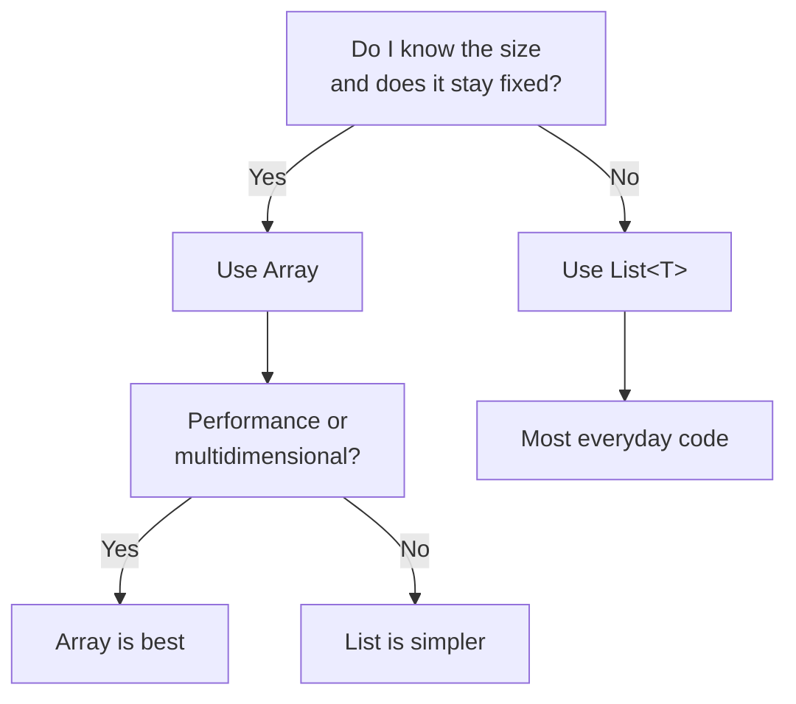

# Array vs List in C#

Both arrays and lists store multiple values of the same type, but they behave very differently. Understanding when to use each is essential for writing efficient, maintainable code.

## Side-by-side comparison

| Aspect | Array | List<T> |
|--------|-------|---------|
| **Size** | Fixed at creation | Dynamic; grows/shrinks |
| **Adding items** | Not possible (must resize entire array) | `Add()`, `AddRange()`, `Insert()` |
| **Removing items** | Not possible (must resize entire array) | `Remove()`, `RemoveAt()`, `RemoveAll()`, `Clear()` |
| **Syntax** | `int[]` | `List<int>` |
| **Element access** | `arr[0]` | `list[0]` |
| **Count/Length** | `.Length` (property, read-only) | `.Count` (property, read-only) |
| **Performance** | Faster access; minimal memory overhead | Slightly slower; internal array overhead |
| **Memory** | Exact size you specify | Allocates more than needed (grows in chunks) |
| **Multidimensional** | Yes (`int[,]`, `int[][]`) | Would need `List<List<int>>` (cumbersome) |
| **Fixed values** | Good for constants/immutable sets | Not ideal |
| **When created** | At runtime with `new` | At runtime with `new` |
| **Common methods** | `.Length`, `Array.IndexOf()`, `Array.Sort()`, `Array.Reverse()` | `.Count`, `.Add()`, `.Find()`, `.Sort()` |

## When to use an array

Use arrays when:

1. **Size is known and fixed** – You know exactly how many items you need, and it never changes.
   ```csharp
   // Reading a file with exactly 100 records
   Record[] records = new Record[100];
   ```

2. **Performance is critical** – Arrays are faster for random access (zero overhead, no resizing).
   ```csharp
   // Game engine processing millions of positions per frame
   Vector3[] positions = new Vector3[100000];
   ```

3. **Multidimensional data** – Grids, matrices, or maps.
   ```csharp
   // Chess board
   Piece[,] board = new Piece[8, 8];
   
   // 3D voxel space
   bool[,,] voxels = new bool[256, 256, 256];
   ```

4. **Fixed sets of values** – Enum-like collections that never change.
   ```csharp
   string[] weekdays = ["Mon", "Tue", "Wed", "Thu", "Fri", "Sat", "Sun"];
   int[] fibonacci = [0, 1, 1, 2, 3, 5, 8, 13];
   ```

5. **Interoperability** – Native code or APIs that expect arrays.
   ```csharp
   // Passing to a method that expects int[]
   ProcessData(numbers.ToArray());
   ```

6. **params parameters** – Methods with variable-length arguments.
   ```csharp
   public void PrintAll(params string[] items)
   {
       foreach (string item in items)
           Console.WriteLine(item);
   }
   ```

## When to use a List<T>

Use lists when:

1. **Size changes** – You don't know how many items you'll have, or the count grows/shrinks.
   ```csharp
   List<string> log = new List<string>();
   log.Add("App started");
   // ... (add more as events happen)
   ```

2. **Adding/removing during runtime** – The collection changes while the program runs.
   ```csharp
   List<Player> activePlayers = new List<Player>();
   // Add players as they join
   // Remove players as they disconnect
   ```

3. **Most everyday code** – Lists are the default choice in most scenarios because they're convenient.
   ```csharp
   var results = new List<SearchResult>();
   ```

4. **Building a collection dynamically** – You don't know the final size upfront.
   ```csharp
   List<int> primes = new List<int>();
   for (int i = 2; i < 100; i++)
   {
       if (IsPrime(i))
           primes.Add(i);
   }
   ```

## Rule of thumb

> **When in doubt, use `List<T>`.**

Lists are flexible, have convenient methods, and the performance overhead is negligible for most applications. Only switch to arrays if you have a specific reason: fixed size (performance, memory, contract), multidimensional data, or fixed values.

## Converting between array and List

### Array to List

```csharp
int[] arr = [1, 2, 3, 4, 5];

// Using constructor
List<int> list1 = new List<int>(arr);

// Using LINQ (System.Linq required)
List<int> list2 = arr.ToList();

Console.WriteLine(list1.Count);  // 5
```

### List to Array

```csharp
List<string> list = ["apple", "banana", "cherry"];

// Using ToArray() (LINQ)
string[] arr1 = list.ToArray();

// Using List<T>.CopyTo()
string[] arr2 = new string[list.Count];
list.CopyTo(arr2);

Console.WriteLine(arr1.Length);  // 3
```

## Other collections to consider

C# offers more collections for specialized needs. You may not need them every day, but know they exist:

- **`Dictionary<TKey, TValue>`** – Key-value pairs. Use when you need fast lookup by key.
  ```csharp
  var scores = new Dictionary<string, int> { { "Alice", 90 }, { "Bob", 85 } };
  int aliceScore = scores["Alice"];  // 90
  ```

- **`HashSet<T>`** – Unique values only. Use when you need membership testing or removing duplicates.
  ```csharp
  var uniqueIds = new HashSet<int> { 1, 2, 3, 2, 1 };
  Console.WriteLine(uniqueIds.Count);  // 3 (duplicates removed)
  ```

- **`Queue<T>`** – FIFO (first-in-first-out). Use for task scheduling, buffering.
  ```csharp
  var queue = new Queue<string>();
  queue.Enqueue("task1");
  string first = queue.Dequeue();
  ```

- **`Stack<T>`** – LIFO (last-in-first-out). Use for undo/redo, depth-first search.
  ```csharp
  var stack = new Stack<int>();
  stack.Push(1);
  int last = stack.Pop();
  ```

## Common mistakes

- **Calling `.Add()` on an array** – Arrays don't have an `Add()` method; use `List<T>` instead.
  ```csharp
  // ❌ CS1061: 'int[]' does not contain a definition for 'Add'
  int[] arr = [1, 2, 3];
  arr.Add(4);
  
  // ✓ Use List<T>
  List<int> list = [1, 2, 3];
  list.Add(4);
  ```

- **Mixing `.Length` and `.Count`** – Arrays use `.Length`; lists use `.Count`.
  ```csharp
  int[] arr = [1, 2, 3];
  Console.WriteLine(arr.Length);      // ✓ 3
  // Console.WriteLine(arr.Count);    // ❌ Error: arrays don't have .Count
  
  List<int> list = [1, 2, 3];
  Console.WriteLine(list.Count);      // ✓ 3
  // Console.WriteLine(list.Length);  // ❌ Error: lists don't have .Length
  ```

- **Resizing an array incorrectly** – Arrays cannot grow; you must create a new one. It's easier to use `List<T>`.
  ```csharp
  // ❌ This doesn't add a 4th element
  int[] arr = [1, 2, 3];
  // arr.Length = 4;  // Error: Length is read-only
  
  // ✓ Use Array.Resize
  Array.Resize(ref arr, 4);
  arr[3] = 4;
  
  // ✓ Or use a List
  List<int> list = [1, 2, 3];
  list.Add(4);
  ```

## Decision flowchart



## Quick recap

- **Arrays** have fixed size, are faster, but cannot grow or shrink easily. Use for known, unchanging data.
- **Lists** are dynamic, convenient, and have methods for adding/removing. Use by default unless you have a specific reason.
- Converting: `arr.ToList()` and `list.ToArray()`.
- Other collections (`Dictionary`, `HashSet`, `Queue`, `Stack`) exist for specialized use cases.
- Common error: Calling `.Add()` on an array (use `List<T>`), confusing `.Length` and `.Count`.
- Rule: **When unsure, use `List<T>`**.
