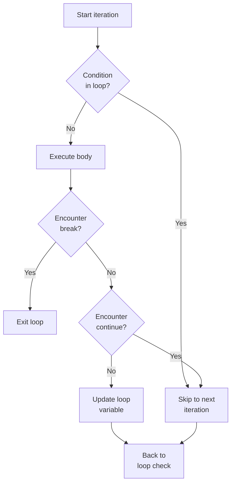

# C# break, continue, and Nested Loops

**break** exits a loop immediately, and **continue** skips to the next iteration. Both help you control loop flow precisely. Understanding these statements is essential for efficient loops and nested loop patterns like searching, filtering, and building collections.

## break: exit the loop

`break` terminates the loop immediately and continues execution after it:

```csharp
for (int i = 0; i < 10; i++)
{
    if (i == 5)
    {
        break;  // Exit the loop when i equals 5
    }
    Console.WriteLine(i);
}
// Output:
// 0
// 1
// 2
// 3
// 4
```

**Example: search for a value**

```csharp
int[] numbers = [10, 20, 30, 40, 50];
int target = 30;
int index = -1;

for (int i = 0; i < numbers.Length; i++)
{
    if (numbers[i] == target)
    {
        index = i;
        break;  // Found it, no need to continue
    }
}

if (index != -1)
{
    Console.WriteLine($"Found {target} at index {index}");
}
else
{
    Console.WriteLine($"{target} not found");
}
// Output: Found 30 at index 2
```

**Example: input validation loop**

```csharp
while (true)
{
    Console.Write("Enter a number between 1 and 10: ");
    int num = int.Parse(Console.ReadLine());

    if (num >= 1 && num <= 10)
    {
        Console.WriteLine("Valid! Thank you.");
        break;  // Exit the loop on valid input
    }

    Console.WriteLine("Invalid. Try again.");
}
// Output (example):
// Enter a number between 1 and 10: 15
// Invalid. Try again.
// Enter a number between 1 and 10: 5
// Valid! Thank you.
```

## continue: skip to the next iteration

`continue` skips the rest of the current iteration and jumps to the next:

```csharp
for (int i = 0; i < 10; i++)
{
    if (i % 2 == 0)
    {
        continue;  // Skip even numbers
    }
    Console.WriteLine(i);  // Only prints odd numbers
}
// Output:
// 1
// 3
// 5
// 7
// 9
```

**Example: skip invalid values**

```csharp
int[] scores = [85, -10, 90, 0, 78, 95];
int sum = 0;

foreach (int score in scores)
{
    if (score < 0 || score > 100)
    {
        continue;  // Skip invalid scores
    }
    sum += score;
}

Console.WriteLine($"Sum of valid scores: {sum}");
// Output: Sum of valid scores: 443
```

**Example: skip specific words**

```csharp
string[] words = ["apple", "banana", "cherry", "date"];

foreach (string word in words)
{
    if (word.Length < 6)
    {
        continue;  // Skip short words
    }
    Console.WriteLine(word);
}
// Output:
// banana
// cherry
```

## return: exit the method (optional mention)

Inside a loop within a method, `return` exits the entire method:

```csharp
int FindNumber(int[] arr, int target)
{
    for (int i = 0; i < arr.Length; i++)
    {
        if (arr[i] == target)
        {
            return i;  // Exit method, return the index
        }
    }
    return -1;  // Exit method, target not found
}

int index = FindNumber([10, 20, 30, 40], 30);
Console.WriteLine(index);
// Output: 2
```

## break and continue flow diagram



## break only exits the innermost loop

When you have nested loops, `break` exits only the **innermost** loop:

```csharp
for (int i = 1; i <= 3; i++)
{
    for (int j = 1; j <= 3; j++)
    {
        if (j == 2)
        {
            break;  // Exits the inner loop, not the outer
        }
        Console.WriteLine($"i={i}, j={j}");
    }
}
// Output:
// i=1, j=1
// i=2, j=1
// i=3, j=1
```

### To exit nested loops: use a flag variable

```csharp
bool found = false;

for (int i = 1; i <= 3 && !found; i++)
{
    for (int j = 1; j <= 3; j++)
    {
        if (i == 2 && j == 2)
        {
            found = true;
            break;  // Exit inner loop
        }
        Console.WriteLine($"i={i}, j={j}");
    }
}
Console.WriteLine("Done");
// Output:
// i=1, j=1
// i=1, j=2
// i=1, j=3
// i=2, j=1
// Done
```

### To exit nested loops: extract into a method

```csharp
bool SearchGrid(int[,] grid, int target)
{
    for (int row = 0; row < grid.GetLength(0); row++)
    {
        for (int col = 0; col < grid.GetLength(1); col++)
        {
            if (grid[row, col] == target)
            {
                return true;  // Returns from the method, exiting both loops
            }
        }
    }
    return false;
}

int[,] grid = { { 1, 2 }, { 3, 4 } };
bool found = SearchGrid(grid, 3);
Console.WriteLine(found);
// Output: true
```

## Loop patterns and examples

### Sum/total pattern

```csharp
int[] numbers = [10, 20, 30, 40];
int sum = 0;

foreach (int num in numbers)
{
    sum += num;
}

Console.WriteLine($"Sum: {sum}");
// Output: Sum: 100
```

### Count matches pattern

```csharp
int[] scores = [85, 90, 78, 92, 88];
int count = 0;

foreach (int score in scores)
{
    if (score >= 90)
    {
        count++;
    }
}

Console.WriteLine($"Scores >= 90: {count}");
// Output: Scores >= 90: 2
```

### Find the maximum pattern

```csharp
int[] numbers = [5, 12, 3, 8, 15, 2];
int max = numbers[0];

foreach (int num in numbers)
{
    if (num > max)
    {
        max = num;
    }
}

Console.WriteLine($"Maximum: {max}");
// Output: Maximum: 15
```

### Build a new list pattern

```csharp
int[] numbers = [1, 2, 3, 4, 5];
List<int> evens = new List<int>();

foreach (int num in numbers)
{
    if (num % 2 == 0)
    {
        evens.Add(num);
    }
}

Console.WriteLine(string.Join(", ", evens));
// Output: 2, 4
```

### Input validation loop pattern

```csharp
int age;
while (true)
{
    Console.Write("Enter your age (18-65): ");
    age = int.Parse(Console.ReadLine());

    if (age >= 18 && age <= 65)
    {
        break;
    }

    Console.WriteLine("Invalid age. Try again.");
}

Console.WriteLine($"Age accepted: {age}");
// Output (example):
// Enter your age (18-65): 10
// Invalid age. Try again.
// Enter your age (18-65): 25
// Age accepted: 25
```

### Game loop pattern (simplified)

```csharp
int health = 100;
bool gameOver = false;

while (!gameOver)
{
    Console.WriteLine($"Health: {health}");
    Console.Write("Action (attack/defend/flee): ");
    string action = Console.ReadLine();

    if (action == "attack")
    {
        health -= 10;
    }
    else if (action == "defend")
    {
        health += 5;
    }
    else if (action == "flee")
    {
        gameOver = true;
    }

    if (health <= 0)
    {
        gameOver = true;
        Console.WriteLine("Game Over!");
    }
}
// Output (example):
// Health: 100
// Action (attack/defend/flee): attack
// Health: 90
// Action (attack/defend/flee): defend
// Health: 95
// Action (attack/defend/flee): flee
// (Game ends)
```

## Avoid goto

C# has a `goto` statement, but it's considered bad practice. Use `break`, `continue`, and structured control flow instead:

```csharp
// ❌ Avoid: goto is hard to follow
goto skip;
Console.WriteLine("This is skipped");
skip:
Console.WriteLine("This runs");

// ✓ Better: use break or continue
if (someCondition)
{
    continue;  // or break
}
Console.WriteLine("This runs");
```

## Common mistakes

- **continue in a while loop without incrementing** – If you forget to update the loop variable before `continue`, you get an infinite loop.

```csharp
// ❌ Infinite loop
int x = 0;
while (x < 5)
{
    if (x == 2)
    {
        continue;  // Skips to next iteration
    }
    Console.WriteLine(x);
    // ❌ x never increments, so we're stuck at x = 2
}

// ✓ Fix: increment before or after the condition
while (x < 5)
{
    if (x == 2)
    {
        x++;
        continue;
    }
    Console.WriteLine(x);
    x++;
}
```

- **Forgetting that break only exits the innermost loop** – Use a flag or extract to a method to exit multiple nested loops.

```csharp
// ❌ Only exits inner loop
for (int i = 0; i < 10; i++)
{
    for (int j = 0; j < 10; j++)
    {
        if (i == 5 && j == 5)
        {
            break;  // Only breaks inner loop
        }
    }
}

// ✓ Use a flag to exit outer loop too
bool found = false;
for (int i = 0; i < 10 && !found; i++)
{
    for (int j = 0; j < 10; j++)
    {
        if (i == 5 && j == 5)
        {
            found = true;
            break;
        }
    }
}
```

- **Using break/continue outside a loop** – They only work inside loops and `switch` statements. You'll get a compiler error.

```csharp
// ❌ Syntax error: break outside a loop
if (x > 5)
{
    break;
}

// ✓ Only use inside loops
for (int i = 0; i < 10; i++)
{
    if (i > 5)
    {
        break;
    }
}
```

## Quick recap

- **break** exits the current loop immediately.
- **continue** skips the rest of the iteration and jumps to the loop check.
- Use `break` to exit when you find what you're looking for (search pattern).
- Use `continue` to skip items that don't meet criteria (filter pattern).
- **break exits only the innermost loop**; use a flag or extract to a method for nested loops.
- Common loop patterns: sum, count, find max, build list, validate input, game loop.
- Avoid `goto`; use structured control flow instead.
- Don't forget to update loop variables before `continue` in `while` loops.
