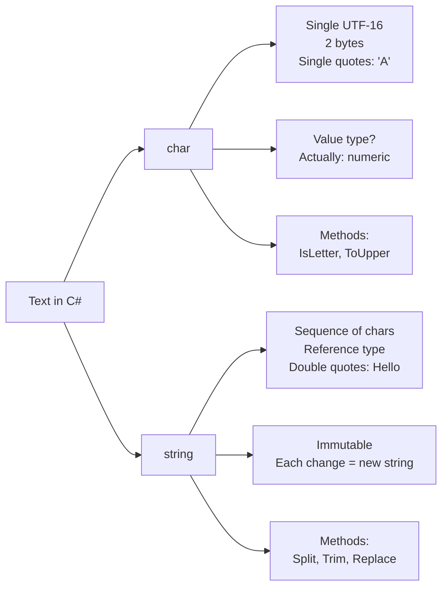

# Char and String Types in C#

`char` and `string` represent text in C#. `char` is a single character; `string` is a sequence of characters. Both are fundamental to handling text, but they have different characteristics and performance implications.

## char: Single character

A `char` holds exactly one UTF-16 code unit (2 bytes, 16 bits):

```csharp
char letter = 'A';          // Single quotes for char
char digit = '5';
char space = ' ';
char escape = '\n';         // Escape sequence
char unicode = '\u0041';    // Unicode: 'A'

Console.WriteLine(letter);  // A
```

### Useful char methods

```csharp
char c = 'a';
Console.WriteLine(char.IsLetter(c));      // true
Console.WriteLine(char.IsDigit('5'));     // true
Console.WriteLine(char.IsWhiteSpace(' ')); // true

char upper = char.ToUpper('a');           // 'A'
char lower = char.ToLower('Z');           // 'z'

char parsed = char.Parse("A");            // 'A'
```

### char as a number

Under the hood, `char` is a numeric type (UTF-16 code units range from 0 to 65,535). You can cast between `char` and integers:

```csharp
char letter = 'A';
int code = (int)letter;           // 65
Console.WriteLine(code);          // 65

char fromCode = (char)65;         // 'A'
Console.WriteLine(fromCode);      // A
```

## string: Sequence of characters

A `string` is a sequence of `char` values. It's a **reference type** (stored on the heap) and is **immutable** (cannot be changed after creation):

```csharp
string greeting = "Hello";        // Double quotes for string
string empty = "";
string name = "Alice";

// Immutable: operations create new strings
string original = "Hello";
string modified = original.Replace("H", "J");  // "Jello"
Console.WriteLine(original);      // Still "Hello" (unchanged)
Console.WriteLine(modified);      // Jello
```

**Important:** `string` is an alias for `System.String`.

## Accessing characters

Use indexing to access individual characters (zero-indexed):

```csharp
string text = "Hello";
Console.WriteLine(text[0]);       // H
Console.WriteLine(text[4]);       // o
Console.WriteLine(text.Length);   // 5

// ❌ Cannot assign: strings are immutable
// text[0] = 'J';  // Compiler error
```

## Common string operations

| Operation | Example | Result |
|-----------|---------|--------|
| **Length** | `"Hello".Length` | 5 |
| **Indexing** | `"Hello"[1]` | 'e' |
| **Substring** | `"Hello".Substring(1, 3)` | "ell" |
| **Contains** | `"Hello".Contains("ll")` | true |
| **Replace** | `"Hello".Replace("l", "L")` | "HeLLo" |
| **Split** | `"a,b,c".Split(',')` | ["a", "b", "c"] |
| **Trim** | `" hello ".Trim()` | "hello" |
| **ToUpper** | `"hello".ToUpper()` | "HELLO" |
| **ToLower** | `"HELLO".ToLower()` | "hello" |
| **Join** | `string.Join(",", new[] {"a", "b"})` | "a,b" |
| **StartsWith** | `"Hello".StartsWith("He")` | true |
| **EndsWith** | `"Hello".EndsWith("lo")` | true |
| **IndexOf** | `"Hello".IndexOf("l")` | 2 |

## String comparison

Use `==` for value comparison or `Equals()` for explicit comparison:

```csharp
string a = "hello";
string b = "hello";
string c = new string(new[] { 'h', 'e', 'l', 'l', 'o' });

Console.WriteLine(a == b);                 // true (value)
Console.WriteLine(a.Equals(b));            // true
Console.WriteLine(a.Equals(b, StringComparison.OrdinalIgnoreCase));  // true

// Case-insensitive
Console.WriteLine("HELLO".Equals("hello", StringComparison.OrdinalIgnoreCase));  // true
```

## null vs empty vs whitespace

```csharp
string nullString = null;         // Null reference
string empty = "";                // Empty (length 0)
string spaces = "   ";            // Whitespace

Console.WriteLine(string.IsNullOrEmpty(empty));              // true
Console.WriteLine(string.IsNullOrEmpty(spaces));            // false
Console.WriteLine(string.IsNullOrWhiteSpace(spaces));       // true
Console.WriteLine(string.IsNullOrWhiteSpace(empty));        // true
```

## String immutability and performance

Because strings are immutable, **concatenation in a loop creates many intermediate strings** and is slow:

```csharp
// ❌ Bad: creates n intermediate strings, O(n²) performance
string result = "";
for (int i = 0; i < 1000; i++)
{
    result += $"Line {i}\n";  // Each += allocates a new string
}

// ✓ Good: StringBuilder accumulates efficiently
var sb = new StringBuilder();
for (int i = 0; i < 1000; i++)
{
    sb.Append($"Line {i}\n");
}
string result = sb.ToString();
```

### StringBuilder: when and why

Use `StringBuilder` when building strings dynamically (loops, concatenation):

```csharp
var sb = new StringBuilder();
sb.Append("Hello");
sb.Append(" ");
sb.Append("World");
string result = sb.ToString();   // "Hello World"

// Methods
sb.Replace("World", "C#");       // Modifies in place
sb.Insert(6, "Beautiful ");
sb.Remove(0, 5);
sb.Clear();
```

**Performance:** `StringBuilder` is O(n) for concatenation; plain string concatenation is O(n²).

## String interpolation

Embed variables directly in strings using `$`:

```csharp
string name = "Alice";
int age = 30;
string message = $"Hello, {name}. You are {age} years old.";
Console.WriteLine(message);  // Hello, Alice. You are 30 years old.

// Expressions in interpolation
string greeting = $"Next year: {age + 1}";
string upper = $"Name: {name.ToUpper()}";
```

## Verbatim strings and escape sequences

**Verbatim strings** (`@`) treat backslashes as literal characters:

```csharp
// Regular string: need escape sequences
string path = "C:\\Users\\Alice\\file.txt";

// Verbatim string: backslashes are literal
string verbatimPath = @"C:\Users\Alice\file.txt";

// Multiline
string text = @"Line 1
Line 2
Line 3";
```

**Raw string literals** (C# 11+) with `"""`:

```csharp
string json = """
{
    "name": "Alice",
    "age": 30
}
""";
```

## Escape sequences

| Sequence | Meaning |
|----------|---------|
| `\'` | Single quote |
| `\"` | Double quote |
| `\\` | Backslash |
| `\n` | Newline |
| `\r` | Carriage return |
| `\t` | Tab |
| `\0` | Null character |
| `\u0041` | Unicode (e.g., 'A') |

## char vs string: comparison



## Common mistakes

- **Using single quotes for a string** – `"A"` is a string; `'A'` is a char. Use double quotes for text.
- **Forgetting strings are immutable** – Reassign the result: `text = text.Replace(...);`
- **Concatenating in loops without StringBuilder** – O(n²) performance; use `StringBuilder` instead.

## Quick recap

- `char` is a single UTF-16 character (2 bytes); use single quotes.
- `string` is a sequence of chars, a reference type, and immutable.
- Common operations: `Length`, indexing, `Substring`, `Contains`, `Replace`, `Split`, `Trim`, `ToUpper`, `ToLower`.
- `string.IsNullOrEmpty()` and `IsNullOrWhiteSpace()` for safe null/empty checks.
- String concatenation in loops is slow; use `StringBuilder`.
- Use `$"string with {variables}"` for interpolation.
- Verbatim strings with `@` treat backslashes literally; raw strings with `"""` for multiline.
