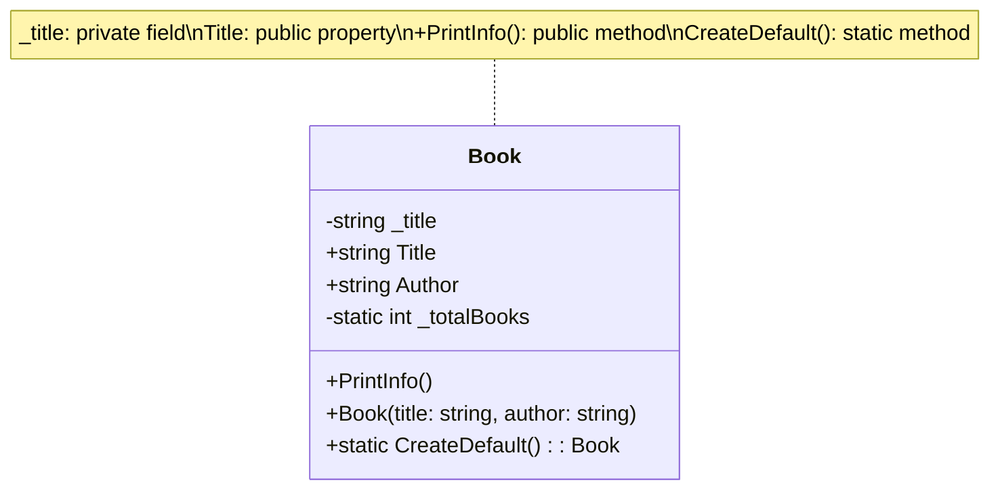

# Classes and Members Overview

A class is a blueprint for objects. Classes contain **members** — fields, properties, methods, and constructors — that define what data an object holds and what it can do. Understanding how these pieces fit together, along with access modifiers and static members, is the foundation of object-oriented programming in C#.

## What is a member?

A class member is anything declared inside the class:

- **Fields** – Store data (state) for an object. Usually private.
- **Properties** – Provide controlled access to data. Usually public.
- **Methods** – Define behavior (functions). Can be public or private.
- **Constructors** – Initialize an object when it's created.
- **Static members** – Belong to the class, not to instances.

## Anatomy of a simple class

```csharp
public class Book
{
    // Field (usually private)
    private string _title;

    // Property (usually public)
    public string Title
    {
        get => _title;
        set => _title = value ?? throw new ArgumentNullException(nameof(Title));
    }

    // Property shorthand
    public string Author { get; set; }

    // Constructor
    public Book(string title, string author)
    {
        Title = title;
        Author = author;
    }

    // Method
    public void PrintInfo()
    {
        Console.WriteLine($"{Title} by {Author}");
    }

    // Static method
    public static Book CreateDefault()
    {
        return new Book("Untitled", "Unknown");
    }

    // Static field (shared by all instances)
    private static int _totalBooks = 0;

    public Book() : this("Untitled", "Unknown")
    {
        _totalBooks++;
    }
}

// Usage:
var myBook = new Book("Clean Code", "Robert C. Martin");
myBook.PrintInfo();  // "Clean Code by Robert C. Martin"

var default_ = Book.CreateDefault();  // Static method
```

## Class diagram: static and instance members



Legend:
- `+` public
- `-` private
- `*` static (shown in italics in diagrams, but marked here for clarity)

## Access modifiers with members

For a quick reference on modifiers and member accessibility, see [Access Modifiers in C#](/content/notes/csharp-access-modifiers.md).

For the principle of keeping fields private and exposing properties, see [Private vs Public in C#](/content/notes/csharp-private-vs-public.md).

## Instance vs static members

| | Instance | Static |
|---|----------|--------|
| **Belongs to** | Object (instance) | Class (type) |
| **When created** | Each time you use `new` | Class is loaded |
| **How to access** | `object.Member` | `ClassName.Member` |
| **Usage** | Store object state and behavior | Shared data, utilities, constants |
| **Example** | `book.PrintInfo()` | `Book.CreateDefault()` |

For more detail, see [Static Members in C#](/content/notes/csharp-static.md).

## Constructors

A constructor is a special method with the same name as the class. It runs when you create an object with `new`:

```csharp
public class Person
{
    public string Name { get; set; }
    public int Age { get; set; }

    // Constructor
    public Person(string name, int age)
    {
        Name = name;
        Age = age;
    }

    // Parameterless constructor (optional)
    public Person() : this("Unknown", 0)
    {
    }
}

var p1 = new Person("Alice", 30);  // Calls first constructor
var p2 = new Person();             // Calls parameterless constructor
```

## Scope and visibility

Where can each member be used?

- **Private members** – Only inside this class.
- **Public members** – Anywhere (same project or other projects).
- **Protected members** – In this class and derived classes.
- **Internal members** – Anywhere in the same assembly (project).

For details on scoping and how it differs from accessibility, see [Scope vs Accessibility in C#](/content/notes/csharp-scope-vs-accessibility.md).

## Common mistakes

- **Using public fields** – Use properties instead. See [Private vs Public](/content/notes/csharp-private-vs-public.md) for why.
- **Making everything static** – Static members are for utilities and constants. Most code should use instances.
- **Not understanding constructor initialization** – Constructors set up initial state. Without them, objects start with default values (null, 0, false).

## Quick recap

- Classes contain fields, properties, methods, and constructors.
- Fields are usually private; properties are usually public.
- Methods define behavior; constructors initialize objects.
- Static members belong to the class; instance members belong to each object.
- Access modifiers control visibility: `public`, `private`, `protected`, `internal`.
- Scope determines where a name is usable; accessibility determines if you're allowed to use it.
