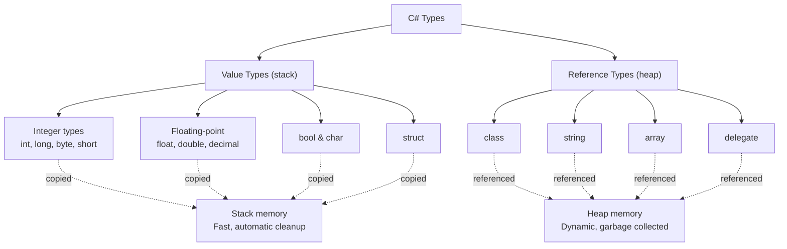

# C# Data Types Overview

Every variable in C# has a **data type** that determines what kind of value it can hold and how much memory it uses. C# is **statically typed**, meaning the type is fixed at compile time—you cannot assign a `string` to an `int` variable without explicit conversion. Understanding types is essential for writing safe, efficient code.

## Value types vs reference types

C# divides all types into two categories based on how they're stored and passed around:

### Value types
- Stored on the **stack** (fast, automatic cleanup)
- **Copied when assigned** or passed to a method
- Include: `int`, `double`, `bool`, `char`, `struct`
- Example: `int x = 5; int y = x;` creates two separate copies of the value 5.

### Reference types
- Stored on the **heap** (dynamic memory, requires garbage collection)
- Variables hold a **reference (address)**, not the actual value
- **Shared when assigned** or passed to a method
- Include: `string`, `class`, `array`, `delegate`
- Example: `string a = "hello"; string b = a;` creates one string, both variables point to it.

**Small example showing the difference:**

```csharp
// Value type: x and y are separate
int x = 10;
int y = x;
y = 20;
Console.WriteLine(x);  // 10 (unchanged)
Console.WriteLine(y);  // 20

// Reference type: both reference the same list
List<int> list1 = new List<int> { 1, 2, 3 };
List<int> list2 = list1;
list2.Add(4);
Console.WriteLine(list1.Count);  // 4 (changed, because both point to same list)
Console.WriteLine(list2.Count);  // 4
```

## Built-in types and their aliases

C# keyword aliases provide short names for .NET types. Both names refer to identical types:

| Keyword | .NET Type | Size | Range/Purpose | Example |
|---------|-----------|------|--------------|---------|
| `bool` | System.Boolean | 1 byte | `true` or `false` | `bool isActive = true;` |
| `byte` | System.Byte | 1 byte | 0 to 255 | `byte b = 255;` |
| `sbyte` | System.SByte | 1 byte | -128 to 127 | `sbyte sb = -50;` |
| `short` | System.Int16 | 2 bytes | -32,768 to 32,767 | `short s = 1000;` |
| `ushort` | System.UInt16 | 2 bytes | 0 to 65,535 | `ushort us = 5000;` |
| `int` | System.Int32 | 4 bytes | -2.1B to 2.1B | `int count = 100;` |
| `uint` | System.UInt32 | 4 bytes | 0 to 4.3B | `uint id = 99999999;` |
| `long` | System.Int64 | 8 bytes | -9.2E18 to 9.2E18 | `long ticks = 9000000000000;` |
| `ulong` | System.UInt64 | 8 bytes | 0 to 1.8E19 | `ulong big = 18000000000000000000;` |
| `float` | System.Single | 4 bytes | ±1.5E-45 to ±3.4E38 | `float f = 3.14f;` |
| `double` | System.Double | 8 bytes | ±5.0E-324 to ±1.7E308 | `double d = 3.14159;` |
| `decimal` | System.Decimal | 16 bytes | ±1.0E-28 to ±7.9E28 | `decimal price = 19.99m;` |
| `char` | System.Char | 2 bytes | Single UTF-16 character | `char ch = 'A';` |
| `string` | System.String | Variable | Text, immutable | `string name = "Alice";` |
| `object` | System.Object | Variable | Any value or reference | `object obj = 42;` |

## var and type inference

`var` lets the compiler **infer the type** from the right-hand side. It is still statically typed; the type is just determined at compile time, not written explicitly:

```csharp
var count = 10;           // Inferred as int
var name = "Alice";       // Inferred as string
var price = 19.99m;       // Inferred as decimal
var numbers = new int[5]; // Inferred as int[]

// ❌ var must be initialized (compiler needs a value to infer from)
// var x;

// ✓ Especially useful with complex types
var list = new List<Dictionary<string, int>>();
```

Use `var` to reduce noise, but be clear about intent—if the type is not obvious, write it explicitly.

## Default values

When a variable is not initialized, its default value depends on type:

```csharp
int i = default;           // 0
double d = default;        // 0.0
bool b = default;          // false
char c = default;          // '\0' (null character)
string s = default;        // null
List<int> list = default;  // null
```

Local variables must be explicitly initialized before use; fields and static fields use defaults automatically.

## Value types vs reference types: visual guide



## Common mistakes

- **Assuming that assigning a value type copies the reference** – Value types are always copied; reference types share the same object.
- **Using `var` when the type is unclear** – While convenient, use explicit types if it helps readability.
- **Forgetting that `string` is immutable and reference-based** – Each concatenation creates a new string; loops should use `StringBuilder`.

## Quick recap

- C# is statically typed; every variable has a fixed type at compile time.
- **Value types** (int, bool, struct) are stored on the stack and copied when assigned.
- **Reference types** (string, class, array) are stored on the heap and shared by reference.
- Keywords like `int`, `float`, `string` are aliases for .NET types (`Int32`, `Single`, `String`).
- `var` infers type at compile time but is still fully typed.
- Uninitialized variables default to zero, false, null, or '\0' depending on type.
