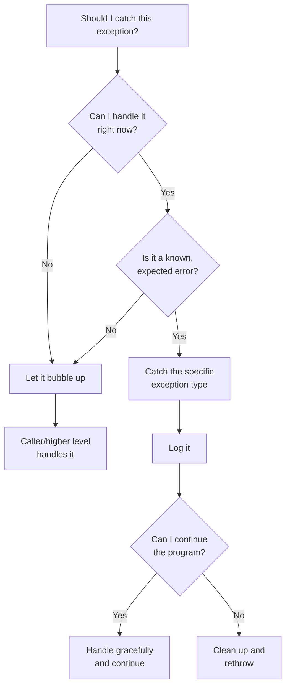

# Exception Handling Best Practices in C#

Exception handling is a tool for dealing with *exceptional* situations, not for normal control flow. Good exception handling code is robust, debuggable, and maintainable. Here are the key practices to follow.

## Do not use exceptions for normal control flow

Exceptions are expensive compared to normal code. Using them to control normal program flow (like a `while` loop alternative) is both slow and confusing:

```csharp
// ❌ Bad: using exceptions for validation and control flow
int count = 0;
try
{
    while (true)
    {
        int value = int.Parse(input[count]);
        count++;
    }
}
catch (IndexOutOfRangeException)
{
    // This is the expected "exit" condition, not an error!
}

// ✓ Good: validate directly with Try pattern
int count = 0;
while (count < input.Length && int.TryParse(input[count], out int value))
{
    // Use value here
    count++;
}
```

### Try pattern alternatives

Many .NET types provide "Try" methods instead of throwing:

```csharp
// Dictionary: TryGetValue instead of catching KeyNotFoundException
if (dict.TryGetValue(key, out var value))
{
    // Use value
}

// Parsing: TryParse instead of catching FormatException
if (int.TryParse(input, out int number))
{
    // Use number
}

// Collection: TryDequeue, TryPeek, etc.
if (queue.TryDequeue(out var item))
{
    // Use item
}

// Optional types: checking for a value
if (maybeValue.HasValue)
{
    int value = maybeValue.Value;
}
```

## Catch only what you can handle

When you catch an exception, you're saying "I know this error can happen, and I can do something about it." If you can't handle it, let it bubble up to the caller or a higher-level handler:

```csharp
// ❌ Bad: catching everything and hiding bugs
public string GetUserName(int userId)
{
    try
    {
        return _database.GetUserName(userId);
    }
    catch (Exception)
    {
        return "Unknown";  // Hides bugs!
    }
}

// ✓ Good: catch only what you can handle
public string GetUserName(int userId)
{
    try
    {
        return _database.GetUserName(userId);
    }
    catch (FileNotFoundException)
    {
        // Database file is missing; we can handle this gracefully
        logger.LogWarning($"Database file missing for user {userId}");
        return "Unknown";
    }
    // Let other exceptions (bugs, timeouts, etc.) bubble up to the caller
}
```

Exceptions at the right level:

- **At the boundary** (web API, entry point): Catch broad exceptions, log them, return an error response
- **In the middle** (business logic): Catch specific exceptions you can handle, let others bubble up
- **At the lowest level** (database, file operations): Throw specific exceptions, don't catch unnecessarily

## Never swallow exceptions silently

Always log or handle exceptions. Silently ignoring them makes debugging impossible:

```csharp
// ❌ Absolutely avoid: silent swallowing
try
{
    ProcessData();
}
catch (Exception)
{
    // Doing nothing is a death trap for debugging
}

// ❌ Also bad: logging only the message, not the exception
try
{
    ProcessData();
}
catch (Exception ex)
{
    Console.WriteLine("Error: " + ex.Message);  // Message alone is not enough
}

// ✓ Good: log the full exception
try
{
    ProcessData();
}
catch (IOException ex)
{
    logger.LogError(ex, "Failed to process data");  // Full exception + message
    // Optionally handle or rethrow
    throw;
}
```

### Logging with ILogger

```csharp
using Microsoft.Extensions.Logging;

public class DataProcessor
{
    private readonly ILogger<DataProcessor> _logger;

    public DataProcessor(ILogger<DataProcessor> logger)
    {
        _logger = logger;
    }

    public void Process(string filePath)
    {
        try
        {
            var data = File.ReadAllText(filePath);
            ParseData(data);
        }
        catch (FileNotFoundException ex)
        {
            _logger.LogError(ex, "File not found: {FilePath}", filePath);
            throw;  // Rethrow or handle
        }
        catch (FormatException ex)
        {
            _logger.LogError(ex, "Invalid data format in {FilePath}", filePath);
            throw;
        }
    }
}
```

## Cleanup with finally or using

Ensure resources are released even if an exception occurs:

```csharp
// Traditional try-finally
StreamWriter? writer = null;
try
{
    writer = new StreamWriter("output.txt");
    writer.WriteLine("Data");
}
catch (IOException ex)
{
    logger.LogError(ex, "Cannot write file");
}
finally
{
    writer?.Dispose();  // Always runs
}

// ✓ Cleaner: using statement (recommended)
using (StreamWriter writer = new StreamWriter("output.txt"))
{
    writer.WriteLine("Data");
}  // Dispose() called automatically

// ✓ Even cleaner: using declaration (C# 8.0+)
using StreamWriter writer = new StreamWriter("output.txt");
writer.WriteLine("Data");
// Dispose() called automatically at end of scope
```

For more details, see [Try-Catch-Finally in C#](/content/notes/csharp-try-catch-finally.md) and [Common Built-in Interfaces in C#](/content/notes/csharp-common-built-in-interfaces.md) (IDisposable section).

## Exceptions and performance

Throwing an exception is **slow** compared to normal code. Never use exceptions for things that happen frequently:

```csharp
// ❌ Slow: throwing exceptions in a loop
int count = 0;
foreach (var input in inputs)
{
    try
    {
        int value = int.Parse(input);
        // Process value
    }
    catch (FormatException)
    {
        count++;
    }
}

// ✓ Fast: validate without exceptions
int count = 0;
foreach (var input in inputs)
{
    if (!int.TryParse(input, out int value))
    {
        count++;
    }
    else
    {
        // Process value
    }
}
```

**Use exceptions for truly exceptional situations**, not for every failure.

## Exceptions in async code

Async code and exception handling work together naturally:

```csharp
// ✓ await in a try/catch works as expected
async Task<User> GetUserAsync(int id)
{
    try
    {
        return await _database.GetUserAsync(id);  // If this throws, catch runs
    }
    catch (TimeoutException ex)
    {
        logger.LogError(ex, "Database timeout");
        throw;
    }
}

// ✓ Call it and catch
try
{
    var user = await GetUserAsync(123);
}
catch (TimeoutException ex)
{
    Console.WriteLine("Request timed out");
}
```

**Important**: Never use `async void` for methods that might throw—use `async Task` instead:

```csharp
// ❌ Bad: async void, exceptions go to synchronization context (dangerous)
async void ProcessDataAsync()
{
    await _database.SaveAsync();  // If this throws, it crashes the app
}

// ✓ Good: async Task, exceptions propagate normally
async Task ProcessDataAsync()
{
    await _database.SaveAsync();  // Caller can catch or propagate
}
```

For `Task.WhenAll`, use a try/catch because it may throw `AggregateException`:

```csharp
// ✓ Handle AggregateException from Task.WhenAll
var tasks = new[] { Task1Async(), Task2Async(), Task3Async() };
try
{
    await Task.WhenAll(tasks);
}
catch (AggregateException ex)
{
    // Multiple tasks may have thrown
    foreach (var inner in ex.InnerExceptions)
    {
        logger.LogError(inner, "Task failed");
    }
}
```

## Exception handling in a web API (.NET Full Stack)

A web API should never return a stack trace to the client. Instead, return a structured error response:

```csharp
// ✓ Global exception handling middleware
public class ExceptionHandlingMiddleware
{
    private readonly RequestDelegate _next;
    private readonly ILogger<ExceptionHandlingMiddleware> _logger;

    public ExceptionHandlingMiddleware(RequestDelegate next, ILogger<ExceptionHandlingMiddleware> logger)
    {
        _next = next;
        _logger = logger;
    }

    public async Task InvokeAsync(HttpContext context)
    {
        try
        {
            await _next(context);
        }
        catch (Exception ex)
        {
            _logger.LogError(ex, "Unhandled exception");
            await HandleExceptionAsync(context, ex);
        }
    }

    private static Task HandleExceptionAsync(HttpContext context, Exception ex)
    {
        context.Response.ContentType = "application/json";

        var response = ex switch
        {
            ArgumentNullException => (StatusCode: StatusCodes.Status400BadRequest, Message: "Invalid input"),
            FileNotFoundException => (StatusCode: StatusCodes.Status404NotFound, Message: "Resource not found"),
            _ => (StatusCode: StatusCodes.Status500InternalServerError, Message: "Internal server error")
        };

        context.Response.StatusCode = response.StatusCode;
        return context.Response.WriteAsJsonAsync(new { error = response.Message });
    }
}

// ✓ Or use IExceptionHandler (.NET 8+)
public class GlobalExceptionHandler : IExceptionHandler
{
    private readonly ILogger<GlobalExceptionHandler> _logger;

    public GlobalExceptionHandler(ILogger<GlobalExceptionHandler> logger) => _logger = logger;

    public async ValueTask<bool> TryHandleAsync(HttpContext context, Exception ex, CancellationToken ct)
    {
        _logger.LogError(ex, "Unhandled exception");
        context.Response.StatusCode = StatusCodes.Status500InternalServerError;
        return await context.Response.WriteAsJsonAsync(new { error = "Internal server error" }, cancellationToken: ct);
    }
}
```

Return `ProblemDetails` for HTTP errors:

```csharp
// ✓ Standard error response
var problemDetails = new ProblemDetails
{
    Status = StatusCodes.Status400BadRequest,
    Title = "Validation Error",
    Detail = "The provided data is invalid."
};
return BadRequest(problemDetails);
```

## Debugging with Rider/Visual Studio

### Break on exceptions

In Rider or Visual Studio:

1. **Debug > Break on Exceptions** (or **Windows > Break on Exceptions**)
2. Select exception types to break on when thrown (even if handled)
3. Debugger pauses at the throw, giving you the full context

### Reading the call stack

In the **Locals** window during debugging:
- Inspect exception properties: `Message`, `StackTrace`, `InnerException`
- Hover over variables to see their values at that point
- Step through code to understand the flow

## Decision flowchart



## Common mistakes

- **Catching `Exception` without being able to handle it** – This hides bugs. Be specific about what you catch.

```csharp
// ❌ Too broad
catch (Exception ex)
{
    Console.WriteLine("Error");  // What error? Hard to debug
}

// ✓ Specific
catch (TimeoutException ex)
{
    logger.LogWarning("Request timed out");
}
```

- **Empty catch blocks** – Always log or handle the error.

```csharp
// ❌ Empty
catch (IOException)
{
}

// ✓ At minimum
catch (IOException ex)
{
    logger.LogError(ex, "IO error");
}
```

- **Using `async void` and not catching exceptions** – Exceptions in `async void` crash the app. Use `async Task`.

## Quick recap

- Use exceptions for exceptional situations, not normal control flow; prefer validation and Try patterns.
- Catch only exceptions you can handle; let others bubble up to alert you of unexpected problems.
- Never silently swallow exceptions; always log the full exception object (not just the message).
- Use `finally` or `using` statements to guarantee cleanup, especially for `IDisposable` resources.
- Throwing is slow; don't use exceptions for frequent failures—validate instead.
- In async code, `await` works naturally in try/catch; avoid `async void` and use `async Task`.
- In a web API, catch exceptions at the boundary and return structured errors (ProblemDetails), never stack traces.
- Use debugger breakpoints on exceptions and read the call stack to understand failures quickly.
- Handle exceptions at the appropriate level: boundary (broad), middle (specific), and bottom (throw specifics).
