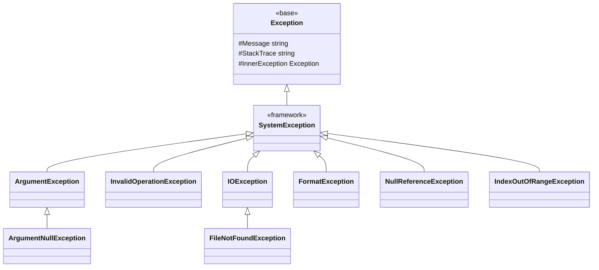

# C# Exceptions Basics

An **exception** is an object that represents an error at runtime and interrupts the normal flow of the program. When something goes wrong during execution, C# creates an exception object and "throws" it. If your code doesn't handle it, the program crashes, prints an error message, and displays a stack trace showing where the error occurred.

## What happens without handling

Without exception handling, an unhandled exception terminates your program and prints diagnostic information. Here are common examples:

```csharp
// Example 1: DivideByZeroException
int x = 10;
int y = 0;
int result = x / y;
// Unhandled exception: DivideByZeroException: Attempted to divide by zero.

// Example 2: NullReferenceException
string text = null;
Console.WriteLine(text.Length);
// Unhandled exception: NullReferenceException: Object reference not set to an instance of an object.

// Example 3: IndexOutOfRangeException
int[] numbers = [1, 2, 3];
Console.WriteLine(numbers[10]);
// Unhandled exception: IndexOutOfRangeException: Index was outside the bounds of the array.
```

## Compile-time errors vs runtime errors vs logic errors

| Type | When | Detected by | Example | Fixable? |
|------|------|------------|---------|----------|
| **Compile-time error** | During compilation | Compiler | Missing semicolon, wrong type | Yes, before running |
| **Runtime error** | During execution | Runtime (exception) | Division by zero, null reference | Yes, with exception handling |
| **Logic error** | During execution | You (testing) | Wrong algorithm, incorrect condition | Yes, by fixing the code |

Exceptions only handle **runtime errors**; compile-time errors must be fixed before the program runs, and logic errors require debugging and code fixes.

## Anatomy of an exception

An exception object contains several useful properties:

```csharp
try
{
    int x = 10 / 0;
}
catch (Exception ex)
{
    Console.WriteLine($"Message: {ex.Message}");
    Console.WriteLine($"Type: {ex.GetType().Name}");
    Console.WriteLine($"Source: {ex.Source}");
    Console.WriteLine($"StackTrace:\n{ex.StackTrace}");
    if (ex.InnerException != null)
        Console.WriteLine($"Inner: {ex.InnerException.Message}");
}
// Output:
// Message: Attempted to divide by zero.
// Type: DivideByZeroException
// Source: ConsoleApp
// StackTrace:
//    at Program.<Main>$(String[] args) in C:\app\Program.cs:line 5
```

### Exception properties:

- **Message**: A human-readable description of the error (e.g., "Attempted to divide by zero.")
- **StackTrace**: Shows the call stack at the moment the exception was thrown; read it from **bottom to top** (innermost call first) to find where the error started
- **Source**: The name of the assembly where the exception was thrown
- **InnerException**: If this exception was thrown in response to another exception, `InnerException` holds the original error
- **GetType().Name**: The concrete exception type (e.g., "DivideByZeroException")

### Reading a stack trace

Stack traces show the chain of method calls, with the most recent (innermost) at the top and the original call at the bottom. Read from **bottom to top** to find where the problem started:

```csharp
// Program output:
// at MyApp.Program.Main() in C:\app\Program.cs:line 15
// at MyApp.MyClass.ProcessData() in C:\app\MyClass.cs:line 42
// at MyApp.MyClass.ReadFile() in C:\app\MyClass.cs:line 50

// Read bottom-to-top:
// 1. Main() called (line 15 in Program.cs) ← Start here
// 2. Main() called ProcessData() (line 42 in MyClass.cs)
// 3. ProcessData() called ReadFile() (line 50 in MyClass.cs)
// 4. Exception thrown here (last line, top of trace)
```

## The exception hierarchy

All exceptions in .NET inherit from `System.Exception`. The hierarchy looks like:

```
System.Exception (base class for ALL exceptions)
├── System.SystemException (framework/system errors)
│   ├── System.ArgumentException
│   ├── System.NullReferenceException
│   ├── System.IndexOutOfRangeException
│   ├── System.InvalidOperationException
│   ├── System.FormatException
│   ├── System.OverflowException
│   ├── System.DivideByZeroException
│   ├── System.IO.IOException
│   │   ├── System.IO.FileNotFoundException
│   │   └── System.IO.DirectoryNotFoundException
│   ├── System.TimeoutException
│   └── ... (many more)
└── System.ApplicationException (deprecated; avoid creating custom exceptions from this)
```

**Note**: `ApplicationException` exists for historical reasons and is **not recommended** for custom exceptions. Derive from `Exception` or a more specific base class instead.



## Common exceptions

Here are exceptions you'll encounter frequently:

| Exception | Cause | Example |
|-----------|-------|---------|
| `NullReferenceException` | Calling a method on `null` | `string text = null; text.Length;` |
| `ArgumentNullException` | A method received `null` when it shouldn't | Constructor validation |
| `ArgumentOutOfRangeException` | Argument value is outside the allowed range | `TimeSpan.FromSeconds(-10)` |
| `IndexOutOfRangeException` | Array/list index is out of bounds | `arr[100]` when `arr.Length == 10` |
| `InvalidOperationException` | Object state doesn't allow the operation | Enumerating a collection while modifying it |
| `FormatException` | String cannot be parsed as the target type | `int.Parse("abc")` |
| `DivideByZeroException` | Division by zero | `10 / 0` |
| `FileNotFoundException` | File doesn't exist | `File.ReadAllText("missing.txt")` |
| `IOException` | General I/O error | Disk read/write failure |
| `TimeoutException` | Operation exceeded the time limit | HTTP request timeout |

## Common mistakes

- **Catching `Exception` without understanding what might be thrown** – This hides bugs. Catch specific exceptions and let unexpected ones bubble up.

```csharp
// ❌ Bad: catches everything, hides bugs
try
{
    int result = int.Parse(userInput);
}
catch (Exception ex)  // Too broad
{
    Console.WriteLine("Error");
}

// ✓ Good: specific exception, clearer intent
try
{
    int result = int.Parse(userInput);
}
catch (FormatException ex)
{
    Console.WriteLine("Invalid number format");
}
```

- **Empty catch blocks** – Silently swallowing exceptions hides problems. Always handle or log the error.

```csharp
// ❌ Bad: empty catch
try
{
    // do something
}
catch (Exception ex)
{
    // Doing nothing here makes debugging impossible!
}

// ✓ Good: log the error at least
try
{
    // do something
}
catch (Exception ex)
{
    logger.LogError(ex, "An error occurred");
    throw;  // or handle specifically
}
```

- **Assuming all errors are exceptional** – Some operations have predictable failure modes that can be checked first (see the Try pattern in [Exception Handling Best Practices](/content/notes/csharp-exception-handling-best-practices.md)).

## Quick recap

- An exception is an object that represents a runtime error and stops normal program flow.
- Without handling, an unhandled exception crashes the program and prints a stack trace.
- Compile-time errors are caught by the compiler; runtime errors become exceptions; logic errors require code fixes.
- Exception properties include: `Message`, `StackTrace`, `InnerException`, `Source`, and `GetType().Name`.
- Read stack traces from **bottom to top** to find where the error originated.
- All exceptions inherit from `System.Exception`; `SystemException` and `ApplicationException` are base classes.
- Common exceptions: `NullReferenceException`, `ArgumentException`, `IndexOutOfRangeException`, `FormatException`, `InvalidOperationException`, and many I/O-related types.
- Catch specific exceptions, never use empty catch blocks, and never silently swallow errors.
