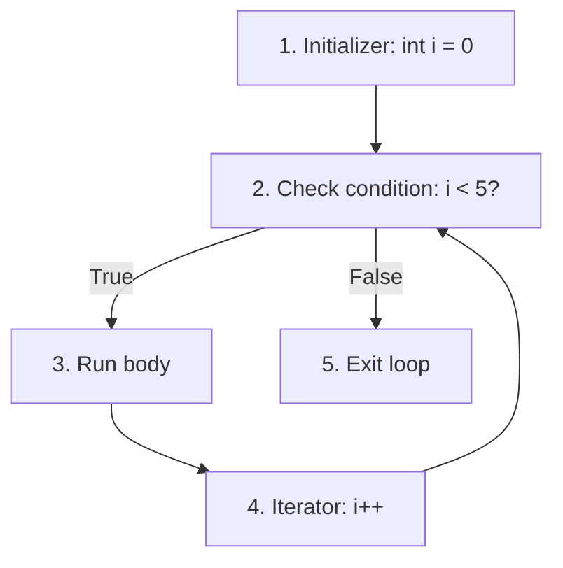

# C# for Loop

The `for` loop is designed for **known repetitions**. It combines initialization, condition checking, and incrementation in a single header. The `for` loop is ideal when you need an index, a fixed count, or more control over how the loop variable changes.

## for loop: syntax and how it works

A `for` loop has three parts:

```csharp
for (initializer; condition; iterator)
{
    // Code runs here
}
```

- **initializer**: Runs once, before the loop starts (usually creates and sets a counter variable).
- **condition**: Checked before each iteration; if false, the loop stops.
- **iterator**: Runs after each iteration (usually increments the counter).

**Step-by-step execution:**



**Example: counting from 0 to 4**

```csharp
for (int i = 0; i < 5; i++)
{
    Console.WriteLine($"i = {i}");
}
// Output:
// i = 0
// i = 1
// i = 2
// i = 3
// i = 4
```

**Example: counting up**

```csharp
for (int count = 1; count <= 10; count++)
{
    Console.WriteLine(count);
}
// Output:
// 1
// 2
// 3
// ...
// 10
```

**Example: counting down**

```csharp
for (int count = 5; count >= 1; count--)
{
    Console.WriteLine(count);
}
// Output:
// 5
// 4
// 3
// 2
// 1
```

## Looping through arrays and lists with for

The `for` loop is perfect for accessing elements by index:

**Looping over an array by index:**

```csharp
string[] colors = ["red", "green", "blue"];

for (int i = 0; i < colors.Length; i++)
{
    Console.WriteLine($"Index {i}: {colors[i]}");
}
// Output:
// Index 0: red
// Index 1: green
// Index 2: blue
```

**Modifying array elements:**

```csharp
int[] numbers = [10, 20, 30, 40];

for (int i = 0; i < numbers.Length; i++)
{
    numbers[i] *= 2;  // Double each element
}

foreach (int num in numbers)
{
    Console.WriteLine(num);
}
// Output:
// 20
// 40
// 60
// 80
```

**Looping over a List<T>:**

```csharp
List<string> fruits = new List<string> { "apple", "banana", "cherry" };

for (int i = 0; i < fruits.Count; i++)
{
    Console.WriteLine($"Index {i}: {fruits[i]}");
}
// Output:
// Index 0: apple
// Index 1: banana
// Index 2: cherry
```

## Step size: skip iterations

Use `+=` or `-=` to change the loop variable by more than 1:

```csharp
// Count by 2s
for (int i = 0; i < 10; i += 2)
{
    Console.WriteLine(i);
}
// Output:
// 0
// 2
// 4
// 6
// 8

// Count down by 3s
for (int i = 20; i >= 0; i -= 3)
{
    Console.WriteLine(i);
}
// Output:
// 20
// 17
// 14
// 11
// 8
// 5
// 2
```

## Going backwards

Reverse a loop by counting down:

```csharp
int[] letters = ['A', 'B', 'C', 'D'];

for (int i = letters.Length - 1; i >= 0; i--)
{
    Console.WriteLine(letters[i]);
}
// Output:
// D
// C
// B
// A
```

## Scope of the loop variable

The loop variable exists **only inside the loop**:

```csharp
for (int i = 0; i < 3; i++)
{
    Console.WriteLine(i);
}

// ❌ Error: i does not exist here
// Console.WriteLine(i);

// ✓ Fix: declare i outside the loop if you need it later
int i;
for (i = 0; i < 3; i++)
{
    Console.WriteLine(i);
}
Console.WriteLine($"Loop ended at i = {i}");  // Prints 3
// Output:
// 0
// 1
// 2
// Loop ended at i = 3
```

## Nested loops

A loop inside a loop processes multidimensional data:

**Example: multiplication table**

```csharp
for (int row = 1; row <= 3; row++)
{
    for (int col = 1; col <= 3; col++)
    {
        Console.WriteLine($"{row} × {col} = {row * col}");
    }
}
// Output:
// 1 × 1 = 1
// 1 × 2 = 2
// 1 × 3 = 3
// 2 × 1 = 2
// 2 × 2 = 4
// 2 × 3 = 6
// 3 × 1 = 3
// 3 × 2 = 6
// 3 × 3 = 9
```

**Example: 2D array (game grid)**

```csharp
int[,] grid = new int[3, 3]
{
    { 1, 2, 3 },
    { 4, 5, 6 },
    { 7, 8, 9 }
};

for (int row = 0; row < grid.GetLength(0); row++)
{
    for (int col = 0; col < grid.GetLength(1); col++)
    {
        Console.Write(grid[row, col] + " ");
    }
    Console.WriteLine();  // New line after each row
}
// Output:
// 1 2 3
// 4 5 6
// 7 8 9
```

**Example: nested list**

```csharp
List<List<int>> matrix = new List<List<int>>
{
    new List<int> { 1, 2 },
    new List<int> { 3, 4 },
    new List<int> { 5, 6 }
};

for (int row = 0; row < matrix.Count; row++)
{
    for (int col = 0; col < matrix[row].Count; col++)
    {
        Console.Write(matrix[row][col] + " ");
    }
    Console.WriteLine();
}
// Output:
// 1 2
// 3 4
// 5 6
```

**How many times does the inner body run?** In nested loops, the inner body runs **outer iterations × inner iterations**. In the examples above, with 3 outer and 3 inner loops, the body runs 3 × 3 = 9 times.

## Off-by-one errors

An off-by-one error occurs when the loop runs one too many or one too few times, often due to using `<=` instead of `<`:

**Example: accessing past the end of an array**

```csharp
int[] arr = [10, 20, 30];  // Indices: 0, 1, 2

// ❌ Off-by-one: tries to access index 3, which doesn't exist
for (int i = 0; i <= arr.Length; i++)
{
    Console.WriteLine(arr[i]);  // IndexOutOfRangeException when i = 3
}

// ✓ Correct: < instead of <=
for (int i = 0; i < arr.Length; i++)
{
    Console.WriteLine(arr[i]);
}
// Output:
// 10
// 20
// 30
```

**Why it happens:** Arrays have Length N, but valid indices are 0 to N-1. Always use `i < array.Length`, never `i <= array.Length`.

**Fix:** Use `<` for arrays and lists:

```csharp
// ✓ Always use <, not <=
for (int i = 0; i < arr.Length; i++) { ... }
for (int i = 0; i < list.Count; i++) { ... }
```

## Multiple variables in a for loop (optional)

You can initialize and update multiple variables:

```csharp
// Two variables
for (int i = 0, j = 10; i < 5; i++, j--)
{
    Console.WriteLine($"i = {i}, j = {j}");
}
// Output:
// i = 0, j = 10
// i = 1, j = 9
// i = 2, j = 8
// i = 3, j = 7
// i = 4, j = 6
```

This is rare and less readable; usually it's clearer to declare variables separately.

## Common mistakes

- **Using `<=` instead of `<` with `.Length`** – This causes an `IndexOutOfRangeException`.

```csharp
// ❌ Wrong
for (int i = 0; i <= arr.Length; i++)
{
    Console.WriteLine(arr[i]);  // IndexOutOfRangeException
}

// ✓ Correct
for (int i = 0; i < arr.Length; i++)
{
    Console.WriteLine(arr[i]);
}
```

- **Forgetting to update the loop variable** – This creates an infinite loop.

```csharp
// ❌ Infinite loop: i never changes
for (int i = 0; i < 5; )
{
    Console.WriteLine(i);
}

// ✓ Fix: increment i
for (int i = 0; i < 5; i++)
{
    Console.WriteLine(i);
}
```

- **Wrong comparison operator** – Using `>` when you mean `<`.

```csharp
// ❌ Never executes: 0 > 5 is false
for (int i = 0; i > 5; i++)
{
    Console.WriteLine(i);
}

// ✓ Correct
for (int i = 0; i < 5; i++)
{
    Console.WriteLine(i);
}
```

## Quick recap

- **for** loops are ideal when you know the number of repetitions or need an index.
- Syntax: `for (init; condition; iterator)` runs initializer once, checks condition, runs body, then iterator.
- Use `<` with `.Length` and `.Count` to avoid off-by-one errors.
- `for` is best for looping over arrays and lists when you need the index.
- Nested loops process multidimensional data; body runs `outer × inner` times.
- Use `i += n` to step by n, and `i--` to count down.
- Loop variables are scoped to the `for` block; declare outside if you need them later.
