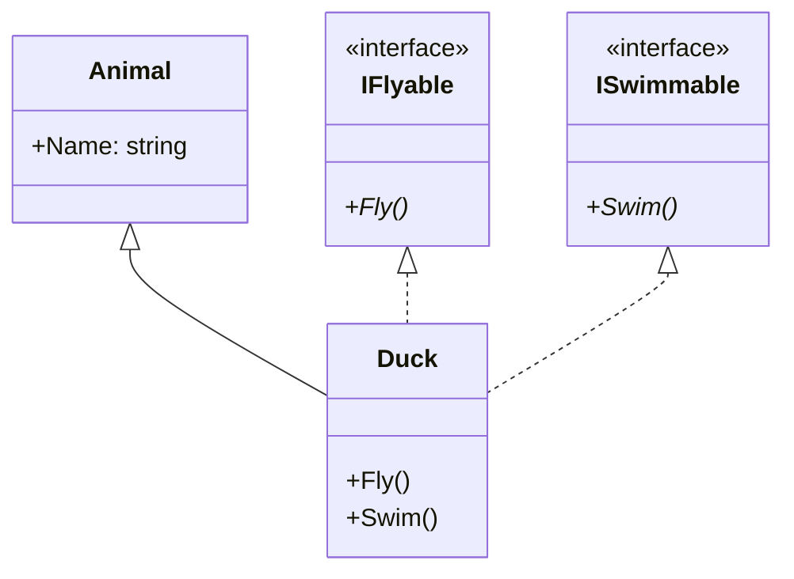

# Implementing Multiple Interfaces in C#

One of the most powerful aspects of interfaces is that a single class can implement **multiple interfaces**. This solves the "one base class only" limitation of inheritance and allows you to combine many different behaviors in one class.

## Multiple interface implementation

A class can implement as many interfaces as it needs. Just separate them with commas:

```csharp
public interface IFlyable
{
    void Fly();
}

public interface ISwimmable
{
    void Swim();
}

public class Duck : IFlyable, ISwimmable
{
    public void Fly()
    {
        Console.WriteLine("Duck is flying");
    }

    public void Swim()
    {
        Console.WriteLine("Duck is swimming");
    }
}

// Usage:
var duck = new Duck();
duck.Fly();    // Output: "Duck is flying"
duck.Swim();   // Output: "Duck is swimming"

// You can also treat it as either interface type
IFlyable flyer = duck;
flyer.Fly();

ISwimmable swimmer = duck;
swimmer.Swim();
```

## Combining a base class and interfaces

If a class needs both a base class and interfaces, the **base class must come first**, then the interfaces:

```csharp
public abstract class Animal
{
    public string Name { get; set; }

    public Animal(string name)
    {
        Name = name;
    }

    public abstract void MakeSound();
}

public interface IFlyable
{
    void Fly();
}

public interface ISwimmable
{
    void Swim();
}

// Base class first, then interfaces
public class Duck : Animal, IFlyable, ISwimmable
{
    public Duck(string name) : base(name)
    {
    }

    public override void MakeSound()
    {
        Console.WriteLine("Quack!");
    }

    public void Fly()
    {
        Console.WriteLine($"{Name} is flying");
    }

    public void Swim()
    {
        Console.WriteLine($"{Name} is swimming");
    }
}

var duck = new Duck("Donald");
duck.MakeSound();  // Output: "Quack!"
duck.Fly();        // Output: "Donald is flying"
duck.Swim();       // Output: "Donald is swimming"
```

## Interface inheritance

An interface can inherit from (extend) other interfaces. This is useful when you have related behaviors:

```csharp
public interface IMovable
{
    void Move();
}

public interface IFlyable : IMovable
{
    void TakeOff();
    void Land();
}

// A class implementing IFlyable must also implement IMovable
public class Plane : IFlyable
{
    public void Move()
    {
        Console.WriteLine("Plane is moving");
    }

    public void TakeOff()
    {
        Console.WriteLine("Plane is taking off");
    }

    public void Land()
    {
        Console.WriteLine("Plane is landing");
    }
}

var plane = new Plane();
plane.Move();      // From IMovable
plane.TakeOff();   // From IFlyable
plane.Land();      // From IFlyable
```

## Name clashes with interfaces

When two interfaces declare a member with the same name and signature, a class must implement both. Usually, they can share the same implementation:

```csharp
public interface IVehicle
{
    void Start();
}

public interface IMachine
{
    void Start();
}

public class Car : IVehicle, IMachine
{
    // Both interfaces need Start(), but one implementation is enough
    public void Start()
    {
        Console.WriteLine("Car starting");
    }
}

var car = new Car();
car.Start();  // Works for both
```

## Explicit interface implementation

If two interfaces have the same method but you want *different* behavior for each, use **explicit interface implementation**. With explicit implementation, you use the interface name in the method signature, and you can only call it through the interface type:

```csharp
public interface IVehicle
{
    void Start();
}

public interface IMachine
{
    void Start();
}

public class Engine : IVehicle, IMachine
{
    // Explicit implementation: only accessible via the interface type
    void IVehicle.Start()
    {
        Console.WriteLine("Vehicle starting");
    }

    void IMachine.Start()
    {
        Console.WriteLine("Machine starting");
    }
}

var engine = new Engine();
// engine.Start();  // ❌ Error: Start() doesn't exist on Engine itself

// Call through the interface type
IVehicle vehicle = engine;
vehicle.Start();  // Output: "Vehicle starting"

IMachine machine = engine;
machine.Start();  // Output: "Machine starting"
```

You can also mix implicit and explicit implementations:

```csharp
public interface ISerializable
{
    string Serialize();
}

public interface IExportable
{
    void Export();
}

public class Document : ISerializable, IExportable
{
    // Implicit: accessible both on Document and ISerializable
    public string Serialize()
    {
        return "Serialized document";
    }

    // Explicit: only accessible via IExportable
    void IExportable.Export()
    {
        Console.WriteLine("Exporting...");
    }
}

var doc = new Document();
Console.WriteLine(doc.Serialize());  // ✓ Implicit, accessible on the object

IExportable exportable = doc;
exportable.Export();  // ✓ Explicit, only via interface

// doc.Export();  // ❌ Error: Export is not visible on Document
```

## Implicit vs explicit implementation comparison

| Aspect | Implicit | Explicit |
|--------|----------|----------|
| **Syntax** | `public returnType Member()` | `returnType InterfaceName.Member()` |
| **Accessible on object** | Yes | No; only via interface type |
| **Use case** | Main implementation | Multiple interfaces with conflicts, or hiding an implementation detail |
| **Can have logic** | Yes | Yes |

## Why interfaces solve the "one base class only" problem

In many languages, you can inherit from only one class. With interfaces, you overcome this:

```csharp
// ❌ You CANNOT do this:
// public class Bird : Parrot, Flamingo { }  // Multiple base classes

// ✓ But you CAN implement multiple interfaces:
public class Animal { }
public interface IFlyable { void Fly(); }
public interface ISinging { void Sing(); }

public class Bird : Animal, IFlyable, ISinging
{
    public void Fly() { }
    public void Sing() { }
}
```

A `Bird` is-a `Animal` (inheritance), but can-fly and can-sing (interfaces).

## Multiple interfaces diagram



The solid arrow (`<|--`) is inheritance (base class); the dashed arrows (`<|..`) are implementations.

## Common mistakes

- **Forgetting the base class must come first** – The order is `Class : BaseClass, IInterface1, IInterface2`. Put the base class before any interfaces, or you get a compiler error.
- **Explicit implementation without understanding visibility** – Explicitly implemented members are `private` to the class and only callable through the interface type. If you need the method on the object itself, use implicit implementation.
- **Name clashes without understanding them** – If two interfaces have the same member, you can usually implement both with one method. Only use explicit implementation if you need different behavior per interface.

## Quick recap

- A class can implement multiple interfaces: `Class : I1, I2, I3`.
- If using a base class, it comes first: `Class : BaseClass, I1, I2`.
- Interfaces can inherit from other interfaces: `interface IFlyable : IMovable`.
- Explicit implementation (`void IInterface.Member()`) is used to disambiguate or hide details.
- Multiple interfaces give you the benefits of multiple inheritance without its drawbacks.
