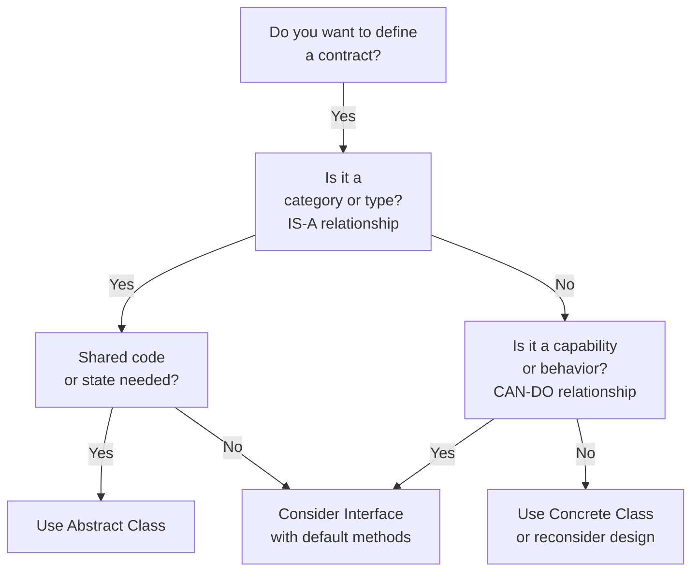

# Interfaces vs Abstract Classes in C#

Both interfaces and abstract classes define contracts, but they serve different purposes. Understanding when to use each is key to good object-oriented design.

## Side-by-side comparison

| Aspect | Interface | Abstract class |
|--------|-----------|-----------------|
| **Can you create an instance?** | No | No |
| **Can have fields?** | No (only properties) | Yes |
| **Can have constructors?** | No | Yes |
| **Can have implemented methods?** | Yes (C# 8+, default methods) | Yes |
| **Access modifiers on members** | Public by default; can't use `protected` | Full range: `public`, `private`, `protected`, `internal` |
| **Multiple inheritance** | Yes (a class can implement many) | No (a class can inherit from only one) |
| **When to add members** | Breaking change to all implementations | Can add with default implementation; not breaking |
| **Static members** | Yes (C# 11+, `static abstract`) | Yes |
| **Versioning** | Adding a member breaks all implementations | Adding a method with default body doesn't break |
| **Typical use** | "What can it do?" (capability/behavior) | "What is it?" (a type/category) |

## Decision flowchart



## When to choose an interface

**Use an interface when:**

- You want to define a **capability** or **behavior** that multiple, unrelated classes might implement
- You need **multiple inheritance** of contracts
- You want to enforce a contract **without prescribing implementation**
- Different implementations should be **freely substituted** (a duck is a bird *and* can fly)

**Examples:**
- `IComparable<T>` – "I can be compared"
- `IDisposable` – "I need cleanup"
- `ILogger` – "I can log messages"
- `IFlyable` – "I can fly"

```csharp
// Bird is-a Animal (inheritance)
// Bird can-fly and can-sing (interfaces)
public abstract class Animal
{
    public string Name { get; set; }
}

public interface IFlyable
{
    void Fly();
}

public interface ISinging
{
    void Sing();
}

public class Bird : Animal, IFlyable, ISinging
{
    public void Fly() => Console.WriteLine("Flying");
    public void Sing() => Console.WriteLine("Singing");
}
```

## When to choose an abstract class

**Use an abstract class when:**

- You have an **is-a relationship** (inheritance hierarchy)
- You want to **share code** or **state** among related classes
- You need **access modifiers** beyond `public` (e.g., `protected` fields)
- You want to **define a type** that logically groups related classes

**Examples:**
- `Animal` – base class for `Dog`, `Cat`, `Bird`
- `Shape` – base class for `Circle`, `Square`, `Triangle`
- `Repository<T>` – base class for `UserRepository`, `ProductRepository`

```csharp
public abstract class Animal
{
    // Shared state
    public string Name { get; set; }
    protected int _age;

    // Shared behavior
    public abstract void MakeSound();

    public virtual void Sleep()
    {
        Console.WriteLine($"{Name} is sleeping");
    }

    public virtual void Eat(string food)
    {
        Console.WriteLine($"{Name} is eating {food}");
    }
}

public class Dog : Animal
{
    public override void MakeSound() => Console.WriteLine("Woof!");
}

public class Cat : Animal
{
    public override void MakeSound() => Console.WriteLine("Meow!");
}

var dog = new Dog { Name = "Rex" };
dog.MakeSound();  // "Woof!"
dog.Eat("bones"); // "Rex is eating bones"
```

## Using both together

Often, the best design combines both: an **abstract class** for a type hierarchy, and **interfaces** for capabilities:

```csharp
// Abstract base class: defines the type
public abstract class DatabaseRepository
{
    protected string _connectionString;

    public DatabaseRepository(string connectionString)
    {
        _connectionString = connectionString;
    }

    protected abstract void Connect();
}

// Interface: defines a capability
public interface ICacheable
{
    void ClearCache();
}

// Concrete class: inherits from abstract class and implements interface
public class UserRepository : DatabaseRepository, ICacheable
{
    private Dictionary<int, User> _cache = new();

    public UserRepository(string connectionString) : base(connectionString)
    {
    }

    protected override void Connect()
    {
        Console.WriteLine("Connected to database");
    }

    public void ClearCache()
    {
        _cache.Clear();
        Console.WriteLine("Cache cleared");
    }

    public User GetUser(int id)
    {
        if (_cache.TryGetValue(id, out var user))
            return user;

        // ... fetch from database
        return user;
    }
}
```

## Default interface methods (C# 8+)

Starting with C# 8, interfaces can have **default implementations**:

```csharp
public interface ILogger
{
    // Abstract member: must be implemented
    void Log(string message);

    // Default method: has an implementation
    public void LogError(string message)
    {
        Console.WriteLine($"ERROR: {message}");
    }

    // Default property: has an implementation
    public string Name => "DefaultLogger";
}

public class ConsoleLogger : ILogger
{
    // Must implement Log
    public void Log(string message)
    {
        Console.WriteLine($"LOG: {message}");
    }

    // Can override default methods if needed, or use the default
}

var logger = new ConsoleLogger();
logger.Log("Test");        // Output: "LOG: Test"
logger.LogError("Oops");   // Output: "ERROR: Oops" (from default)
Console.WriteLine(logger.Name);  // "DefaultLogger"
```

**Important:** Default interface methods are **not** inherited by the class; they're only accessible through the interface type:

```csharp
ILogger loggerInterface = logger;
loggerInterface.LogError("Via interface");  // ✓ Works

logger.LogError("Via class");  // ❌ Error! LogError not visible on ConsoleLogger itself
```

Use default methods carefully—they can confuse implementers about what they must override.

## Versioning: adding members later

**Abstract class (easy):**
```csharp
// v1.0
public abstract class Animal
{
    public abstract void MakeSound();
}

// v2.0: add a method with default implementation
public abstract class Animal
{
    public abstract void MakeSound();

    public virtual void Sleep()  // ✓ No breaking change
    {
        Console.WriteLine("Zzz");
    }
}

// All existing implementations still work!
```

**Interface (breaking):**
```csharp
// v1.0
public interface IAnimal
{
    void MakeSound();
}

// v2.0 (without default method): add an abstract member
public interface IAnimal
{
    void MakeSound();
    void Sleep();  // ❌ All implementations break!
}

// v2.0 (with default method): add with default implementation
public interface IAnimal
{
    void MakeSound();
    public void Sleep() => Console.WriteLine("Zzz");  // ✓ Not breaking
}
```

This is why abstract classes are more suitable for base types that evolve over time.

## Static abstract members (C# 11+, advanced)

Interfaces can declare static abstract members for generic math and other scenarios (mentioned for completeness; rarely used):

```csharp
public interface INumeric<T> where T : INumeric<T>
{
    static abstract T operator +(T left, T right);
}
```

This is an advanced feature; most code won't use it.

## Common mistakes

- **Using an abstract class when multiple inheritance is needed** – Use interfaces; a class can implement many interfaces but inherit from only one base class.
- **Adding too much shared code to an interface** – Interfaces should define contracts. Shared code belongs in an abstract class or base class.
- **Forgetting default interface methods are not inherited** – A default interface method is only callable via the interface type, not the class. If a class needs the method, override it explicitly.
- **Versioning an interface by adding abstract members** – This breaks all implementations. Use default methods or design smaller, focused interfaces from the start.

## Quick recap

- **Interfaces** define capabilities and contracts; multiple inheritance is allowed; great for polymorphism.
- **Abstract classes** define types and share implementation; single inheritance only; better for related hierarchies.
- Use both: abstract base classes for structure, interfaces for capabilities.
- Default interface methods (C# 8+) help with versioning but are only callable via the interface type.
- When unsure, start with an interface; upgrade to an abstract class if you need shared state or access modifiers.
