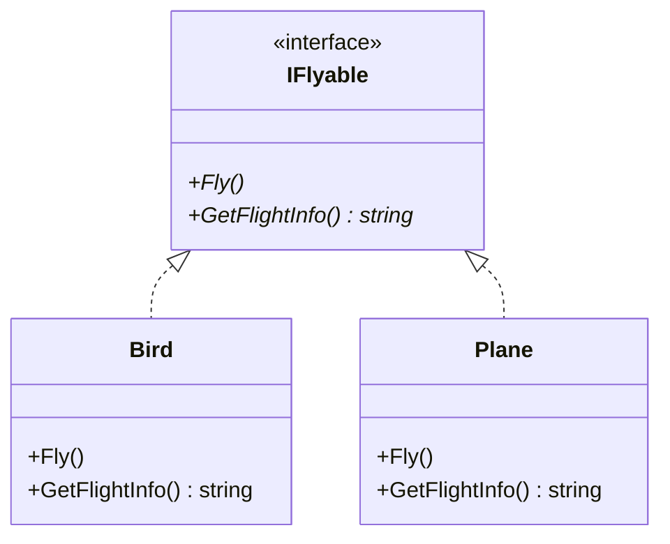

# Interfaces Basics in C#

An **interface** is a contract that specifies a set of members (methods, properties, events, indexers) that a class must provide. Unlike a base class, an interface does not say *how* to implement these members—it only says *what* must be implemented. Interfaces define a "can-do" or "behaves-like" relationship: "this type CAN fly" or "this type CAN be serialized," rather than the "is-a" relationship of inheritance.

## What is an interface?

An interface is like a promise: "Any class that implements this interface promises to provide these members." It's a way to specify an expected behavior without tying classes together through inheritance.

**Key points:**
- An interface defines a contract, not implementation.
- Multiple classes can implement the same interface.
- A class can implement multiple interfaces (but can inherit from only one base class).
- Interface members are `public` by default.

## Declaring an interface

Interfaces use the `interface` keyword. By convention, interface names start with `I`:

```csharp
public interface IFlyable
{
    void Fly();
    string GetFlightInfo();
}
```

## Implementing an interface

A class implements an interface using the colon (`:`) syntax, just like inheritance. The class must implement *all* members declared in the interface:

```csharp
public class Bird : IFlyable
{
    public void Fly()
    {
        Console.WriteLine("Bird is flying");
    }

    public string GetFlightInfo()
    {
        return "Bird can fly up to 50 km/h";
    }
}

public class Plane : IFlyable
{
    public void Fly()
    {
        Console.WriteLine("Plane is taking off");
    }

    public string GetFlightInfo()
    {
        return "Plane cruises at 900 km/h";
    }
}

// Usage:
var bird = new Bird();
bird.Fly();  // Output: "Bird is flying"

var plane = new Plane();
plane.Fly();  // Output: "Plane is taking off"
```

## Interface members must be public

All members declared in an interface are implicitly `public`. When you implement an interface member, you must declare it `public` in the class (or you get **error CS0737**):

```csharp
public interface IWalkable
{
    void Walk();
}

// ❌ Error CS0737: 'Dog' does not implement interface member 'IWalkable.Walk'.
// The implementing member must be public.
public class Dog : IWalkable
{
    private void Walk()  // ❌ Not public!
    {
        Console.WriteLine("Dog is walking");
    }
}

// ✓ Fix: Make the method public
public class Dog : IWalkable
{
    public void Walk()
    {
        Console.WriteLine("Dog is walking");
    }
}
```

## Must implement ALL members

A class must implement every member declared in the interface (or it gets **error CS0535**):

```csharp
public interface IVehicle
{
    void Start();
    void Stop();
    string GetStatus();
}

// ❌ Error CS0535: 'Car' does not implement interface member 'IVehicle.Stop'
public class Car : IVehicle
{
    public void Start()
    {
        Console.WriteLine("Engine starting");
    }

    public string GetStatus()
    {
        return "Car is running";
    }
    // Missing Stop() ❌
}

// ✓ Fix: Implement all members
public class Car : IVehicle
{
    public void Start()
    {
        Console.WriteLine("Engine starting");
    }

    public void Stop()
    {
        Console.WriteLine("Engine stopping");
    }

    public string GetStatus()
    {
        return "Car is running";
    }
}
```

## Interfaces as types

You cannot create an instance of an interface directly (error **CS0144**), but you can use an interface as a variable type:

```csharp
// ❌ Error CS0144: Cannot create an instance of the abstract type 'IFlyable'
var flyer = new IFlyable();

// ✓ You can declare a variable with the interface type
IFlyable bird = new Bird();
IFlyable plane = new Plane();

// Now both bird and plane are treated as IFlyable,
// and you can call only the methods declared in IFlyable
bird.Fly();
plane.Fly();
```

This is the foundation of **polymorphism**: treat different types through a common interface.

## Interface members: properties, not fields

Interfaces can declare properties, but not fields (data members). An interface can only specify what properties must exist; the class decides how to implement them:

```csharp
public interface IAnimal
{
    string Name { get; set; }  // ✓ Property
    int Age { get; }           // ✓ Read-only property
    // string _species;        // ❌ Cannot declare a field
}

public class Dog : IAnimal
{
    private string _name;
    private int _age;

    public string Name
    {
        get => _name;
        set => _name = value;
    }

    public int Age => _age;

    public Dog(string name, int age)
    {
        _name = name;
        _age = age;
    }
}

var dog = new Dog("Rex", 3);
Console.WriteLine($"{dog.Name} is {dog.Age} years old");
// Output: "Rex is 3 years old"
```

## No constructors

Interfaces cannot declare constructors. Each implementing class defines its own constructors:

```csharp
public interface IShape
{
    double GetArea();
    // public IShape() { }  // ❌ Cannot declare a constructor
}

public class Circle : IShape
{
    private double _radius;

    public Circle(double radius)  // ✓ Class defines its constructor
    {
        _radius = radius;
    }

    public double GetArea() => Math.PI * _radius * _radius;
}

var circle = new Circle(5);
Console.WriteLine($"Area: {circle.GetArea()}");  // Area: 78.54...
```

## Interface diagram



The dashed arrow (`<|..`) indicates "implements an interface."

## Common mistakes

- **Declaring interface members as private in the implementing class** – Interface members are `public` by default. If your implementation is `private`, you get error CS0737. Always declare them `public`.
- **Not implementing all interface members** – If you miss even one member, you get error CS0535. Implement every declared method and property.
- **Trying to create an instance of an interface** – Use it as a type, not with `new`. This is error CS0144; instead, create an instance of a class that implements it.

## Quick recap

- An interface is a contract: "if you implement me, you promise to provide these members."
- Use the `interface` keyword to declare; use `ClassName : InterfaceName` to implement.
- Interface members are `public`; implement them as `public` in your class.
- You must implement all declared members, or the compiler rejects it.
- Use an interface as a variable type for polymorphism: `IFlyable bird = new Bird();`
- Interfaces define properties and methods, not fields or constructors.
