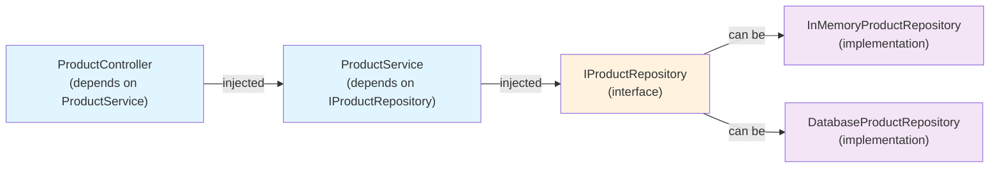

# Interfaces in .NET Projects

For .NET Full Stack developers, interfaces are essential to ASP.NET Core architecture, dependency injection, and unit testing. They enable loose coupling, testability, and swappable implementations.

## Why interfaces matter in .NET

**1. Dependency Injection in ASP.NET Core**

Interfaces allow you to register different implementations in the IoC container. Your controllers and services receive the interface type, not concrete classes, making the code flexible and testable.

**2. Unit testing with mocks**

Without interfaces, testing is difficult because you depend on concrete classes. With interfaces, you create fake (mock) implementations that behave predictably in tests.

**3. Loose coupling**

Code that depends on interfaces, not concrete classes, is easier to change and extend. You can swap implementations without rewriting the caller.

## Realistic example: product repository

Here's a typical .NET project structure:

```csharp
// 1. Define the interface (contract)
public interface IProductRepository
{
    Task<IEnumerable<Product>> GetAllAsync();
    Task<Product?> GetByIdAsync(int id);
    Task CreateAsync(Product product);
    Task UpdateAsync(Product product);
    Task DeleteAsync(int id);
}

// 2. Concrete implementation (in-memory, for this example)
public class InMemoryProductRepository : IProductRepository
{
    private List<Product> _products = new()
    {
        new Product { Id = 1, Name = "Laptop", Price = 999.99m },
        new Product { Id = 2, Name = "Mouse", Price = 29.99m }
    };

    public Task<IEnumerable<Product>> GetAllAsync()
    {
        return Task.FromResult(_products.AsEnumerable());
    }

    public Task<Product?> GetByIdAsync(int id)
    {
        return Task.FromResult(_products.FirstOrDefault(p => p.Id == id));
    }

    public Task CreateAsync(Product product)
    {
        product.Id = _products.Max(p => p.Id) + 1;
        _products.Add(product);
        return Task.CompletedTask;
    }

    public Task UpdateAsync(Product product)
    {
        var existing = _products.First(p => p.Id == product.Id);
        existing.Name = product.Name;
        existing.Price = product.Price;
        return Task.CompletedTask;
    }

    public Task DeleteAsync(int id)
    {
        _products.RemoveAll(p => p.Id == id);
        return Task.CompletedTask;
    }
}

// 3. Service that depends on the interface
public class ProductService
{
    private IProductRepository _repository;

    // Dependency injected via constructor
    public ProductService(IProductRepository repository)
    {
        _repository = repository;
    }

    public async Task<IEnumerable<Product>> GetAllProducts()
    {
        return await _repository.GetAllAsync();
    }

    public async Task<Product?> GetProduct(int id)
    {
        return await _repository.GetByIdAsync(id);
    }

    public async Task AddProduct(string name, decimal price)
    {
        var product = new Product { Name = name, Price = price };
        await _repository.CreateAsync(product);
    }
}

// 4. Product data model
public class Product
{
    public int Id { get; set; }
    public string Name { get; set; }
    public decimal Price { get; set; }
}

// 5. Register in Program.cs
var builder = WebApplicationBuilder.CreateBuilder(args);

// Register the interface with its implementation
builder.Services.AddScoped<IProductRepository, InMemoryProductRepository>();
builder.Services.AddScoped<ProductService>();

var app = builder.Build();

// 6. Controller uses the service (service gets repository via DI)
[ApiController]
[Route("api/[controller]")]
public class ProductController : ControllerBase
{
    private ProductService _service;

    public ProductController(ProductService service)
    {
        _service = service;
    }

    [HttpGet]
    public async Task<IActionResult> GetAll()
    {
        var products = await _service.GetAllProducts();
        return Ok(products);
    }

    [HttpGet("{id}")]
    public async Task<IActionResult> GetById(int id)
    {
        var product = await _service.GetProduct(id);
        return product != null ? Ok(product) : NotFound();
    }

    [HttpPost]
    public async Task<IActionResult> Create([FromBody] ProductCreateDto dto)
    {
        await _service.AddProduct(dto.Name, dto.Price);
        return CreatedAtAction(nameof(GetAll), new { });
    }
}
```

## Dependency injection flow



The container wires everything together. When you request `ProductController`, it creates a `ProductService`, which needs `IProductRepository`, so it instantiates `InMemoryProductRepository`.

## Testing with a mock implementation

```csharp
// Mock for testing (always returns fixed data)
public class MockProductRepository : IProductRepository
{
    private List<Product> _products = new()
    {
        new Product { Id = 1, Name = "Test Product", Price = 50m }
    };

    public Task<IEnumerable<Product>> GetAllAsync() => Task.FromResult(_products.AsEnumerable());
    public Task<Product?> GetByIdAsync(int id) => Task.FromResult(_products.FirstOrDefault(p => p.Id == id));
    public Task CreateAsync(Product product) { _products.Add(product); return Task.CompletedTask; }
    public Task UpdateAsync(Product product) => Task.CompletedTask;
    public Task DeleteAsync(int id) => Task.CompletedTask;
}

// Unit test: no need to hit the database
[TestClass]
public class ProductServiceTests
{
    [TestMethod]
    public async Task GetAllProducts_ReturnsList()
    {
        // Arrange: inject mock instead of real repository
        var mockRepo = new MockProductRepository();
        var service = new ProductService(mockRepo);

        // Act
        var products = await service.GetAllProducts();

        // Assert
        Assert.AreEqual(1, products.Count());
        Assert.AreEqual("Test Product", products.First().Name);
    }
}
```

## Swapping implementations without changing code

```csharp
// Original: use in-memory for prototyping
builder.Services.AddScoped<IProductRepository, InMemoryProductRepository>();

// Later: switch to database (only change the registration, not the service)
builder.Services.AddScoped<IProductRepository, DatabaseProductRepository>();

// Or: use a decorator to add caching
builder.Services.AddScoped<IProductRepository, CachedProductRepository>();

// ProductService code doesn't change at all!
```

## Naming and design best practices

**Keep interfaces small and focused (Interface Segregation Principle)**

```csharp
// ❌ Too big: "do-everything" interface
public interface IProductService
{
    Task<IEnumerable<Product>> GetAllAsync();
    Task<Product?> GetByIdAsync(int id);
    Task CreateAsync(Product product);
    Task UpdateAsync(Product product);
    Task DeleteAsync(int id);
    Task<IEnumerable<Category>> GetCategoriesAsync();  // Unrelated!
    void SendNotification(string message);  // Unrelated!
}

// ✓ Better: focused, single-responsibility interfaces
public interface IProductRepository
{
    Task<IEnumerable<Product>> GetAllAsync();
    Task<Product?> GetByIdAsync(int id);
    Task CreateAsync(Product product);
    Task UpdateAsync(Product product);
    Task DeleteAsync(int id);
}

public interface ICategoryService
{
    Task<IEnumerable<Category>> GetAllAsync();
}

public interface INotificationService
{
    Task SendAsync(string message);
}
```

**Don't create an interface "just in case"**

```csharp
// ❌ Over-engineering: interface with one implementation
public interface IOrderCalculator { ... }
public class OrderCalculator : IOrderCalculator { ... }
// Only use this if you plan to have multiple implementations or need DI

// ✓ Better: use concrete class if there's only one implementation
public class OrderCalculator { ... }
```

## Common .NET interface patterns

| Pattern | Usage |
|---------|-------|
| **Repository** | `IUserRepository`, `IProductRepository` – data access |
| **Service** | `IEmailService`, `IPaymentService` – business logic |
| **Handler** | `ICommandHandler<T>`, `IQueryHandler<T>` – CQRS pattern |
| **Middleware** | `IMiddleware` – ASP.NET Core request pipeline |
| **Logger** | `ILogger<T>` – built-in logging abstraction |
| **Configuration** | `IOptions<T>` – settings/configuration |

## Registering interfaces in Program.cs

```csharp
var builder = WebApplicationBuilder.CreateBuilder(args);

// Singleton: one instance for the entire application
builder.Services.AddSingleton<ILoggerService, ConsoleLoggerService>();

// Scoped: one instance per HTTP request
builder.Services.AddScoped<IProductRepository, DatabaseProductRepository>();
builder.Services.AddScoped<ProductService>();

// Transient: new instance every time it's requested
builder.Services.AddTransient<IEmailService, EmailService>();

// Factory: custom creation logic
builder.Services.AddScoped<IPaymentProcessor>(provider =>
{
    var config = provider.GetRequiredService<IConfiguration>();
    var apiKey = config["PaymentApiKey"];
    return new StripePaymentProcessor(apiKey);
});

var app = builder.Build();
```

## Common mistakes

- **Creating an interface with exactly one implementation "just in case"** – Add interfaces when you have multiple implementations, need testability, or are using dependency injection. Don't add them preemptively.
- **Injecting concrete classes instead of interfaces** – Always inject the interface type, not the concrete class. This defeats the purpose of DI.
- **Registering `AddScoped<IService, Service>()` but using `Service` in constructors** – Always use the interface type as the dependency. The container injects the concrete implementation.

## Quick recap

- Interfaces are central to ASP.NET Core dependency injection.
- Register interfaces with concrete implementations in `Program.cs` using `AddScoped()`, `AddSingleton()`, or `AddTransient()`.
- Controllers and services depend on interfaces, not concrete classes; the DI container injects implementations.
- Use mock implementations to test services without hitting databases or external services.
- Keep interfaces focused (Interface Segregation Principle); don't create an interface unless you have multiple implementations or need testability.
- Swapping implementations is as easy as changing one line in `Program.cs`.
