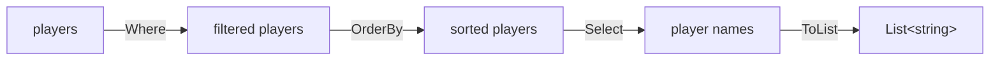

# C# LINQ Basics

LINQ (Language Integrated Query) is a uniform way to query and transform data in C#. Instead of writing loops and conditional logic, you describe *what* you want—not *how* to get it. LINQ works on anything that implements `IEnumerable<T>`: arrays, lists, dictionaries, strings, and databases (via EF Core). It makes your code more concise, readable, and less error-prone.

## Why use LINQ?

Consider finding all player names with a score above 10, sorted alphabetically:

### Without LINQ (verbose, imperative)

```csharp
List<Player> players = new List<Player>
{
    new Player { Name = "Alice", Score = 15 },
    new Player { Name = "Bob", Score = 8 },
    new Player { Name = "Charlie", Score = 12 }
};

// Manual loop and sort
List<Player> result = new List<Player>();
foreach (var p in players)
{
    if (p.Score > 10)
    {
        result.Add(p);
    }
}

result.Sort((a, b) => a.Name.CompareTo(b.Name));

foreach (var p in result)
{
    Console.WriteLine(p.Name);
}
// Alice
// Charlie
```

### With LINQ (concise, declarative)

```csharp
using System.Linq;

List<Player> players = new List<Player>
{
    new Player { Name = "Alice", Score = 15 },
    new Player { Name = "Bob", Score = 8 },
    new Player { Name = "Charlie", Score = 12 }
};

var result = players
    .Where(p => p.Score > 10)
    .OrderBy(p => p.Name)
    .ToList();

foreach (var p in result)
{
    Console.WriteLine(p.Name);
}
// Alice
// Charlie
```

LINQ is **shorter**, **more readable**, and **less error-prone**. You declare what you want, not the steps to get it.

## Setup: using System.Linq

LINQ methods live in the `System.Linq` namespace:

```csharp
using System.Linq;  // Required for Where, Select, OrderBy, etc.

List<int> numbers = [1, 2, 3, 4, 5];
var evens = numbers.Where(x => x % 2 == 0).ToList();
// [2, 4]
```

### Common error: CS1061

If you forget `using System.Linq`:

```csharp
// ❌ Error CS1061: 'List<int>' does not contain a definition for 'Where'
List<int> numbers = [1, 2, 3, 4, 5];
var evens = numbers.Where(x => x % 2 == 0).ToList();
```

**Fix**: Add `using System.Linq;` at the top of the file.

```csharp
// ✓
using System.Linq;

List<int> numbers = [1, 2, 3, 4, 5];
var evens = numbers.Where(x => x % 2 == 0).ToList();
```

## Two syntaxes: Method and Query

LINQ has two syntaxes that do the same thing. **Method syntax is far more common** in modern C#.

### Method syntax (recommended)

Methods chained together; most readable and flexible:

```csharp
var result = players
    .Where(p => p.Score > 10)      // Filter
    .OrderBy(p => p.Name)           // Sort
    .Select(p => p.Name)            // Project
    .ToList();
```

### Query syntax

Similar to SQL; older style, less flexible:

```csharp
var result = (from p in players
              where p.Score > 10
              orderby p.Name
              select p.Name).ToList();
```

Both produce the same result. **Use method syntax**—it's the modern standard and allows more complex operations.

## Lambda expressions: a quick refresher

LINQ relies on lambda expressions (anonymous functions) to describe what you want:

```csharp
// Lambda: input => operation
x => x > 10                     // "x, such that x is greater than 10"
p => p.Score > 10              // "p, such that p's score is greater than 10"
(a, b) => a + b                // "a and b, their sum"
```

Lambdas are of type `Func<T, TResult>`. For example:

```csharp
Func<int, bool> isPositive = x => x > 0;
Console.WriteLine(isPositive(5));   // true
Console.WriteLine(isPositive(-3));  // false
```

LINQ methods like `Where` take a `Func<T, bool>` (a function that returns true/false):

```csharp
// Where takes Func<Player, bool>
players.Where(p => p.Score > 10)
```

## IEnumerable<T>

LINQ works on anything that implements `IEnumerable<T>`. This includes:

- Arrays: `int[]`
- Lists: `List<T>`
- Dictionaries: `Dictionary<K, V>` (via `.Keys`, `.Values`, or `.`)
- Strings: `string` (enumerable as `char`)
- Sets and other collections: `HashSet<T>`, `ISet<T>`
- Database queries: `DbSet<T>` (EF Core)
- XML: `XElement` queries
- Any custom type implementing `IEnumerable<T>`

See [Interfaces Basics](/content/notes/csharp-interfaces-basics.md) for details on interfaces.

## A LINQ pipeline

LINQ queries flow like a pipeline: data in → transforms → result out.



Each step receives the output of the previous step. The order matters:

```csharp
// Order matters: Where before Select is more efficient
var names = players
    .Where(p => p.Score > 10)   // Filter first (fewer items)
    .Select(p => p.Name)        // Then project
    .ToList();
```

## Common mistakes

- **Forgetting `using System.Linq`** – You'll get `CS1061: does not contain a definition for 'Where'`.

```csharp
// ❌ Error without using System.Linq
List<int> numbers = [1, 2, 3];
var odds = numbers.Where(x => x % 2 == 1).ToList();

// ✓ Fix: add the using
using System.Linq;
var odds = numbers.Where(x => x % 2 == 1).ToList();
```

- **Confusing method syntax with query syntax** – Query syntax looks like SQL but is less common. Stick with method syntax.

```csharp
// ❌ Query syntax (less common)
var result = (from p in players where p.Score > 10 select p.Name).ToList();

// ✓ Method syntax (preferred)
var result = players.Where(p => p.Score > 10).Select(p => p.Name).ToList();
```

- **Forgetting that LINQ is lazy** – Most LINQ methods don't execute immediately; they run when you enumerate (see [LINQ Deferred Execution](/content/notes/csharp-linq-deferred-execution.md)). Use `ToList()` or `ToArray()` to materialize results when needed.

```csharp
List<int> numbers = [1, 2, 3, 4, 5];

// This does NOT run yet (deferred)
var evens = numbers.Where(x => x % 2 == 0);

// This runs the query
var list = evens.ToList();  // Now: [2, 4]
```

## Quick recap

- **LINQ** queries and transforms data with readable, composable expressions.
- **Setup**: `using System.Linq` to access LINQ methods.
- **Why**: Shorter and more readable than manual loops; describes what you want, not how.
- **Syntax**: Method syntax (`.Where(...).Select(...)`) is preferred over query syntax.
- **Lambda expressions**: `x => x > 10` define conditions and transformations.
- **IEnumerable<T>**: LINQ works on arrays, lists, dictionaries, databases, and more.
- **Pipeline**: Data flows through filters, transforms, and projections to produce results.
- **Common error**: `CS1061` means you forgot `using System.Linq`.
- **Deferred execution**: Most LINQ methods run lazily; use `.ToList()` to materialize.

## Example: Player class (used in other notes)

```csharp
public class Player
{
    public string Name { get; set; }
    public string Team { get; set; }
    public int Score { get; set; }
    public int Level { get; set; }
}
```
