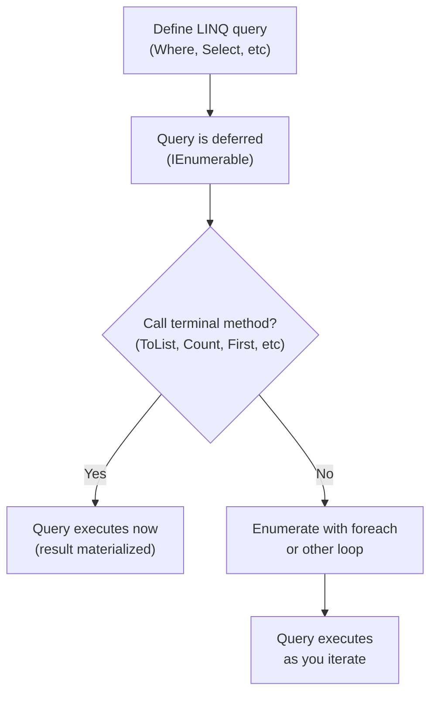

# C# LINQ – Deferred Execution

Deferred execution is THE central concept in LINQ: **most LINQ methods do not run when you write them; they run when you enumerate the result**. This can be powerful (efficiency, flexibility) or treacherous (unexpected side effects, repeated work). Understanding this is crucial to mastering LINQ.

## The core idea

When you write a LINQ query, nothing happens yet:

```csharp
using System.Linq;

List<int> numbers = [1, 2, 3, 4, 5];

// This line does NOT execute the query
var evens = numbers.Where(x => x % 2 == 0);

// The query is defined, but not run. evens is IEnumerable<int>, not List<int>.
Console.WriteLine(evens.GetType());  // System.Linq.Enumerable+WhereListIterator`1[System.Int32]
```

The query runs **only when you enumerate** (iterate over) the result:

```csharp
// Now the query runs
foreach (var e in evens)
{
    Console.WriteLine(e);  // 2, 4
}

// Or with ToList(), which also enumerates
var evensList = evens.ToList();  // Query runs here
```

## Demonstration: changing source after defining the query

```csharp
List<int> numbers = [1, 2, 3, 4, 5];

// Define the query
var evens = numbers.Where(x => x % 2 == 0);

// Add a new item
numbers.Add(6);

// Now enumerate the query
var result = evens.ToList();
// Result: [2, 4, 6] (includes 6, even though it was added after defining the query!)

Console.WriteLine(result.Count);  // 3
```

This shows that **the query captures the source, not a snapshot**. It evaluates against the current state of the source.

## Enumerating the same query twice

If you enumerate the same query twice, it **runs twice**:

```csharp
List<int> numbers = [1, 2, 3, 4, 5];
var evens = numbers.Where(x => x % 2 == 0);

// First enumeration
var result1 = evens.ToList();  // Query runs: filters numbers

// Second enumeration
var result2 = evens.ToList();  // Query runs AGAIN

Console.WriteLine(result1.Count);  // 2
Console.WriteLine(result2.Count);  // 2
```

If the query is expensive (database, complex filtering), running it twice is wasteful.

## Immediate execution: methods that run now

Some LINQ methods **execute immediately**, not lazily:

| Method | Returns | Executes? |
|--------|---------|-----------|
| **ToList()** | `List<T>` | ✓ Immediately |
| **ToArray()** | `T[]` | ✓ Immediately |
| **ToDictionary()** | `Dictionary<,>` | ✓ Immediately |
| **ToHashSet()** | `HashSet<T>` | ✓ Immediately |
| **Count()** | `int` | ✓ Immediately |
| **Sum()** | `T` | ✓ Immediately |
| **Average()** | `double` | ✓ Immediately |
| **Min() / Max()** | `T` | ✓ Immediately |
| **First() / Last()** | `T` | ✓ Immediately |
| **Single()** | `T` | ✓ Immediately |
| **Any()** | `bool` | ✓ Immediately |
| **All()** | `bool` | ✓ Immediately |
| **Where()** | `IEnumerable<T>` | ✗ Deferred |
| **Select()** | `IEnumerable<T>` | ✗ Deferred |
| **OrderBy()** | `IOrderedEnumerable<T>` | ✗ Deferred |
| **GroupBy()** | `IEnumerable<IGrouping<,>>` | ✗ Deferred |

## When to materialize with ToList()

Materialize (convert to `List<T>`) when:

1. **Freeze the result** – Stop it from reflecting future changes to the source.

```csharp
List<int> numbers = [1, 2, 3];
var odds = numbers.Where(x => x % 2 == 1);  // Deferred

numbers.Add(5);  // Add to source

// If we enumerate now, we get [1, 3, 5] (includes 5)
var list = odds.ToList();  // Freeze: [1, 3, 5]

numbers.Add(7);
// Enumerating odds again would include 7, but list is frozen
```

2. **Avoid repeated enumeration** – If you'll use the result multiple times.

```csharp
var odds = numbers.Where(x => x % 2 == 1);  // Deferred

var count = odds.Count();      // Enumeration 1
var sum = odds.Sum();          // Enumeration 2 (wasteful!)

// Better: materialize once
var oddsList = odds.ToList();  // Query runs once
var count = oddsList.Count;    // No re-enumeration
var sum = oddsList.Sum();      // No re-enumeration
```

3. **Avoid modifying while iterating** – The classic bug (see below).

## The classic bug: modifying while iterating

You **cannot modify** a collection while iterating with a deferred LINQ query:

```csharp
List<int> numbers = [1, 2, 3, 4, 5];

foreach (var n in numbers.Where(x => x > 2))  // Deferred query
{
    if (n == 3)
        numbers.Add(99);  // ❌ InvalidOperationException: Collection was modified
}
```

**Fix 1: Materialize first**

```csharp
// Materialize BEFORE iterating
var toProcess = numbers.Where(x => x > 2).ToList();

foreach (var n in toProcess)
{
    if (n == 3)
        numbers.Add(99);  // ✓ OK: toProcess is a snapshot
}
```

**Fix 2: Use RemoveAll or other list methods**

```csharp
// Don't iterate with LINQ; use list methods
numbers.RemoveAll(x => x < 3);  // ✓ OK: designed for this
```

## Multiple enumeration problem

Reusing a deferred query multiple times enumerates it multiple times:

```csharp
var odds = numbers.Where(x => x % 2 == 1);

// Enumeration 1 (Rider/ReSharper warns here)
var count = odds.Count();

// Enumeration 2 (and here)
var sum = odds.Sum();

// Enumeration 3
var list = odds.ToList();
```

Modern IDEs (Rider, ReSharper) warn: "Possible multiple enumeration of IEnumerable."

**Fix: Materialize once**

```csharp
var odds = numbers.Where(x => x % 2 == 1).ToList();  // Materialize once

var count = odds.Count;   // Property, no enumeration
var sum = odds.Sum();     // No re-enumeration
var list = odds;          // Already a list
```

## Deferred vs Immediate: a flowchart



## Practical consequences

### Performance: batching transformations

Deferred execution lets you chain transformations without intermediate allocations:

```csharp
var result = numbers
    .Where(x => x > 10)        // Not executed
    .Select(x => x * 2)        // Not executed
    .OrderBy(x => x)           // Not executed
    .ToList();                 // All run here, in a single pass

// Without deferred execution (hypothetically), each step would create a new list
// This design is a major win for performance
```

### Lazy evaluation: stop early

Some queries can stop without processing everything:

```csharp
var numbers = Enumerable.Range(1, 1_000_000);
var first = numbers.Where(x => x > 500).First();  // Stops at 501, doesn't check all 1 million
```

If you called `ToList()` first, it would process all 1 million items (wasteful).

## Common mistakes

- **Forgetting that `IEnumerable<T>` is lazy** – You define a query, but it doesn't execute.

```csharp
// ❌ numbers is NOT filtered; it's IEnumerable<int>
var odds = numbers.Where(x => x % 2 == 1);

// ✓ Now it's executed and materialized as List<int>
var oddsList = odds.ToList();
```

- **Enumerating the same lazy query multiple times** – Each enumeration re-runs the query.

```csharp
// ❌ Query runs twice (wasteful)
var odds = numbers.Where(x => x % 2 == 1);
var count = odds.Count();
var sum = odds.Sum();

// ✓ Query runs once
var odds = numbers.Where(x => x % 2 == 1).ToList();
var count = odds.Count;
var sum = odds.Sum();
```

- **Modifying the source while iterating a deferred query** – Throws `InvalidOperationException`.

```csharp
// ❌ Collection was modified
foreach (var n in numbers.Where(x => x > 2))
{
    numbers.Add(99);
}

// ✓ Materialize first
var toProcess = numbers.Where(x => x > 2).ToList();
foreach (var n in toProcess)
{
    numbers.Add(99);  // OK
}
```

- **Assuming `.ToList()` is free** – It enumerates the entire source; on large collections, it's expensive.

```csharp
// ✓ Efficient: take first without materializing all
var first = numbers.Where(x => x > 10).First();

// ❌ Wasteful: materialize all, then take first
var first = numbers.Where(x => x > 10).ToList().First();
```

## Quick recap

- **Deferred execution**: LINQ queries (Where, Select, etc.) don't run when defined; they run when enumerated.
- **IEnumerable<T>**: Lazy; runs on-demand.
- **Terminal methods**: `ToList()`, `ToArray()`, `Count()`, `First()`, `Sum()`, etc. execute immediately.
- **Materialize with `.ToList()`** to freeze results, avoid repeated enumeration, or prevent "Collection was modified" errors.
- **Multiple enumeration**: Enumerating the same lazy query twice runs it twice (use `.ToList()` once if reusing).
- **Lazy evaluation wins**: Chain transformations without intermediate allocations; queries can stop early.
- **Common error**: "Collection was modified" – materialize with `.ToList()` before modifying the source.
- **IDE warning**: "Possible multiple enumeration" – materialize with `.ToList()` if reusing the query.
- **Performance**: Deferred execution is usually faster, but materialize when needed for correctness or when reusing.
