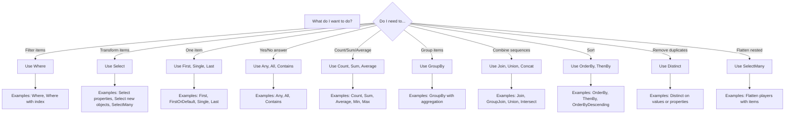

# C# LINQ – In Practice

This note combines concepts from [LINQ Basics](/content/notes/csharp-linq-basics.md), [Filtering & Projection](/content/notes/csharp-linq-filtering-and-projection.md), [Sorting, Grouping & Joining](/content/notes/csharp-linq-sorting-grouping-and-joining.md), [Aggregation & Quantifiers](/content/notes/csharp-linq-aggregation-and-quantifiers.md), and [Deferred Execution](/content/notes/csharp-linq-deferred-execution.md) into realistic examples. We'll explore LINQ with player data, strings, dictionaries, EF Core, and performance considerations.

## Worked example series: Player and Item classes

```csharp
public class Player
{
    public int Id { get; set; }
    public string Name { get; set; }
    public string Team { get; set; }
    public int Score { get; set; }
    public int Level { get; set; }
    public List<string> Items { get; set; } = new();
}

public class Item
{
    public string Name { get; set; }
    public int Rarity { get; set; }  // 1=common, 5=legendary
}

List<Player> players = new List<Player>
{
    new Player { Id = 1, Name = "Alice", Team = "Red", Score = 95, Level = 10, Items = new List<string> { "sword", "shield" } },
    new Player { Id = 2, Name = "Bob", Team = "Blue", Score = 50, Level = 3, Items = new List<string> { "bow" } },
    new Player { Id = 3, Name = "Charlie", Team = "Red", Score = 80, Level = 7, Items = new List<string> { "staff", "ring" } },
    new Player { Id = 4, Name = "Diana", Team = "Green", Score = 0, Level = 1, Items = new List<string>() }
};

List<Item> items = new List<Item>
{
    new Item { Name = "sword", Rarity = 3 },
    new Item { Name = "shield", Rarity = 2 },
    new Item { Name = "bow", Rarity = 2 },
    new Item { Name = "staff", Rarity = 4 },
    new Item { Name = "ring", Rarity = 5 }
};
```

## Task 1: Top 3 players by score

```csharp
var top3 = players
    .OrderByDescending(p => p.Score)
    .Take(3)
    .Select(p => $"{p.Name} ({p.Score})")
    .ToList();

foreach (var item in top3)
{
    Console.WriteLine(item);
}
// Output:
// Alice (95)
// Charlie (80)
// Bob (50)
```

## Task 2: Average score per team

```csharp
var avgPerTeam = players
    .GroupBy(p => p.Team)
    .Select(g => new 
    { 
        Team = g.Key, 
        AverageScore = g.Average(p => p.Score),
        Count = g.Count()
    })
    .OrderByDescending(x => x.AverageScore)
    .ToList();

foreach (var stat in avgPerTeam)
{
    Console.WriteLine($"{stat.Team}: avg {stat.AverageScore:F1} ({stat.Count} players)");
}
// Output:
// Red: avg 87.5 (2 players)
// Green: avg 0.0 (1 player)
// Blue: avg 50.0 (1 player)
```

## Task 3: Players who have never scored

```csharp
var noScore = players
    .Where(p => p.Score == 0)
    .Select(p => p.Name)
    .ToList();

Console.WriteLine($"Never scored: {string.Join(", ", noScore)}");
// Output:
// Never scored: Diana
```

## Task 4: All items of all players (flattened)

Using `SelectMany` to flatten:

```csharp
var allItems = players
    .SelectMany(p => p.Items)
    .Distinct()
    .ToList();

Console.WriteLine($"All items: {string.Join(", ", allItems)}");
// Output:
// All items: sword, shield, bow, staff, ring
```

## Task 5: Highest level in each team

```csharp
var maxLevelPerTeam = players
    .GroupBy(p => p.Team)
    .Select(g => new 
    { 
        Team = g.Key, 
        MaxLevel = g.Max(p => p.Level),
        TopPlayer = g.MaxBy(p => p.Level).Name
    })
    .ToList();

foreach (var item in maxLevelPerTeam)
{
    Console.WriteLine($"{item.Team}: level {item.MaxLevel} ({item.TopPlayer})");
}
// Output:
// Red: level 10 (Alice)
// Blue: level 3 (Bob)
// Green: level 1 (Diana)
```

## Task 6: Check if any player is below level 5

```csharp
bool anyBelowLevel5 = players.Any(p => p.Level < 5);
Console.WriteLine(anyBelowLevel5);  // true

// Or with specific players
var below = players.Where(p => p.Level < 5).Select(p => p.Name).ToList();
Console.WriteLine($"Below level 5: {string.Join(", ", below)}");
// Output:
// Below level 5: Bob, Diana
```

## Task 7: Leaderboard string (all players ranked)

```csharp
var leaderboard = players
    .OrderByDescending(p => p.Score)
    .Select((p, index) => $"{index + 1}. {p.Name} - Score: {p.Score}, Level: {p.Level}")
    .ToList();

foreach (var line in leaderboard)
{
    Console.WriteLine(line);
}
// Output:
// 1. Alice - Score: 95, Level: 10
// 2. Charlie - Score: 80, Level: 7
// 3. Bob - Score: 50, Level: 3
// 4. Diana - Score: 0, Level: 1
```

## Task 8: Paging (e.g., 2 items per page)

```csharp
var pageSize = 2;
var pageNumber = 1;  // Page 1

var page = players
    .OrderBy(p => p.Name)
    .Skip((pageNumber - 1) * pageSize)
    .Take(pageSize)
    .Select(p => p.Name)
    .ToList();

Console.WriteLine($"Page {pageNumber}: {string.Join(", ", page)}");
// Output:
// Page 1: Alice, Bob

pageNumber = 2;
var page2 = players
    .OrderBy(p => p.Name)
    .Skip((pageNumber - 1) * pageSize)
    .Take(pageSize)
    .Select(p => p.Name)
    .ToList();

Console.WriteLine($"Page {pageNumber}: {string.Join(", ", page2)}");
// Output:
// Page 2: Charlie, Diana
```

## LINQ with strings

Strings are `IEnumerable<char>`, so LINQ works on them:

### Count words in a string

```csharp
string text = "the quick brown fox jumps";
var wordCount = text.Split(' ').Length;
Console.WriteLine(wordCount);  // 5

// Or with LINQ
var wordCountLinq = text.Split(' ').Count();  // 5
```

### Group letters by character

```csharp
string text = "hello";
var byChar = text.GroupBy(c => c).ToList();

foreach (var group in byChar)
{
    Console.WriteLine($"{group.Key}: {group.Count()}");
}
// Output:
// h: 1
// e: 1
// l: 2
// o: 1
```

### Find the longest word

```csharp
string text = "the quick brown fox jumps";
var longest = text.Split(' ')
    .OrderByDescending(w => w.Length)
    .First();

Console.WriteLine(longest);  // "quick" or "brown" (both 5 chars)

// Or with MaxBy
var longestWord = text.Split(' ').MaxBy(w => w.Length);
Console.WriteLine(longestWord);  // "quick" or "brown"
```

## LINQ with dictionaries

Iterate `KeyValuePair`, filter, order by key or value:

```csharp
Dictionary<string, int> scores = new Dictionary<string, int>
{
    { "Alice", 95 },
    { "Bob", 50 },
    { "Charlie", 80 }
};

// All key-value pairs
foreach (var kvp in scores)
{
    Console.WriteLine($"{kvp.Key}: {kvp.Value}");
}

// Order by value descending
var byScore = scores
    .OrderByDescending(kvp => kvp.Value)
    .Select(kvp => $"{kvp.Key} ({kvp.Value})")
    .ToList();

foreach (var item in byScore)
{
    Console.WriteLine(item);
}
// Output:
// Alice (95)
// Charlie (80)
// Bob (50)

// Filter and project
var high = scores
    .Where(kvp => kvp.Value > 60)
    .ToDictionary(kvp => kvp.Key, kvp => kvp.Value);

Console.WriteLine(high.Count);  // 2
```

## LINQ with EF Core

LINQ with EF Core queries the database:

```csharp
using Microsoft.EntityFrameworkCore;

public class GameContext : DbContext
{
    public DbSet<Player> Players { get; set; }
    public DbSet<Item> Items { get; set; }
}

var context = new GameContext();

// LINQ query on DbSet becomes SQL
var top3 = context.Players
    .Where(p => p.Score > 50)
    .OrderByDescending(p => p.Score)
    .Take(3)
    .ToList();  // ToList() executes the SQL query

// Use navigation properties (cleaner than Join)
var playerItems = context.Players
    .Include(p => p.Items)
    .Where(p => p.Score > 60)
    .ToList();
```

**Key EF Core concept**: 

- **IQueryable<T>** (DbSet returns this): Lazy; builds an SQL query.
- **IEnumerable<T>**: Lazy in memory; executed when enumerated.
- Calling **`.ToList()`** switches from IQueryable to IEnumerable and executes the SQL.
- **Calling `.ToList()` too early** loads everything into memory (wasteful on large datasets).

```csharp
// ✓ Efficient: SQL does the filtering and sorting
var top = context.Players
    .Where(p => p.Score > 50)
    .OrderByDescending(p => p.Score)
    .Take(3)
    .ToList();  // Only 3 rows fetched from database

// ❌ Wasteful: loads all players into memory, then filters
var top = context.Players
    .ToList()  // Loads all players!
    .Where(p => p.Score > 50)
    .OrderByDescending(p => p.Score)
    .Take(3)
    .ToList();
```

## Performance tips

### 1. Use `Any()` instead of `Count() > 0`

```csharp
// ✓ Fast: stops at first item
if (players.Any(p => p.Score > 90)) { ... }

// ❌ Slow: counts all items
if (players.Count(p => p.Score > 90) > 0) { ... }
```

### 2. Filter early, before expensive operations

```csharp
// ✓ Efficient: filter 10 items, sort 10 items
var result = players
    .Where(p => p.Score > 50)
    .OrderBy(p => p.Name)
    .ToList();

// ❌ Less efficient: sort all 1000, filter to 10
var result = players
    .OrderBy(p => p.Name)
    .Where(p => p.Score > 50)
    .ToList();
```

### 3. Materialize before repeated use

```csharp
// ✓ Query runs once
var active = players.Where(p => p.Score > 0).ToList();
var count = active.Count;
var sum = active.Sum(p => p.Score);

// ❌ Query runs three times (wasteful)
var active = players.Where(p => p.Score > 0);
var count = active.Count();
var sum = active.Sum(p => p.Score);
```

### 4. Use `.First()` or `.Take()` to avoid loading all data

```csharp
// ✓ Fast: gets first match (or first N)
var first = players.Where(p => p.Score > 90).First();
var top3 = players.OrderByDescending(p => p.Score).Take(3).ToList();

// ❌ Slow: loads all, then picks first
var first = players.Where(p => p.Score > 90).ToList().First();
```

## When NOT to use LINQ

Use a `foreach` loop when:

1. **Complex logic with side effects** – LINQ is for queries, not imperative logic.

```csharp
// ❌ Bad: complex side effects in LINQ
players
    .Where(p => p.Score > 50)
    .ForEach(p => 
    {
        p.Level++;
        database.Save(p);  // Side effect in lambda
        logFile.Write($"Updated {p.Name}");
    });

// ✓ Better: explicit foreach loop
foreach (var p in players.Where(p => p.Score > 50))
{
    p.Level++;
    database.Save(p);
    logFile.Write($"Updated {p.Name}");
}
```

2. **Readability suffers** – A simple loop is clearer.

```csharp
// ❌ Overly complex LINQ
var result = players
    .SelectMany(p => p.Items, (player, item) => new { player, item })
    .GroupBy(x => x.item)
    .Select(g => new { Item = g.Key, Players = g.Select(x => x.player) })
    .ToList();

// ✓ Clearer: explicit nested loops
var result = new Dictionary<string, List<Player>>();
foreach (var player in players)
{
    foreach (var item in player.Items)
    {
        if (!result.ContainsKey(item))
            result[item] = new List<Player>();
        result[item].Add(player);
    }
}
```

## Which LINQ method do I need?



## Common mistakes

- **Calling expensive operations after `.ToList()`** – Materialize only when needed.

```csharp
// ❌ Loads all into memory, then sorts
var sorted = players.ToList().OrderBy(p => p.Score).ToList();

// ✓ Sort first, then materialize
var sorted = players.OrderBy(p => p.Score).ToList();
```

- **Enumerating a deferred query multiple times** – See [LINQ Deferred Execution](/content/notes/csharp-linq-deferred-execution.md).

```csharp
// ❌ Query runs multiple times
var odds = numbers.Where(x => x % 2 == 1);
var count = odds.Count();
var sum = odds.Sum();

// ✓ Materialize once
var odds = numbers.Where(x => x % 2 == 1).ToList();
var count = odds.Count;
var sum = odds.Sum();
```

- **Modifying source while iterating** – Throws exception. See [LINQ Deferred Execution](/content/notes/csharp-linq-deferred-execution.md).

## Quick recap

- **Real-world tasks**: Top N, grouping with aggregation, filtering, flattening with SelectMany, paging.
- **Strings**: Split, group by character, find longest word.
- **Dictionaries**: Order by key/value, filter, project.
- **EF Core**: LINQ on `DbSet<T>` becomes SQL; call `.ToList()` to execute; filter before `.ToList()` for efficiency.
- **Performance**: `Any()` over `Count() > 0`; filter early; materialize once if reusing.
- **Readability**: Use foreach for complex logic; use LINQ for data queries.
- **Deferred execution**: Most LINQ methods are lazy; use `.ToList()` to materialize when needed.
- **Common error**: Calling `.ToList()` too early (loads all data) or enumerating lazy queries multiple times.
