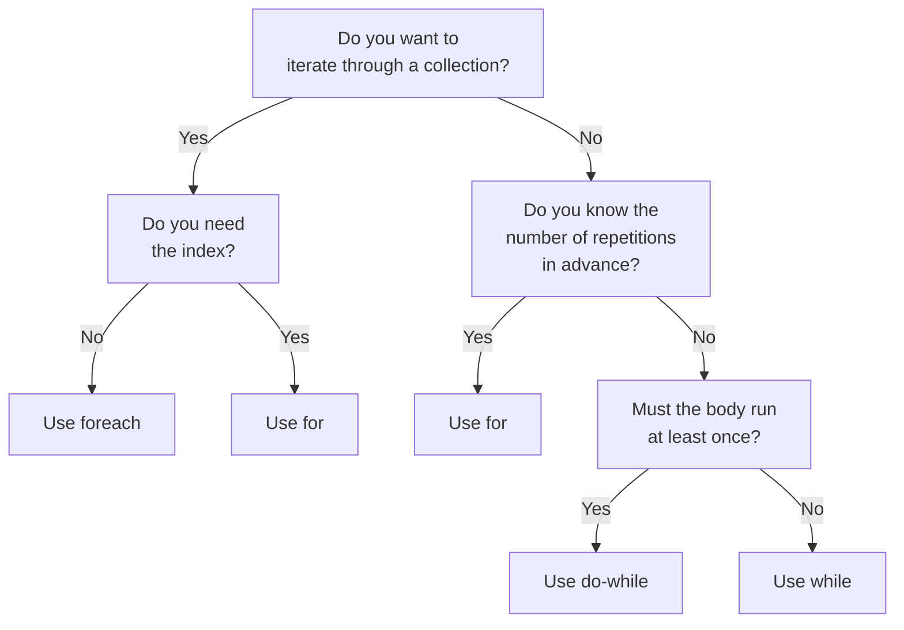

# C# Loops Overview

A **loop** repeats a block of code multiple times. Loops are essential for processing collections, counting, and waiting for conditions. C# provides four types of loops: `while`, `do-while`, `for`, and `foreach`. Each is best suited to different situations.

## When and why we use loops

Loops solve three common problems:

1. **Repeat code** – Run the same code multiple times without rewriting it.

```csharp
// Without a loop (tedious):
Console.WriteLine("*");
Console.WriteLine("*");
Console.WriteLine("*");
Console.WriteLine("*");

// With a loop (concise):
for (int i = 0; i < 4; i++)
{
    Console.WriteLine("*");
}
// Output:
// *
// *
// *
// *
```

2. **Process every item in a collection** – Examine or modify each element of an array or list.

```csharp
int[] scores = [85, 90, 78, 92];

foreach (int score in scores)
{
    Console.WriteLine($"Score: {score}");
}
// Output:
// Score: 85
// Score: 90
// Score: 78
// Score: 92
```

3. **Repeat until a condition changes** – Keep going while something is true, then stop.

```csharp
int health = 100;
while (health > 0)
{
    health -= 10;
    Console.WriteLine($"Health: {health}");
}
// Output:
// Health: 90
// Health: 80
// Health: 70
// Health: 60
// Health: 50
// Health: 40
// Health: 30
// Health: 20
// Health: 10
// Health: 0
```

## Loop types at a glance

| Loop | Checks condition | Runs at least once | Typical use |
|------|------------------|--------------------|------------|
| `while` | Before each run | No | Unknown repetitions, condition-based |
| `do-while` | After each run | **Yes** | Input validation, menus |
| `for` | Before each run | No | Fixed repetitions, known count, index needed |
| `foreach` | (automatic) | No | Iterate every item in a collection |

## Small examples of each loop type

### while loop

Checks the condition **before** each run:

```csharp
int count = 0;
while (count < 3)
{
    Console.WriteLine($"Count: {count}");
    count++;
}
// Output:
// Count: 0
// Count: 1
// Count: 2
```

### do-while loop

Runs the body **at least once**, then checks the condition:

```csharp
int count = 0;
do
{
    Console.WriteLine($"Count: {count}");
    count++;
} while (count < 3);
// Output:
// Count: 0
// Count: 1
// Count: 2
```

### for loop

Initializes, checks condition, and increments in one line:

```csharp
for (int i = 0; i < 3; i++)
{
    Console.WriteLine($"i: {i}");
}
// Output:
// i: 0
// i: 1
// i: i: 2
```

### foreach loop

Automatically iterates every item in a collection:

```csharp
string[] fruits = ["apple", "banana", "cherry"];
foreach (string fruit in fruits)
{
    Console.WriteLine(fruit);
}
// Output:
// apple
// banana
// cherry
```

## Which loop to use: decision guide

Choose the right loop for your situation:

- **foreach**: Go through every item of an array or list, and you don't need the index.
- **for**: You need the index, want a fixed number of repetitions, need to go backwards, or skip by steps.
- **while**: Repeat until a condition changes, and you don't know how many times in advance (user input, game loop, reading data).
- **do-while**: The body must run at least once, such as input validation or displaying a menu.



## Common mistakes

- **Forgetting to update the loop variable** – A `while` loop that never changes the condition variable creates an infinite loop.

```csharp
int x = 0;
while (x < 3)
{
    Console.WriteLine(x);
    // ❌ Infinite loop: x never changes!
}

// ✓ Fix: increment x
while (x < 3)
{
    Console.WriteLine(x);
    x++;
}
```

- **Using `=` (assignment) instead of `==` (comparison)** – This is a common typo that won't compile or will behave unexpectedly.

```csharp
// ❌ Syntax error or logic error
while (x = 3)  // This assigns 3 to x, doesn't check if x equals 3

// ✓ Use == to compare
while (x == 3)
```

- **Choosing the wrong loop type** – Using `foreach` when you need an index, or using `while` for simple iterations when `for` is clearer.

## Quick recap

- Loops repeat code blocks multiple times—essential for processing collections and conditions.
- **while** checks the condition before each run; **do-while** runs at least once.
- **for** is best for fixed iterations or when you need an index; **foreach** is for iterating all items.
- Choose based on what you need: index?, known count?, must run once?
- Always update loop variables to avoid infinite loops.
- Use `for` or `foreach` for collections; use `while` for unknown iterations.
