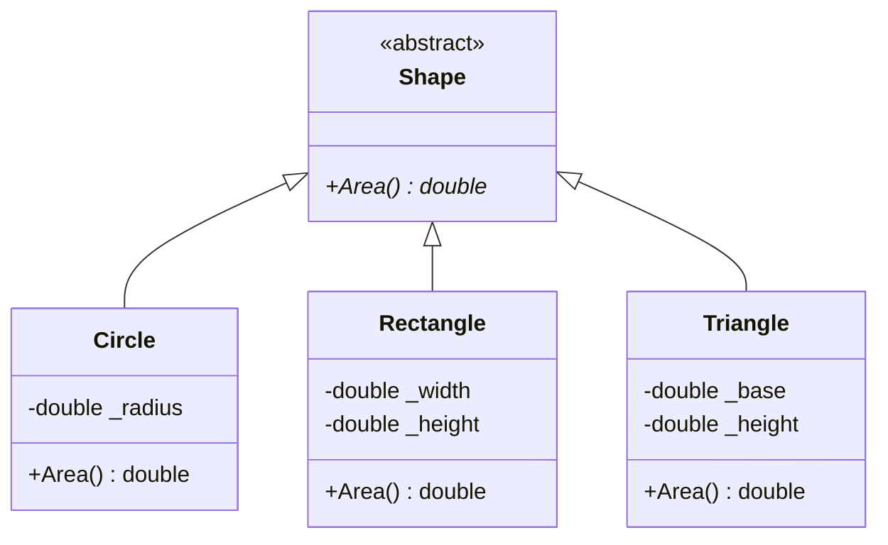

# Polymorphism Explained in C#

**Polymorphism** means "many forms." In programming, it's the ability for one name or one type to have many behaviors. Instead of writing a different function for each type, you write one function that works with a base type or interface, and the actual behavior depends on what concrete type you're really dealing with. It's the foundation of flexible, reusable code.

## What is polymorphism?

**In plain English:** One name, many behaviors.

**Analogy:** A "Play" button on your phone. Press it, and you get different behavior depending on what's open: it plays music, plays a video, or starts a game. The interface (the button) is the same; the action changes based on context.

**In C#:** You can write code like:
```csharp
List<Shape> shapes = new() { new Circle(5), new Rectangle(3, 4), new Triangle(5, 4) };
foreach (var shape in shapes)
{
    Console.WriteLine(shape.Area());  // Different Area() behavior for each type
}
// Output:
// 78.53981633974483 (Circle)
// 12 (Rectangle)
// 10 (Triangle)
```

One loop, three different implementations of `Area()`.

## Why polymorphism matters

Without polymorphism, you'd write:
```csharp
// ❌ Lots of if/else or switch statements
foreach (var shape in shapes)
{
    if (shape is Circle c)
        Console.WriteLine(Math.PI * c.Radius * c.Radius);
    else if (shape is Rectangle r)
        Console.WriteLine(r.Width * r.Height);
    else if (shape is Triangle t)
        Console.WriteLine(t.Base * t.Height / 2);
}
```

With polymorphism:
```csharp
// ✓ Clean, extensible
foreach (var shape in shapes)
    Console.WriteLine(shape.Area());
```

**Benefits:**
- **Less if/else clutter** – The type system handles dispatch, not your code.
- **Easy to extend** – Add a new shape (Pentagon, Circle, etc.) without changing existing code that works with `Shape`.
- **Loose coupling** – Code depends on a base type or interface, not concrete classes.
- **Cleaner testing** – Use mock implementations to test behavior in isolation.

## The main kinds of polymorphism in C#

| Kind | How | Decided When | Example |
|------|-----|--------------|---------|
| **Subtype (Runtime)** | Inheritance + `virtual`/`override` | Runtime (actual object type) | `Shape s = new Circle(); s.Area();` → calls `Circle.Area()` |
| **Interface** | Implement interface contract | Runtime (actual object type) | `ILogger log = new ConsoleLogger(); log.Log(...);` |
| **Method Overloading** | Same method name, different parameters | Compile time (parameter types) | `Add(int, int)` vs `Add(double, double)` |
| **Operator Overloading** | Redefine operators for custom types | Compile time (operator definition) | `Vector2 a + Vector2 b` |
| **Generics (Parametric)** | Type variable, works for any type | Compile time (type parameter) | `List<T>`, `Max<T>(T a, T b)` |

For detailed coverage of each, see:
- [Runtime Polymorphism: How It Works](/content/notes/csharp-runtime-polymorphism-how-it-works.md)
- [Compile-Time Polymorphism](/content/notes/csharp-compile-time-polymorphism.md)

## First complete example: shapes and areas

```csharp
// Base class with virtual method
public abstract class Shape
{
    public abstract double Area();
}

// Three implementations
public class Circle : Shape
{
    private double _radius;

    public Circle(double radius)
    {
        _radius = radius;
    }

    public override double Area() => Math.PI * _radius * _radius;
}

public class Rectangle : Shape
{
    private double _width, _height;

    public Rectangle(double width, double height)
    {
        _width = width;
        _height = height;
    }

    public override double Area() => _width * _height;
}

public class Triangle : Shape
{
    private double _base, _height;

    public Triangle(double baseLength, double height)
    {
        _base = baseLength;
        _height = height;
    }

    public override double Area() => _base * _height / 2;
}

// Use polymorphism
List<Shape> shapes = new()
{
    new Circle(5),
    new Rectangle(3, 4),
    new Triangle(5, 4)
};

foreach (var shape in shapes)
{
    Console.WriteLine($"Area: {shape.Area():F2}");
}

// Output:
// Area: 78.54
// Area: 12.00
// Area: 10.00
```

The loop doesn't know (or care) which concrete type each shape is. It calls the right `Area()` method automatically.

## Class diagram: shape hierarchy



## Common mistakes

- **Assuming polymorphism without `virtual`** – If a base method isn't `virtual`, the override doesn't apply; the base method runs instead. See [Virtual/Override/New Syntax](/content/notes/csharp-virtual-override-new.md).
- **Mixing variable type and object type** – `Shape s = new Circle();` – `s` is type `Shape`, but the actual object is `Circle`. Polymorphism uses the actual object type to pick the method. See [Runtime Polymorphism: How It Works](/content/notes/csharp-runtime-polymorphism-how-it-works.md).
- **Building deep class hierarchies to avoid if/else** – Use polymorphism for genuine "is-a" relationships, not as a workaround. See [When NOT to Use Polymorphism](/content/notes/csharp-polymorphism-in-practice.md).

## Quick recap

- Polymorphism is "many forms": one name, many behaviors depending on the actual type.
- Avoids if/else clutter; makes code extensible and testable.
- **Runtime polymorphism** (inheritance, interfaces) uses virtual/override.
- **Compile-time polymorphism** (overloading, operator overloading, generics) is resolved by the compiler.
- One loop or method can handle different types seamlessly.
- Link to related topics for details on each kind.
