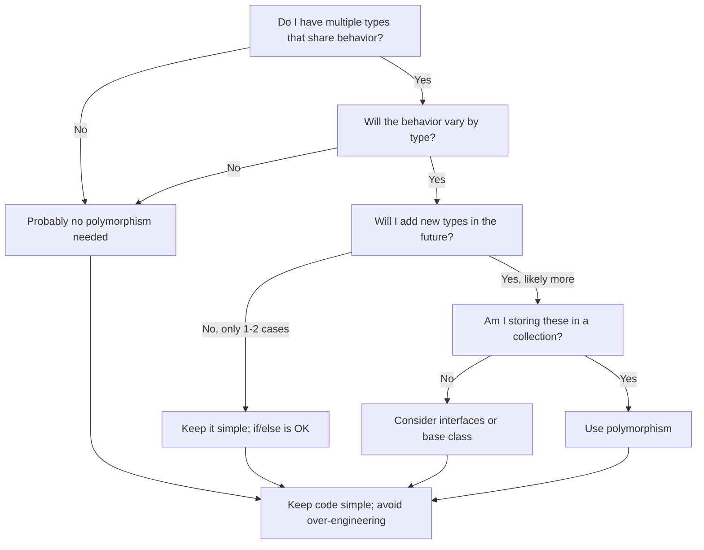

# Polymorphism in Practice in C#

Polymorphism shines in real code. This note shows practical examples where it simplifies design, enables flexibility, and makes code easier to test and extend.

## Example 1: Game enemies with polymorphic attack

Different enemy types, same interface:

```csharp
public abstract class Enemy
{
    public string Name { get; set; }
    public int Health { get; set; }

    public Enemy(string name, int health)
    {
        Name = name;
        Health = health;
    }

    // Polymorphic: each enemy type attacks differently
    public abstract void Attack(Player player);

    public virtual void TakeDamage(int damage)
    {
        Health -= damage;
        Console.WriteLine($"{Name} took {damage} damage (Health: {Health})");
    }
}

public class Goblin : Enemy
{
    public Goblin() : base("Goblin", 20) { }

    public override void Attack(Player player)
    {
        Console.WriteLine($"{Name} swings a club at {player.Name}!");
        player.TakeDamage(5);
    }
}

public class Dragon : Enemy
{
    public Dragon() : base("Dragon", 100) { }

    public override void Attack(Player player)
    {
        Console.WriteLine($"{Name} breathes fire at {player.Name}!");
        player.TakeDamage(25);
    }
}

public class Archer : Enemy
{
    public Archer() : base("Archer", 30) { }

    public override void Attack(Player player)
    {
        Console.WriteLine($"{Name} shoots an arrow at {player.Name}!");
        player.TakeDamage(10);
    }
}

public class Player
{
    public string Name { get; set; }
    public int Health { get; set; } = 100;

    public Player(string name) => Name = name;

    public void TakeDamage(int damage)
    {
        Health -= damage;
        Console.WriteLine($"  → {Name} now has {Health} health");
    }
}

// Game loop: works with any Enemy type
List<Enemy> enemies = new()
{
    new Goblin(),
    new Dragon(),
    new Archer(),
    new Goblin()
};

Player player = new("Hero");

foreach (var enemy in enemies)
{
    if (enemy.Health > 0)
        enemy.Attack(player);
}

// Output:
// Goblin swings a club at Hero!
//   → Hero now has 95 health
// Dragon breathes fire at Hero!
//   → Hero now has 70 health
// Archer shoots an arrow at Hero!
//   → Hero now has 60 health
// Goblin swings a club at Hero!
//   → Hero now has 55 health
```

The game loop doesn't know (or care) about `Goblin`, `Dragon`, or `Archer` specifically. It just knows `Enemy`. Add a new enemy type, and the loop works unchanged.

## Example 2: Payment processing with interfaces

Different payment methods, one checkout:

```csharp
public interface IPaymentMethod
{
    void Charge(decimal amount);
    string GetDescription();
}

public class CreditCard : IPaymentMethod
{
    private string _cardNumber;

    public CreditCard(string cardNumber) => _cardNumber = cardNumber;

    public void Charge(decimal amount)
    {
        Console.WriteLine($"Charging ${amount} to credit card {_cardNumber}");
    }

    public string GetDescription() => $"Credit Card (****{_cardNumber[^4..]})";
}

public class PayPal : IPaymentMethod
{
    private string _email;

    public PayPal(string email) => _email = email;

    public void Charge(decimal amount)
    {
        Console.WriteLine($"Charging ${amount} via PayPal to {_email}");
    }

    public string GetDescription() => $"PayPal ({_email})";
}

public class Invoice : IPaymentMethod
{
    private string _companyName;

    public Invoice(string companyName) => _companyName = companyName;

    public void Charge(decimal amount)
    {
        Console.WriteLine($"Sending invoice for ${amount} to {_companyName}");
    }

    public string GetDescription() => $"Invoice ({_companyName})";
}

public class Checkout
{
    public void ProcessPayment(IPaymentMethod method, decimal amount)
    {
        Console.WriteLine($"Processing payment via {method.GetDescription()}");
        method.Charge(amount);
        Console.WriteLine("Payment successful!");
    }
}

// Usage
Checkout checkout = new();

// Different payment methods, same checkout
checkout.ProcessPayment(new CreditCard("1234567890123456"), 99.99m);
checkout.ProcessPayment(new PayPal("customer@example.com"), 50.00m);
checkout.ProcessPayment(new Invoice("ACME Corp"), 1000.00m);

// Output:
// Processing payment via Credit Card (****3456)
// Charging $99.99 to credit card 1234567890123456
// Payment successful!
// Processing payment via PayPal (customer@example.com)
// Charging $50 via PayPal to customer@example.com
// Payment successful!
// Processing payment via Invoice (ACME Corp)
// Sending invoice for $1000 to ACME Corp
// Payment successful!
```

Add a new payment method (Apple Pay, Google Pay, etc.)? Just implement `IPaymentMethod`. Checkout doesn't change.

## Example 3: Replacing switch/if-else with polymorphism

**Before (imperative, brittle):**

```csharp
public class ReportGenerator
{
    public void GenerateReport(string format, string data)
    {
        if (format == "PDF")
        {
            Console.WriteLine("Generating PDF report...");
            Console.WriteLine($"PDF Content: {data}");
        }
        else if (format == "Excel")
        {
            Console.WriteLine("Generating Excel report...");
            Console.WriteLine($"Excel Content: {data}");
        }
        else if (format == "HTML")
        {
            Console.WriteLine("Generating HTML report...");
            Console.WriteLine($"<html><body>{data}</body></html>");
        }
        else
        {
            throw new ArgumentException($"Unknown format: {format}");
        }
    }
}
```

Adding a new format requires changing this method (violation of Open/Closed Principle).

**After (polymorphic, extensible):**

```csharp
public interface IReportFormat
{
    void Generate(string data);
}

public class PdfReport : IReportFormat
{
    public void Generate(string data)
    {
        Console.WriteLine("Generating PDF report...");
        Console.WriteLine($"PDF Content: {data}");
    }
}

public class ExcelReport : IReportFormat
{
    public void Generate(string data)
    {
        Console.WriteLine("Generating Excel report...");
        Console.WriteLine($"Excel Content: {data}");
    }
}

public class HtmlReport : IReportFormat
{
    public void Generate(string data)
    {
        Console.WriteLine("Generating HTML report...");
        Console.WriteLine($"<html><body>{data}</body></html>");
    }
}

public class ReportGenerator
{
    public void GenerateReport(IReportFormat format, string data)
    {
        format.Generate(data);  // ✓ No if/else; delegates to the right type
    }
}

// Usage
ReportGenerator generator = new();
generator.GenerateReport(new PdfReport(), "Sales Data");
generator.GenerateReport(new HtmlReport(), "Chart Data");

// Add a new format (e.g., JsonReport) without touching ReportGenerator
```

## The Strategy pattern in one sentence

**Strategy:** A family of algorithms, each in its own class. At runtime, pick which one to use. Polymorphism does the selection.

```csharp
// Different sorting strategies
public interface ISortStrategy
{
    void Sort(int[] array);
}

public class BubbleSort : ISortStrategy
{
    public void Sort(int[] array) => Console.WriteLine("Bubble sorting...");
}

public class QuickSort : ISortStrategy
{
    public void Sort(int[] array) => Console.WriteLine("Quick sorting...");
}

public class Sorter
{
    private ISortStrategy _strategy;

    public Sorter(ISortStrategy strategy) => _strategy = strategy;

    public void Execute(int[] array) => _strategy.Sort(array);  // Uses the chosen strategy
}

// Pick strategy at runtime
Sorter sorter = new(new QuickSort());
sorter.Execute(new[] { 5, 2, 8, 1 });  // Output: Quick sorting...

// Swap strategy without changing Sorter
sorter = new(new BubbleSort());
sorter.Execute(new[] { 5, 2, 8, 1 });  // Output: Bubble sorting...
```

## ToString() override and Console.WriteLine

Every object inherits `ToString()` from `object`. Polymorphism lets each class define its own string representation:

```csharp
public class Person
{
    public string Name { get; set; }
    public int Age { get; set; }

    public Person(string name, int age)
    {
        Name = name;
        Age = age;
    }

    // Override ToString
    public override string ToString() => $"{Name} ({Age} years old)";
}

public class Dog
{
    public string Name { get; set; }
    public string Breed { get; set; }

    public Dog(string name, string breed)
    {
        Name = name;
        Breed = breed;
    }

    public override string ToString() => $"{Name} the {Breed}";
}

// Console.WriteLine uses ToString() polymorphically
Person p = new("Alice", 30);
Dog d = new("Rex", "Labrador");

Console.WriteLine(p);  // Calls Person.ToString() → "Alice (30 years old)"
Console.WriteLine(d);  // Calls Dog.ToString() → "Rex the Labrador"

// Works in collections too
List<object> things = new() { p, d, "plain string" };
foreach (var thing in things)
    Console.WriteLine(thing);  // ✓ Each ToString() runs correctly
```

## Polymorphism in .NET itself

You use polymorphism constantly, even if you don't think about it:

- **ILogger** – Different logging implementations (Console, File, Event Log, etc.).
- **Stream** – Base class for FileStream, NetworkStream, MemoryStream, etc. All use the same `Read()`, `Write()` interface.
- **IEnumerable<T>** – Any collection (List, Array, LinkedList, Dictionary) can be iterated with `foreach`.
- **DbContext.OnModelCreating** – Fluent API lets different database providers configure models polymorphically.

## When NOT to use polymorphism

- **Too many specialized types** – If you have one or two cases, an `if/else` is clearer. Polymorphism adds indirection.
  ```csharp
  // ✓ Fine
  if (order.Status == "pending") ApproveOrder();
  else CancelOrder();

  // ✗ Overkill (unless Status has many values)
  _statusHandlers[order.Status].Handle(order);
  ```

- **Shallow hierarchies** – A deep class tree (Base → Derived1 → Derived2 → Derived3...) gets confusing. Use interfaces instead.

- **No real "is-a" or "can-do" relationship** – Polymorphism should model real behavior. Don't create fake hierarchies to avoid an if/else.

## Decision flowchart: Do I need polymorphism here?



## Common mistakes

- **Building inheritance hierarchies to avoid if/else** – Use polymorphism for genuine "is-a" or "can-do" relationships, not as a workaround for conditional logic.

- **Polymorphism without clear interface** – If you're not sure what behavior is shared, an interface or base class gets messy. Step back and clarify the design first.

- **Overly deep hierarchies** – More than 3-4 levels of inheritance gets hard to follow. Prefer composition or interfaces.

## Quick recap

- Use polymorphism to let different types share a common behavior.
- Avoids if/else clutter; makes adding new types easy.
- Polymorphism enables Strategy, Decorator, Factory, and many other patterns.
- Every type should define a meaningful `ToString()`.
- .NET is full of polymorphic interfaces (ILogger, Stream, IEnumerable, etc.).
- Use it for genuine type hierarchies; keep simple cases simple.
- For detailed syntax and rules, see [Virtual/Override/New Syntax](/content/notes/csharp-virtual-override-new.md), [Interfaces Basics](/content/notes/csharp-interfaces-basics.md), and [Programming to an Interface](/content/notes/csharp-programming-to-an-interface.md).
