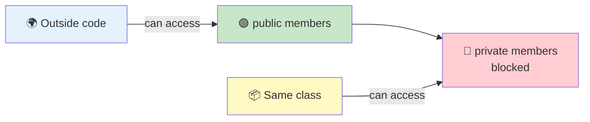

# Private vs Public in C#

**Private** means only code inside the class can access a member. **Public** means any code can access it. The difference is simple but critical: private protects your code's internal state, while public defines what you promise to other developers.

## A concrete example: BankAccount

```csharp
public class BankAccount
{
    // Private field: internal only
    private decimal _balance = 0;

    // Public method: anyone can call it
    public void Deposit(decimal amount)
    {
        if (amount <= 0)
            throw new ArgumentException("Amount must be positive");
        _balance += amount;
    }

    // Public property: read-only access from outside
    public decimal Balance => _balance;
}

// Usage:
var account = new BankAccount();
account.Deposit(100);
Console.WriteLine(account.Balance);  // 100
// account._balance = -50;  // ❌ Compiler error: _balance is private
```

The `_balance` field is `private` so only the `Deposit` method can modify it. This prevents someone from setting an invalid balance:

```csharp
// Without private:
public class BadAccount
{
    public decimal Balance = 0;  // Public field
}

var bad = new BadAccount();
bad.Balance = -9999;  // ❌ Allowed! Invalid state.
```

## Rule of thumb

**Start everything as private. Make things public only when other code actually needs them.**

This gives you freedom to change the implementation later without breaking code that uses your class.

## Public API vs internal implementation

Think of your class as a contract:

- **Public members** form the *public API* — the interface you promise to maintain.
- **Private members** are the *internal implementation* — you can refactor these without fear.

```csharp
public class UserService
{
    // Private: implementation detail, can refactor anytime
    private User[] GetAllUsersFromDatabase()
    {
        // ...
    }

    // Public: this is your API contract
    public User GetUserById(int id)
    {
        var users = GetAllUsersFromDatabase();
        return users.FirstOrDefault(u => u.Id == id);
    }
}
```

If you expose `GetAllUsersFromDatabase` as public, other code depends on it. Now you can't change it without breaking their code.

## Why exposing public fields causes problems

```csharp
public class BadDesign
{
    // Public field: dangerous
    public int Age;
}

var person = new BadDesign();
person.Age = -5;  // Allowed! Invalid age.
person.Age = 150;  // Allowed! Unrealistic.
```

Later, you want to add validation:

```csharp
public class BetterDesign
{
    private int _age;

    public int Age
    {
        get => _age;
        set
        {
            if (value < 0 || value > 150)
                throw new ArgumentException("Invalid age");
            _age = value;
        }
    }
}
```

But now you've broken every line of code that set the field directly. With properties from the start, you never had this problem.

## When to use protected and internal

- **`protected`** – Use when derived classes need to access or override a member. Protect shared logic that subclasses reuse.
- **`internal`** – Use when helper classes in the same project need access, but other assemblies shouldn't.

```csharp
public class Base
{
    // Derived classes can call this, but it's not part of the public API
    protected void LogInternally(string msg)
    {
        Console.WriteLine(msg);
    }
}

public class Derived : Base
{
    public void DoSomething()
    {
        LogInternally("Working...");  // ✓ Allowed
    }
}
```

## Visualizing the boundary



## Common mistakes

- **Exposing fields directly** – Always use properties instead, even for simple get/set.
- **Making things public "just in case"** – Add `public` only when needed. You can always add it later.
- **Not using property validation** – Properties let you guard against invalid state:
  ```csharp
  public string Email
  {
      get => _email;
      set => _email = value ?? throw new ArgumentNullException(nameof(Email));
  }
  ```

## Quick recap

- `private` = only this class; `public` = anyone
- Start private, make public only when needed
- Use properties, not public fields
- Public members = your contract; private members = implementation
- Private members give you freedom to refactor later
