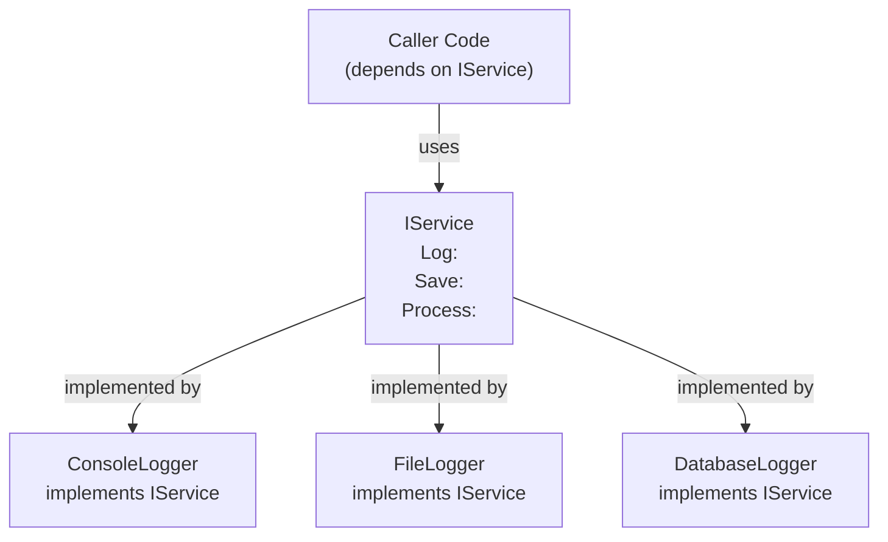

# Programming to an Interface in C#

The core principle of using interfaces is: **write your code against the interface, not the concrete class**. This decouples your code from specific implementations, makes it more flexible, and enables easy testing through substitution (mocks).

## The key idea

Instead of:
```csharp
var logger = new FileLogger();  // ❌ Depends on concrete class
logger.Log("Error occurred");
```

Do this:
```csharp
ILogger logger = new FileLogger();  // ✓ Depends on interface
logger.Log("Error occurred");
```

Now if you need to switch to a different logger, only the instantiation line changes, not your business logic.

## Polymorphism through interfaces

You can store multiple types in a list (or array) of an interface type, then work with them all the same way:

```csharp
public interface IDamageable
{
    void TakeDamage(int amount);
    int Health { get; }
}

public class Player : IDamageable
{
    private int _health = 100;
    public int Health => _health;

    public void TakeDamage(int amount)
    {
        _health -= amount;
        Console.WriteLine($"Player took {amount} damage. Health: {_health}");
    }
}

public class Enemy : IDamageable
{
    private int _health = 50;
    public int Health => _health;

    public void TakeDamage(int amount)
    {
        _health -= amount;
        Console.WriteLine($"Enemy took {amount} damage. Health: {_health}");
    }
}

public class Crate : IDamageable
{
    private int _health = 20;
    public int Health => _health;

    public void TakeDamage(int amount)
    {
        _health -= amount;
        if (_health <= 0)
            Console.WriteLine("Crate is destroyed");
        else
            Console.WriteLine($"Crate took {amount} damage. Health: {_health}");
    }
}

// Store different types in one collection
List<IDamageable> targets = new()
{
    new Player(),
    new Enemy(),
    new Crate(),
    new Player()
};

// Loop through all and damage them, regardless of type
foreach (var target in targets)
{
    target.TakeDamage(10);
}
// Output:
// Player took 10 damage. Health: 90
// Enemy took 10 damage. Health: 40
// Crate took 10 damage. Health: 10
// Player took 10 damage. Health: 90
```

## Interfaces as method parameters

Design methods to accept interface types, not concrete classes:

```csharp
public interface IStorage
{
    void Save(string key, string value);
    string Load(string key);
}

public class FileStorage : IStorage
{
    public void Save(string key, string value)
    {
        System.IO.File.WriteAllText(key, value);
    }

    public string Load(string key)
    {
        return System.IO.File.ReadAllText(key);
    }
}

public class MemoryStorage : IStorage
{
    private Dictionary<string, string> _data = new();

    public void Save(string key, string value)
    {
        _data[key] = value;
    }

    public string Load(string key)
    {
        return _data.TryGetValue(key, out var value) ? value : null;
    }
}

public class UserService
{
    private IStorage _storage;

    // Accept the interface, not a concrete class
    public UserService(IStorage storage)
    {
        _storage = storage;
    }

    public void SaveUser(string userId, string userData)
    {
        _storage.Save($"user_{userId}", userData);
    }

    public string GetUser(string userId)
    {
        return _storage.Load($"user_{userId}");
    }
}

// Usage: swap storage implementations without changing UserService
var userService1 = new UserService(new FileStorage());
userService1.SaveUser("123", "Alice");

var userService2 = new UserService(new MemoryStorage());
userService2.SaveUser("456", "Bob");
```

## Practical example: logging with different implementations

```csharp
public interface ILogger
{
    void Log(string message);
}

public class ConsoleLogger : ILogger
{
    public void Log(string message)
    {
        Console.WriteLine($"[Console] {DateTime.Now:yyyy-MM-dd HH:mm:ss} - {message}");
    }
}

public class FileLogger : ILogger
{
    private string _filePath;

    public FileLogger(string filePath)
    {
        _filePath = filePath;
    }

    public void Log(string message)
    {
        string logEntry = $"[File] {DateTime.Now:yyyy-MM-dd HH:mm:ss} - {message}";
        System.IO.File.AppendAllText(_filePath, logEntry + Environment.NewLine);
    }
}

public class Application
{
    private ILogger _logger;

    public Application(ILogger logger)
    {
        _logger = logger;
    }

    public void Run()
    {
        _logger.Log("Application started");
        _logger.Log("Processing data");
        _logger.Log("Application finished");
    }
}

// Usage 1: Log to console
var appConsole = new Application(new ConsoleLogger());
appConsole.Run();
// Output:
// [Console] 2026-11-17 09:30:45 - Application started
// [Console] 2026-11-17 09:30:45 - Processing data
// [Console] 2026-11-17 09:30:45 - Application finished

// Usage 2: Log to file (same code, different implementation)
var appFile = new Application(new FileLogger("app.log"));
appFile.Run();
// (output written to app.log)
```

## Testing with interfaces

Interfaces make testing easy because you can create mock implementations:

```csharp
public interface IPaymentProcessor
{
    bool ProcessPayment(decimal amount);
}

public class OrderService
{
    private IPaymentProcessor _paymentProcessor;

    public OrderService(IPaymentProcessor paymentProcessor)
    {
        _paymentProcessor = paymentProcessor;
    }

    public bool PlaceOrder(decimal amount)
    {
        return _paymentProcessor.ProcessPayment(amount);
    }
}

// Mock for testing (always succeeds)
public class MockPaymentProcessor : IPaymentProcessor
{
    public bool ProcessPayment(decimal amount) => true;
}

// Test without hitting real payment systems
[Test]
public void PlaceOrder_WithMockPayment_Succeeds()
{
    var service = new OrderService(new MockPaymentProcessor());
    bool result = service.PlaceOrder(99.99m);
    Assert.IsTrue(result);
}
```

## Checking types at runtime

Sometimes you need to know what concrete type an object is. Use `is` or `as` to test and cast:

```csharp
public void HandleObject(IDamageable obj)
{
    obj.TakeDamage(10);

    // Check if it's a Player
    if (obj is Player player)
    {
        Console.WriteLine($"Player name would be accessed here");
    }

    // Check if it's an Enemy
    if (obj is Enemy enemy)
    {
        Console.WriteLine($"Enemy defeated!");
    }

    // Try to cast (returns null if not that type)
    Crate crate = obj as Crate;
    if (crate != null)
    {
        Console.WriteLine("It's a crate!");
    }
}
```

## Interfaces as return types

Design methods to return interface types for maximum flexibility:

```csharp
public interface IRepository<T>
{
    IEnumerable<T> GetAll();
    T GetById(int id);
}

// Returns interface, not concrete class
public IRepository<User> CreateUserRepository()
{
    return new UserRepository();  // Could return any implementation
}

// Caller doesn't care which concrete type
var repository = CreateUserRepository();
foreach (var user in repository.GetAll())
{
    Console.WriteLine(user);
}
```

## Polymorphism diagram



Caller depends only on `IService`, not on any concrete implementation. You can add new implementations without changing the caller.

## Common mistakes

- **Depending on concrete classes when an interface exists** – If a class implements `ILogger`, use `ILogger`, not the concrete class name.
- **Creating huge "do-everything" interfaces** – An interface should represent one behavior or concept. Split large interfaces into smaller, focused ones (Interface Segregation Principle).
- **Mixing interface and concrete types in a collection** – Either use the interface type for the collection, or don't; don't mix `List<ILogger>` with concrete instantiation elsewhere.

## Quick recap

- Write code against interfaces, not concrete classes; makes swapping implementations easy.
- Methods should accept interface parameters and return interface types.
- Use interfaces in collections to store multiple types with polymorphism.
- Testing is simpler with interfaces: create mock implementations for testing.
- Use `is` and `as` to check and cast interface references at runtime.
- Interface Segregation: keep interfaces focused and small.
