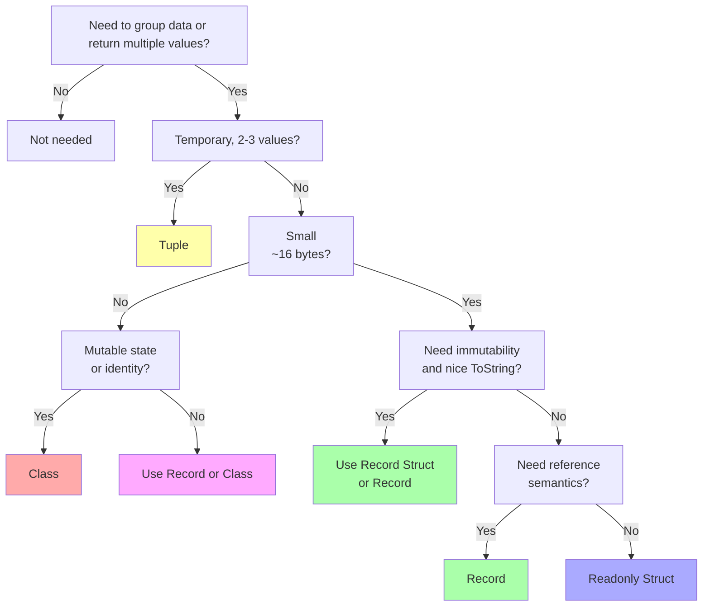

# C# Record vs Class vs Struct vs Tuple

This is the central comparison note for choosing between tuple, struct, class, record class, and record struct. Use it as a quick reference when deciding which type to define.

## The comparison table

| Feature | Tuple | Class | Struct | Record Class | Record Struct |
|---------|-------|-------|--------|--------------|---------------|
| **Type** | Value type | Reference type | Value type | Reference type | Value type |
| **Equality** | By value (all elements) | By identity (reference) | By value (all fields) | By value (all fields) | By value (all fields) |
| **Mutable** | ✓ Yes | ✓ Yes | ✓ Yes (mutable by default) | ✗ No (immutable by default) | ✗ No (immutable by default) |
| **Can be null** | No | ✓ Yes | No (unless `T?`) | ✓ Yes | No (unless `T?`) |
| **Built-in ToString** | Generic `(Item1, Item2, ...)` | ✗ No | ✗ No | ✓ Yes (`Record { Field = value }`) | ✓ Yes |
| **Built-in Equals/GetHashCode** | ✓ Yes | ✗ No (by reference) | ✓ Yes | ✓ Yes | ✓ Yes |
| **Built-in Deconstruct** | ✓ Yes | ✗ No | ✗ No | ✓ Yes | ✓ Yes |
| **`with` expression** | ✗ No | ✗ No | ✗ No | ✓ Yes | ✓ Yes |
| **Inheritance** | ✗ No | ✓ Yes (one base) | ✗ No | ✓ Yes (from other records) | ✗ No |
| **Methods** | ✗ No | ✓ Yes | ✓ Yes | ✓ Yes | ✓ Yes |
| **Heap allocation** | No | ✓ Yes | No (usually) | ✓ Yes | No (usually) |
| **Syntax** | `(type1, type2)` | `class Name { }` | `struct Name { }` | `record Name(fields)` | `record struct Name(fields)` |

## Decision guide with concrete scenarios

### DTOs and API request/response models → Record

Records are ideal for data transfer objects and API contracts. They compare by value, have nice `ToString`, and auto-generate `Equals` and `GetHashCode`:

```csharp
// ASP.NET Core controller
public record CreateUserRequest(string Name, string Email);
public record UserResponse(int Id, string Name, string Email);

[ApiController]
public class UsersController : ControllerBase
{
    [HttpPost]
    public UserResponse CreateUser(CreateUserRequest request)
    {
        // request comes from JSON; records work great with model binding
        return new UserResponse(1, request.Name, request.Email);
    }
}

// In tests: easy equality comparison
var expected = new UserResponse(1, "Alice", "alice@example.com");
var actual = controller.CreateUser(new CreateUserRequest("Alice", "alice@example.com"));
Assert.Equal(expected, actual);  // Value-based equality works perfectly
```

### Immutable domain values → Record or readonly struct

For domain values like `EmailAddress`, `Money`, `Coordinates`, use a record or readonly struct depending on size and reference needs:

```csharp
// Record: when you want reference semantics or inheritance
public record Money(decimal Amount, string Currency)
{
    public Money(decimal amount, string currency) : this(amount, currency)
    {
        if (amount < 0)
            throw new ArgumentException("Amount cannot be negative");
    }
}

// Readonly struct: when you want value semantics and small size
public readonly struct Coordinates
{
    public double Latitude { get; }
    public double Longitude { get; }

    public Coordinates(double lat, double lon)
    {
        Latitude = lat;
        Longitude = lon;
    }
}
```

### Entities with identity and mutable state → Class

For database entities, User objects, or domain entities that have identity and change over time, use a class:

```csharp
// EF Core entity: class with mutable properties
public class User
{
    public int Id { get; set; }
    public string Name { get; set; }
    public string Email { get; set; }
    public DateTime CreatedAt { get; set; }
}

var user = new User { Name = "Alice", Email = "alice@example.com" };
user.Name = "Alicia";  // Mutable: change the entity
context.SaveChanges();
```

### Small, short-lived values in hot paths → Struct or readonly struct

For high-performance scenarios (games, math libraries), use a struct when the type is small and you don't need heap allocation:

```csharp
// Games: Vector2 as struct (millions of vectors, need speed)
public readonly struct Vector2
{
    public float X { get; }
    public float Y { get; }

    public Vector2(float x, float y)
    {
        X = x;
        Y = y;
    }

    public static Vector2 operator +(Vector2 a, Vector2 b)
        => new Vector2(a.X + b.X, a.Y + b.Y);
}

var v1 = new Vector2(10, 20);
var v2 = new Vector2(30, 40);
var result = v1 + v2;  // No heap allocation
```

### Quick multi-value return from a method → Tuple

For simple, temporary groupings returned from a method, tuples are lightweight and fast:

```csharp
public (int Min, int Max, double Average) GetStats(int[] numbers)
{
    return (numbers.Min(), numbers.Max(), numbers.Average());
}

var (min, max, avg) = GetStats(new[] { 1, 2, 3, 4, 5 });
Console.WriteLine($"Min: {min}, Max: {max}, Avg: {avg}");
```

## Decision flowchart: tuple, struct, record, or class?



## Worked example: modeling "Product"

Here's the same data modeled four different ways:

### As a class

```csharp
public class Product
{
    public string Name { get; set; }
    public decimal Price { get; set; }

    public Product(string name, decimal price)
    {
        Name = name;
        Price = price;
    }
}

var p1 = new Product("Widget", 19.99m);
var p2 = new Product("Widget", 19.99m);

Console.WriteLine(p1 == p2);  // false (different identities)
```

**Evaluation:** Mutable, compare by identity. Good for entities with changing state, but doesn't reflect that this is immutable data.

### As a record

```csharp
public record Product(string Name, decimal Price);

var p1 = new Product("Widget", 19.99m);
var p2 = new Product("Widget", 19.99m);

Console.WriteLine(p1 == p2);  // true (value-based equality)

var p3 = p1 with { Price = 24.99m };  // Non-destructive mutation
Console.WriteLine(p1.Price);  // 19.99 (original unchanged)
Console.WriteLine(p3.Price);  // 24.99
```

**Evaluation:** Immutable by default, value-based equality, nice `ToString`. Excellent for domain values and DTOs. Recommend for most cases.

### As a struct

```csharp
public readonly struct Product
{
    public string Name { get; }
    public decimal Price { get; }

    public Product(string name, decimal price)
    {
        Name = name;
        Price = price;
    }
}

var p1 = new Product("Widget", 19.99m);
var p2 = new Product("Widget", 19.99m);

Console.WriteLine(p1 == p2);  // true (value-based equality)
// No built-in with expression; must create a new struct manually
```

**Evaluation:** Value type, immutable, value-based equality. Good for small values, but no built-in `with` expression and no inheritance. The string field makes it larger than ideal for a struct.

### As a tuple

```csharp
public (string Name, decimal Price) GetProduct()
{
    return ("Widget", 19.99m);
}

var (name, price) = GetProduct();
```

**Evaluation:** Lightweight for temporary groupings. No type name, so less self-documenting. Best for simple returns, not for domain data.

**Recommendation:** Use **record** for `Product`. It's the best fit: immutable data, value-based equality, clean syntax, and self-documenting. If `Product` were mutable (e.g., user can change the price in a shopping cart), use a **class**.

## Common mistakes

- **Using a record for everything** – Records are great, but they're not always the best choice. For mutable entities, use a class. For simple temporary returns, use a tuple. For small immutable values, consider a readonly struct.

```csharp
// ❌ Overkill: record for a simple, temporary pair
public record Point(int X, int Y);  // Could be a tuple or struct
public (int X, int Y) GetPoint() => new Point(10, 20);  // Extra allocation

// ✓ Better: tuple for temporary grouping
public (int X, int Y) GetPoint() => (10, 20);
```

- **Using a record for database entities** – Records are immutable by default. EF Core entities should be mutable so the change tracker can detect modifications. Use a class for EF entities.

```csharp
// ❌ Not ideal: record for EF Core entity
public record User(int Id, string Name, string Email);
// user.Name = "new";  // Error: immutable

// ✓ Correct: class for mutable EF Core entity
public class User
{
    public int Id { get; set; }
    public string Name { get; set; }
    public string Email { get; set; }
}
```

- **Mutable structs in collections** – Modifying a struct retrieved from a collection modifies a copy, not the original. Use `readonly struct` to prevent accidents.

```csharp
// ❌ Bug: modifying a copy
var points = new List<Point> { new Point(1, 2) };
// points[0].X = 100;  // Error: cannot modify returned value (good!)

// ✓ Fix: reassign
Point p = points[0];
p.X = 100;
points[0] = p;
```

## Quick recap

- **Tuple** – Lightweight, temporary 2–3 value returns. Fast, no heap allocation.
- **Struct** – Small (~16 bytes), immutable values. Use `readonly struct` to prevent bugs.
- **Record** – Immutable data with value-based equality and nice `ToString`. Best for domain values and DTOs.
- **Class** – Mutable objects with identity, inheritance, and complex behavior. Use for entities and business logic.
- **Record struct** – Combines record features with value-type semantics. Use when you need a small, immutable value type with records' conveniences.
- When unsure, use a **class**. For immutable data, upgrade to a **record**. For small performance-critical code, consider a **struct**.
