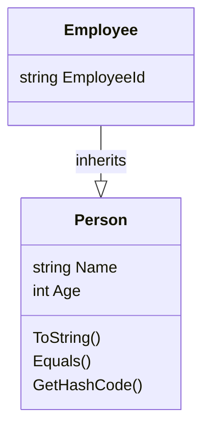

# C# Records

A **record** (C# 9+) is a type designed for **data**. Records compare by content (not identity), print nicely, and are immutable by default. In simple terms: a record is "a class that compares by content and prints nicely." This note covers positional records, immutability via the `with` expression, value-based equality, and inheritance.

## What is a record?

A record is a lightweight, immutable type for storing data. Unlike a class, two records with the same field values are considered equal. Records automatically generate useful methods like `ToString`, `Equals`, and `GetHashCode` based on your fields:

```csharp
// Record: a type for data with value-based equality and nice ToString
public record Person(string Name, int Age);

var p1 = new Person("Alice", 30);
var p2 = new Person("Alice", 30);

Console.WriteLine(p1 == p2);        // true (same values)
Console.WriteLine(p1.ToString());   // Person { Name = Alice, Age = 30 }

var p3 = new Person("Bob", 25);
Console.WriteLine(p1 == p3);        // false (different values)
```

## Record vs record class vs record struct

Records come in two flavors, controlled by the `record` keyword:

- **`record` or `record class`** – A reference type (like a class). Stored on the heap, variables hold references. Can inherit from other records. Most common.
- **`record struct`** – A value type (like a struct). Stored on the stack (usually), copied on assignment. Cannot inherit. Use when size is small and you need value semantics.

```csharp
// Record class (reference type)
public record PersonClass(string Name, int Age);

// Record struct (value type)
public record struct PersonStruct(string Name, int Age);

// Declaring explicitly (same as above)
public record class PersonClassExplicit(string Name, int Age);
```

**Most of this note focuses on `record` (record class), which is the most common choice.**

## Positional records

A **positional record** uses a compact syntax: parameters in parentheses. The compiler generates properties, a constructor, `Deconstruct`, `ToString`, `Equals`, and `GetHashCode`:

```csharp
public record Person(string Name, int Age);

// Compiler generates:
// - Properties: public string Name { get; init; }
// - Constructor: public Person(string Name, int Age) { ... }
// - Deconstruct: public void Deconstruct(out string Name, out int Age)
// - ToString: public override string ToString() => "Person { Name = Alice, Age = 30 }"
// - Equals & GetHashCode based on Name and Age

var p = new Person("Alice", 30);
Console.WriteLine(p.Name);     // Alice
Console.WriteLine(p.Age);      // 30
Console.WriteLine(p);          // Person { Name = Alice, Age = 30 }

// Deconstruct
var (name, age) = p;
Console.WriteLine($"{name} is {age}");  // Alice is 30
```

## Init-only properties and immutability

Properties in positional records are **init-only by default**. This means you can set them when creating the record, but not after:

```csharp
public record Person(string Name, int Age);

var p = new Person("Alice", 30);
// p.Name = "Bob";  // ❌ Error: init-only property or indexer cannot be set outside of object initializers or the init accessor

// ✓ You can use object initializer syntax during construction
var p2 = new Person("Bob", 25);  // OK
```

**Init-only accessor explained (briefly):** A property with `init` can be set once during initialization but not changed afterward:

```csharp
// Record with explicit init-only properties
public record Product(string Name)
{
    public decimal Price { get; init; }
}

var prod = new Product("Widget") { Price = 19.99m };
// prod.Price = 25.00m;  // ❌ Error: cannot change after init
```

**Record struct:** Properties are `readonly` (fully immutable) instead of init-only:

```csharp
public record struct PersonStruct(string Name, int Age);

var p = new PersonStruct("Alice", 30);
// p.Name = "Bob";  // ❌ Error: readonly field cannot be assigned
```

## Non-positional records

You can also define records without positional syntax, adding properties explicitly:

```csharp
public record Person
{
    public string Name { get; init; }
    public int Age { get; init; }
}

var p = new Person { Name = "Alice", Age = 30 };
Console.WriteLine(p);  // Person { Name = Alice, Age = 30 }
```

## The `with` expression: non-destructive mutation

The `with` expression creates a copy of a record with one or more fields changed. The original stays unchanged:

```csharp
public record Person(string Name, int Age);

var p1 = new Person("Alice", 30);
var p2 = p1 with { Age = 31 };  // Create a copy with Age = 31

Console.WriteLine(p1.Age);  // 30 (original unchanged)
Console.WriteLine(p2.Age);  // 31 (new record)

// Can change multiple fields
var p3 = p1 with { Name = "Bob", Age = 25 };
Console.WriteLine(p3);      // Person { Name = Bob, Age = 25 }
```

The `with` expression performs a **shallow copy**: reference fields are copied by reference, not deep-copied:

```csharp
public record Person(string Name, List<string> Hobbies);

var p1 = new Person("Alice", new List<string> { "reading", "coding" });
var p2 = p1 with { Name = "Bob" };

// p2.Hobbies is the SAME list (shallow copy)
p2.Hobbies.Add("gaming");
Console.WriteLine(p1.Hobbies.Count);  // 3 (changed, because Hobbies is shared)
```

## Value-based equality

Records compare by **value** (the content of fields), not by identity (reference). Two separate record instances with the same values are equal:

```csharp
public record Person(string Name, int Age);

var p1 = new Person("Alice", 30);
var p2 = new Person("Alice", 30);

Console.WriteLine(p1 == p2);           // true (same values)
Console.WriteLine(ReferenceEquals(p1, p2)); // false (different objects)
```

Compare this to a class:

```csharp
public class PersonClass
{
    public string Name { get; set; }
    public int Age { get; set; }

    public PersonClass(string name, int age)
    {
        Name = name;
        Age = age;
    }
}

var c1 = new PersonClass("Alice", 30);
var c2 = new PersonClass("Alice", 30);

Console.WriteLine(c1 == c2);  // false (classes compare by identity by default)
Console.WriteLine(c1.Equals(c2)); // false (unless you override Equals)
```

**Use `ReferenceEquals` to check if two records refer to the exact same object (identity):**

```csharp
var p1 = new Person("Alice", 30);
var p2 = p1;  // Both reference the same record

Console.WriteLine(p1 == p2);           // true (same values AND same object)
Console.WriteLine(ReferenceEquals(p1, p2)); // true (same object)
```

## Records and inheritance

Records can inherit from other records (but not from classes). A derived record extends the base record's properties:

```csharp
public record Person(string Name, int Age);

public record Employee(string Name, int Age, string EmployeeId) : Person(Name, Age);

var emp = new Employee("Alice", 30, "EMP123");
Console.WriteLine(emp);  // Employee { Name = Alice, Age = 30, EmployeeId = EMP123 }

// Equality compares all properties, including base and derived
var emp2 = new Employee("Alice", 30, "EMP123");
Console.WriteLine(emp == emp2);  // true

var emp3 = new Employee("Bob", 30, "EMP123");
Console.WriteLine(emp == emp3);  // false (different Name)
```

## Sealed records

A `sealed record` cannot be inherited:

```csharp
public sealed record Person(string Name, int Age);

// ❌ Error: cannot derive from sealed record 'Person'
// public record Employee(string Name, int Age, string EmployeeId) : Person(Name, Age);
```

## Deconstruction of records

Records automatically support deconstruction (unpacking into individual variables). See [C# Tuple Deconstruction and Discards](/content/notes/csharp-tuple-deconstruction-and-discards.md) for detailed examples:

```csharp
public record Person(string Name, int Age);

var person = new Person("Alice", 30);
var (name, age) = person;  // Deconstruct

Console.WriteLine($"{name} is {age}");  // Alice is 30
```

## Record hierarchy class diagram



## Common mistakes

- **Expecting full immutability with mutable reference fields** – Records are immutable for their own fields, but if a field is a mutable type (like `List<T>`), you can still modify the list:

```csharp
public record Person(string Name, List<string> Hobbies);

var p = new Person("Alice", new List<string> { "reading" });
// p.Hobbies = new List<string>();  // ❌ Error: init-only

// ✓ But you can modify the list inside
p.Hobbies.Add("coding");  // The list is modified
Console.WriteLine(p.Hobbies.Count);  // 2

// Use immutable collections to enforce deep immutability
using System.Collections.Immutable;
public record PersonImmutable(string Name, ImmutableList<string> Hobbies);
```

- **Forgetting that `with` creates a shallow copy** – If a record field holds a reference type (like a list), `with` copies the reference, not the object itself:

```csharp
var p1 = new Person("Alice", new List<string> { "reading" });
var p2 = p1 with { Name = "Bob" };

// p2.Hobbies points to the SAME list as p1.Hobbies
p2.Hobbies.Add("coding");
Console.WriteLine(p1.Hobbies.Count);  // 2 (p1's list changed too!)
```

- **Using records for entities with mutable state** – Records are immutable by default. If you have a domain entity that frequently changes (like an EF Core entity), use a class instead.

```csharp
// ❌ Not ideal: record for a database entity with changing state
public record User(int Id, string Name, string Email);

// ✓ Better: class for mutable entities
public class User
{
    public int Id { get; set; }
    public string Name { get; set; }
    public string Email { get; set; }
}
```

## Quick recap

- **Record** is a type designed for immutable data with value-based equality and auto-generated `ToString`.
- **`record` (record class)** = reference type; **`record struct`** = value type.
- **Positional record** syntax: `record Person(string Name, int Age);` generates properties, constructor, `Deconstruct`, `ToString`, `Equals`, `GetHashCode`.
- Properties are **init-only** (set during construction, immutable after). Use the `with` expression for non-destructive mutation.
- **Value-based equality**: two records with the same field values are equal (unlike classes, which compare by identity).
- **`with` expression**: creates a shallow copy with one or more fields changed; the original is unchanged.
- Records can inherit from other records (but not classes) and can be `sealed`.
- Records auto-support **deconstruction** (`var (name, age) = record;`).
- For mutable reference fields, use `ImmutableList<T>` or similar to enforce full immutability.
- For database entities with changing state, use a class instead.
