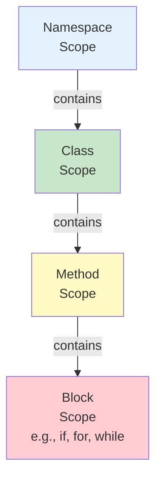

# Scope vs Accessibility in C#

**Scope** and **accessibility** are two different questions about visibility, but they are often confused.

- **Scope** = "Can I use this *name* here?" It's about whether a name is defined and visible in the current code location.
- **Accessibility** = "Am I *allowed* to access this member?" It's about access modifiers (`public`, `private`, etc.) that guard against unauthorized use.

Compiler errors tell you which problem you have.

## Side by side: two different errors

### Scope problem → CS0103

**The name does not exist in the current context.** The variable is out of scope.

```csharp
public class Example
{
    public void Method1()
    {
        int x = 10;
        Console.WriteLine(x);  // ✓ x is in scope
    }

    public void Method2()
    {
        Console.WriteLine(x);  // ❌ CS0103: The name 'x' does not exist
        // x was declared in Method1, so it's not visible here
    }
}
```

**Fix:** Declare the variable in a scope that includes both uses, or pass it as a parameter.

```csharp
public class Example
{
    private int x = 10;  // Now in class scope

    public void Method1()
    {
        Console.WriteLine(x);  // ✓
    }

    public void Method2()
    {
        Console.WriteLine(x);  // ✓
    }
}
```

### Accessibility problem → CS0122

**The member is inaccessible due to its protection level.** The name exists and is in scope, but the access modifier prevents access.

```csharp
public class BankAccount
{
    private decimal _balance = 1000;

    public decimal GetBalance() => _balance;
}

public class Main
{
    public static void Main()
    {
        var account = new BankAccount();
        Console.WriteLine(account.GetBalance());  // ✓ Calls public method
        Console.WriteLine(account._balance);      // ❌ CS0122: Inaccessible due to protection level
        // The name _balance exists but is private
    }
}
```

**Fix:** Use the public interface instead (e.g., call the public method).

```csharp
Console.WriteLine(account.GetBalance());  // ✓
```

## Comparison table

| | Scope | Accessibility |
|---|-------|----------------|
| **Question** | Is this name defined here? | Am I allowed to access this? |
| **Decided by** | Code structure (blocks, methods, classes) | Access modifiers (public, private, etc.) |
| **Examples** | Local variable out of its block; name never declared | Private member; internal member accessed from other assembly |
| **Compiler error** | CS0103: name does not exist | CS0122: inaccessible due to protection level |
| **Applies to** | Any name: variables, methods, types, parameters | Members with access modifiers (fields, methods, properties, types) |
| **Fix strategy** | Move code, declare at broader scope, pass as parameter | Change access modifier or use public interface |

## Nested scopes (Mermaid diagram)



**How scopes nest in code:**

```csharp
namespace MyApp  // ← Namespace scope starts
{
    public class MyClass  // ← Class scope starts
    {
        private int _field = 5;

        public void MyMethod()  // ← Method scope starts
        {
            if (_field > 0)  // ← Block scope starts
            {
                int localVar = 10;
                Console.WriteLine(localVar);  // ✓ visible here
            }  // ← Block scope ends
            // Console.WriteLine(localVar);  // ❌ CS0103: out of scope
        }  // ← Method scope ends
    }  // ← Class scope ends
}  // ← Namespace scope ends
```

## Shadowing: when scope gets confusing

You can declare a name in an inner scope that hides an outer name. This is **shadowing** and it's legal but confusing:

```csharp
public class Example
{
    private int x = 5;  // Class scope

    public void Method()
    {
        int x = 10;  // Method scope: shadows the class field
        Console.WriteLine(x);  // 10 (method scope)
    }
}
```

The inner `x` shadows the outer `x`. Avoid this; it makes code hard to read.

## A third idea: lifetime (brief)

**Lifetime** is how long a variable exists in memory. It's separate from scope and accessibility:

- A local variable's lifetime starts when it's declared and ends when the method exits.
- A field's lifetime lasts as long as the object exists.
- A static field's lifetime lasts for the entire program.

Lifetime is usually automatic and doesn't cause compiler errors, but it matters for memory management.

## Common mistakes

- **Confusing "CS0103" with "CS0122"** – One is about the name not existing; the other is about access denied. Read the message carefully.
- **Assuming accessibility means scope** – A `public` member outside your method's scope is still not usable there (scope blocks it first). Fix the scope issue first.
- **Not understanding block scope** – Variables declared in `if` or `for` blocks don't exist outside them.

## Quick recap

- **Scope** = "Is this name defined here?" Decided by code structure.
- **Accessibility** = "Am I allowed to use it?" Decided by access modifiers.
- **CS0103** = name doesn't exist (scope problem).
- **CS0122** = access denied (accessibility problem).
- Scope nests: namespace > class > method > block.
- Lifetime is separate: how long a variable lives in memory.
