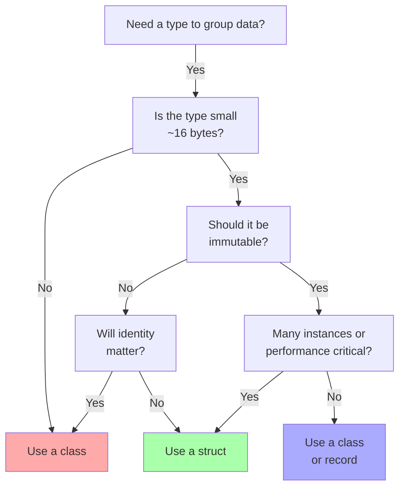

# C# Struct vs Class

Both structs and classes are types you can define to group data and behavior. The choice between them has profound implications for memory, performance, and how data is copied or shared. This note details when to use each.

## Detailed comparison

| Aspect | Struct | Class |
|--------|--------|-------|
| **Type kind** | Value type | Reference type |
| **Memory location** | Stack (usually); also heap when nested in class/array | Heap |
| **Storage** | Data stored directly in variable | Variable holds a reference to the object |
| **Copy semantics** | Assignment or parameter passing *copies* the struct | Assignment or parameter passing shares the reference |
| **Can be null** | No (unless `T?` for Nullable<T>) | Yes |
| **Inheritance** | Cannot inherit from other types (implicit from ValueType) | Can inherit from one base class |
| **Abstract** | Cannot be abstract | Can be abstract |
| **Default constructor** | Implicitly zero-initializes all fields | Must be explicitly defined (default is parameterless) |
| **Default value** | `default(StructType)` zeros all fields | `default` is `null` |
| **Equality (default)** | Compares by value (all fields) | Compares by reference (identity) |
| **Performance** | No heap allocation, but copies can be expensive if large | Heap allocation and GC overhead, but references are lightweight |
| **Best for** | Small values (≤16 bytes), immutable, short-lived, many instances | Objects with identity, mutable state, inheritance needs |

**Caveat on memory:** Structs are "usually" stack-allocated but can live on the heap when they're inside a class field, an array, or other collection. The key distinction is *how they're copied*: by value (struct) or by reference (class).

## Boxing: when a struct is treated as an object

**Boxing** occurs when a struct (value type) is treated as an `object` or an interface. The struct is wrapped in an object on the heap, and a reference is used. This costs performance:

```csharp
public struct Point
{
    public int X;
    public int Y;
}

Point p = new Point { X = 10, Y = 20 };

// Boxing: Point is wrapped in an object
object o = p;         // ✓ Boxing happens here
string s = o.ToString();  // Uses boxed Point's ToString

// Another boxing
IComparable c = p;    // ✓ Boxing when assigned to interface

// No boxing: calling ToString on Point directly
string s2 = p.ToString();  // No boxing

// Unboxing: extract the original struct
Point p2 = (Point)o;  // ✓ Unboxing happens here
```

**Why boxing costs performance:**
- A heap allocation is needed.
- The garbage collector must track and clean it up.
- Two memory accesses (reference + dereferencing) instead of one.

**Rule:** Avoid boxing structs in hot code paths. If you need a struct in a collection with an interface type, consider using a generic collection or a class instead. See [C# Type Conversion](/content/notes/csharp-type-conversion.md) for more on boxing.

## When to use a struct

Use a struct when:

1. **Small in size** – Guideline: about 16 bytes or less (four `int`s, two `long`s, etc.). Larger structs incur expensive copies.
2. **Immutable** – The struct should not change after creation. This avoids the classic bug of modifying a copy in a collection.
3. **Represents a single value or a few related values** – Examples: `Point` (X, Y), `Color` (R, G, B, A), `Vector2`, `Money` (amount, currency), `Range` (min, max).
4. **Short-lived** – Used temporarily and discarded, not stored long-term.
5. **Many instances** – Performance-critical code where thousands or millions of instances exist. The lack of heap allocation and GC pressure is significant.

**Example: Vector2 struct (makes sense)**

```csharp
public readonly struct Vector2
{
    public float X { get; }
    public float Y { get; }

    public Vector2(float x, float y)
    {
        X = x;
        Y = y;
    }

    public float Length => MathF.Sqrt(X * X + Y * Y);

    public Vector2 Normalize()
    {
        float len = Length;
        return new Vector2(X / len, Y / len);
    }

    public static Vector2 operator +(Vector2 a, Vector2 b)
        => new Vector2(a.X + b.X, a.Y + b.Y);
}

// Usage in game: millions of vectors, each operation must be fast
var v1 = new Vector2(10, 20);
var v2 = new Vector2(30, 40);
var result = v1 + v2;  // No heap allocation, no GC pressure
```

## When NOT to use a struct

Avoid structs when:

1. **Larger data** – If the struct is >16 bytes and mutable, copies are expensive and unpredictable.
2. **Mutable state** – If the struct's fields frequently change, copy semantics cause confusion and bugs.
3. **Identity matters** – If two instances with the same data should be treated as different (e.g., Player objects in a game, User entities in a database), use a class. Structs compare by value; classes compare by identity.
4. **Polymorphism is needed** – Structs cannot inherit, so if you need a base type or derived types, use a class.
5. **Frequently boxed** – If a struct is often treated as an `object` or interface, boxing overhead negates the performance benefit.

## Decision: Struct or class?



## Common mistakes

- **Large mutable structs** – A large struct that changes frequently causes expensive copies and confusing behavior.

```csharp
// ❌ Bad: 1000-byte struct, mutable, copied on every assignment
public struct BigData
{
    public byte[] Payload = new byte[1000];  // Ouch
    public int Count;
}

// ✓ Better: use a class
public class BigData
{
    public byte[] Payload = new byte[1000];
    public int Count;
}
```

- **Forgetting copy semantics** – A struct is copied when assigned or passed to a method. Modifying one copy doesn't affect others.

```csharp
Point p1 = new Point { X = 10, Y = 20 };
Point p2 = p1;
p2.X = 100;

Console.WriteLine(p1.X);  // 10, not 100; they are separate copies
```

- **Storing a mutable struct in a collection and expecting in-place modification** – Getting a struct from a `List<T>` and modifying it modifies a copy. You must reassign it.

```csharp
var points = new List<Point> { new Point { X = 1, Y = 2 } };

// ❌ Compiler error CS1612: cannot modify the return value
// points[0].X = 50;

// ✓ Correct: reassign
Point p = points[0];
p.X = 50;
points[0] = p;
```

## Quick recap

- **Struct** = value type, stack-allocated (usually), copied on assignment, no null, no inheritance. Best for small, immutable values.
- **Class** = reference type, heap-allocated, reference shared on assignment, can be null, supports inheritance. Best for objects with identity or complex state.
- Structs incur a copy cost but avoid heap allocation. Classes incur heap allocation and GC cost but share references efficiently.
- **Boxing** (treating a struct as `object`) wraps it in a heap object, negating the performance benefit.
- Rule of thumb: when unsure, use a **class** (or a **record** if you want immutability and value-based equality).
- Immutable, small, short-lived values → struct. Objects with identity, mutable state, inheritance → class.
