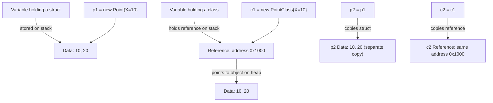

# C# Structs

A **struct** (structure) is a custom **value type**. Like built-in value types (`int`, `double`, `bool`), structs are stored on the stack and are copied when assigned to another variable or passed to a method. This note explains what structs are, when to use them, their limits, and common patterns. For how value and reference types differ fundamentally, see [C# Data Types Overview](/content/notes/csharp-data-types-overview.md).

## What is a struct: a value type

A struct is a custom value type, contrasting with a class, which is a reference type:

- **Struct (value type):** Stored on the stack. Each variable holds the actual data. When you assign a struct to another variable, the data is *copied*. Changes to the copy don't affect the original.
- **Class (reference type):** Stored on the heap. Variables hold a *reference* to the data. When you assign a class to another variable, both variables reference the same object.

**Small example proving the copy behavior:**

```csharp
// Struct: value type, copy behavior
public struct Point
{
    public int X;
    public int Y;
}

Point p1 = new Point { X = 10, Y = 20 };
Point p2 = p1;        // Copy the struct
p2.X = 100;           // Change the copy

Console.WriteLine(p1.X);  // 10 (original unchanged)
Console.WriteLine(p2.X);  // 100 (copy changed)

// Class: reference type, shared reference
public class PointClass
{
    public int X;
    public int Y;
}

PointClass pc1 = new PointClass { X = 10, Y = 20 };
PointClass pc2 = pc1;     // Both reference the same object
pc2.X = 100;              // Change via pc2

Console.WriteLine(pc1.X); // 100 (both point to the same object)
Console.WriteLine(pc2.X); // 100
```

## Declaring structs

Structs are declared with the `struct` keyword. They can contain fields, properties, methods, and constructors:

```csharp
public struct Rectangle
{
    // Fields
    public int Width;
    public int Height;

    // Property
    public int Area => Width * Height;

    // Constructor (must initialize all fields)
    public Rectangle(int width, int height)
    {
        Width = width;
        Height = height;
    }

    // Method
    public void PrintInfo()
    {
        Console.WriteLine($"Width: {Width}, Height: {Height}, Area: {Area}");
    }
}

// Usage:
var rect = new Rectangle(10, 20);
rect.PrintInfo();  // Width: 10, Height: 20, Area: 200
```

### C# 10+: Parameterless constructors and field initializers

Starting with C# 10, structs can have parameterless constructors and initialize fields at declaration:

```csharp
public struct Circle
{
    // Field initializer
    public int Radius = 5;

    // Parameterless constructor (C# 10+)
    public Circle()
    {
        Radius = 1;
    }

    // Explicit constructor
    public Circle(int radius)
    {
        Radius = radius;
    }

    public double GetArea() => Math.PI * Radius * Radius;
}

var c1 = new Circle();     // Uses parameterless constructor, Radius = 1
var c2 = new Circle(10);   // Uses explicit constructor, Radius = 10
```

### Default value and the `default` keyword

A struct always has a default value: all fields are initialized to their zero/null equivalents (`0`, `0.0`, `false`, `null`):

```csharp
public struct Temperature
{
    public double Celsius;
    public string Unit;
}

var t = default(Temperature);
Console.WriteLine(t.Celsius);  // 0
Console.WriteLine(t.Unit);     // null

// Shorthand: default without parentheses (inferred from context)
Temperature t2 = default;
Console.WriteLine(t2.Celsius); // 0
```

Using `new()` on a struct creates an instance with the default value:

```csharp
var t = new Temperature();
Console.WriteLine(t.Celsius);  // 0
```

## Limits of structs

### Cannot inherit from other structs or classes

Structs **cannot** inherit from other types (except implicitly from `System.ValueType`). They **can** implement interfaces:

```csharp
public interface IDrawable
{
    void Draw();
}

// ❌ Structs cannot inherit from other structs or classes
// public struct Square : Rectangle { }

// ✓ Structs CAN implement interfaces
public struct Square : IDrawable
{
    public int Side;

    public void Draw()
    {
        Console.WriteLine("Drawing a square");
    }
}
```

### Cannot be abstract

Structs cannot be declared as `abstract`. All structs are implicitly sealed (cannot be extended):

```csharp
// ❌ Error: cannot use abstract with struct
// public abstract struct Shape { }

// ✓ Structs are implicitly sealed
public struct Circle { }
```

### No null without Nullable\<T\>

A struct variable cannot be `null` by default. To allow `null`, use the nullable syntax `T?`:

```csharp
public struct Point
{
    public int X;
    public int Y;
}

Point p1 = new Point { X = 10, Y = 20 };
// Point p2 = null;  // ❌ Error: cannot assign null to a non-nullable value type

// ✓ Use nullable syntax
Point? p3 = null;
Console.WriteLine(p3 == null);  // true

// Check before use
if (p3 is not null)
{
    Console.WriteLine(p3.Value.X);  // Access with .Value
}
```

## Readonly struct and readonly members

Structs should be **immutable** (unchangeable). C# provides two ways to enforce this:

### Readonly struct

Declaring a struct as `readonly` makes all members read-only:

```csharp
public readonly struct ImmutablePoint
{
    public int X { get; }
    public int Y { get; }

    public ImmutablePoint(int x, int y)
    {
        X = x;
        Y = y;
    }
}

var p = new ImmutablePoint(10, 20);
// p.X = 100;  // ❌ Error: cannot modify readonly struct member
```

### Readonly members

You can mark individual members as `readonly`:

```csharp
public struct MixedStruct
{
    private int _value;

    // Readonly property (no setter or init-only setter)
    public int Value
    {
        readonly get => _value;
    }

    // Mutable field (can be changed)
    public string Name;

    public readonly void PrintInfo()  // Readonly method
    {
        Console.WriteLine($"Value: {Value}");
    }
}
```

### Why immutability matters: the classic bug

Modifying a struct that is an element in a collection gives a compiler error (CS1612). This is because you're modifying a copy, not the original:

```csharp
public struct Point
{
    public int X;
    public int Y;
}

var points = new List<Point> { new Point { X = 1, Y = 2 } };

// ❌ Error CS1612: cannot modify the return value of a property because it is not a variable
// points[0].X = 100;

// ✓ Fix: get the struct, modify it, and reassign
Point p = points[0];
p.X = 100;
points[0] = p;

Console.WriteLine(points[0].X);  // 100
```

## ref struct (advanced)

A `ref struct` is an advanced feature that can only live on the stack and **cannot** be used in async methods, iterators, or as array elements. It's designed for high-performance scenarios like `Span<T>`:

```csharp
public ref struct StackOnly
{
    private Span<int> _data;

    public StackOnly(Span<int> data)
    {
        _data = data;
    }
}

// Can use locally
Span<int> buffer = stackalloc int[10];
var refStruct = new StackOnly(buffer);

// ❌ Error: cannot return ref struct from method
// public StackOnly GetStruct() { }

// ❌ Error: cannot use ref struct in async method
// public async Task ProcessAsync() { ... }
```

For most applications, focus on `readonly struct` rather than `ref struct`.

## Struct examples from .NET

The .NET framework includes many built-in structs:

- **`DateTime`** – Represents a date and time.
- **`TimeSpan`** – Represents a duration.
- **`Guid`** – A globally unique identifier.
- **`int`, `double`, `bool`, `char`** – Primitive types are structs.
- **`Nullable<T>`** – Wraps a value type to allow `null` (e.g., `int?` = `Nullable<int>`).
- **`KeyValuePair<TKey, TValue>`** – Holds a key-value pair.
- **`ValueTuple`** – Lightweight tuple.

## Mermaid diagram: stack vs heap



## Common mistakes

- **Large mutable structs** – Structs are copied when assigned or passed to methods. Large mutable structs cause performance issues and unexpected behavior. Use `readonly struct` or convert to a `class` if the struct is large.

```csharp
// ❌ Bad: 1000-byte mutable struct copied every time
public struct LargeData
{
    public byte[] Data = new byte[1000];
}

// ✓ Better: readonly struct (compiler optimizes) or use class
public readonly struct LargeDataRO
{
    public readonly byte[] Data;
    public LargeDataRO(byte[] data) => Data = data;
}
```

- **Forgetting copy semantics** – Every assignment creates a copy. Modifying one struct variable doesn't affect others.

```csharp
Point p1 = new Point { X = 10, Y = 20 };
Point p2 = p1;
p2.X = 100;
Console.WriteLine(p1.X);  // 10, not 100!
```

- **Attempting to modify a struct from a collection** – Getting a struct from a collection and modifying it modifies a copy. You must reassign it back.

```csharp
// ❌ This modifies a copy, not the original
// list[0].X = 50;

// ✓ Correct: get, modify, reassign
var item = list[0];
item.X = 50;
list[0] = item;
```

## Quick recap

- **Struct** is a custom value type: data is stored on the stack and copied when assigned.
- Structs are declared with the `struct` keyword and can contain fields, properties, methods, and constructors.
- Structs **cannot** inherit from other types (but can implement interfaces) and **cannot** be abstract.
- A struct variable cannot be `null` without `Nullable<T>` (e.g., `Point?`).
- Use **`readonly struct`** to enforce immutability and avoid common bugs.
- Structs should be small (≤16 bytes), immutable, and short-lived.
- Common .NET structs: `int`, `DateTime`, `TimeSpan`, `Guid`, `KeyValuePair<K,V>`.
- Classic pitfall: modifying a struct from a collection (e.g., `list[0].X = 5`) fails with error CS1612; reassign the struct back.
