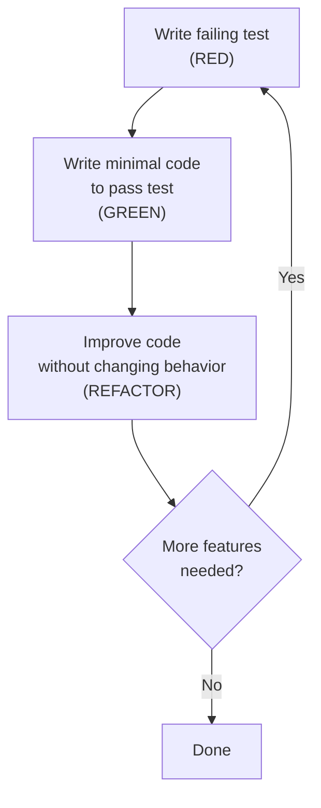

# C# TDD and Testing Practices

This note covers Test-Driven Development (TDD), code testability, best practices for writing good tests, common pitfalls, and how tests fit into CI/CD pipelines.

## TDD: Red-Green-Refactor

**Test-Driven Development** means writing a failing test *before* writing production code. The cycle is:

1. **Red**: Write a failing test for a feature you haven't built yet.
2. **Green**: Write just enough code to make the test pass.
3. **Refactor**: Improve the code without changing its behavior.



### TDD in action: a tiny example

**Step 1: Write a failing test (RED)**

```csharp
[Fact]
public void Add_TwoNumbers_ReturnsSum()
{
    var calc = new Calculator();
    int result = calc.Add(2, 3);
    Assert.Equal(5, result);
}

// Compile error: Calculator doesn't exist yet
// Error CS0246: The type or namespace name 'Calculator' could not be found
```

**Step 2: Write minimal code to pass the test (GREEN)**

```csharp
public class Calculator
{
    public int Add(int a, int b) => a + b;
}

// ✓ Test passes
```

**Step 3: Refactor if needed (REFACTOR)**

In this case, the code is already clean, so no refactoring is needed.

**Step 4: Write the next failing test**

```csharp
[Fact]
public void Subtract_TwoNumbers_ReturnsDifference()
{
    var calc = new Calculator();
    int result = calc.Subtract(5, 3);
    Assert.Equal(2, result);
}

// Error CS1061: 'Calculator' does not contain a definition for 'Subtract'
```

**Step 5: Add code to pass the new test**

```csharp
public class Calculator
{
    public int Add(int a, int b) => a + b;
    public int Subtract(int a, int b) => a - b;
}

// ✓ Both tests pass
```

**Benefits of TDD:**
- Tests exist by default (no "I'll write tests later" that never happens).
- Code is designed with testability in mind.
- Incremental development with constant feedback.
- Tests document intended behavior.

**When to use TDD:**
- Complex business logic where requirements are clear.
- Code that will be refactored frequently.
- When bug prevention is critical.

**When TDD is overkill:**
- Simple glue code that just calls other libraries.
- Spikes or exploratory coding.
- Very straightforward CRUD operations.

## What makes code testable?

Testable code has these characteristics:

### Small, focused methods

```csharp
// ❌ Hard to test: does too much
public void ProcessOrder(Order order)
{
    if (!ValidateOrder(order)) return;
    var items = GetItemsFromWarehouse(order.ItemIds);
    if (items.Count != order.ItemIds.Count) throw new Exception("Items not found");
    var total = CalculateTotal(items);
    var tax = CalculateTax(total);
    var finalTotal = total + tax;
    var payment = ProcessPayment(order.CardToken, finalTotal);
    if (!payment.Success) throw new Exception("Payment failed");
    SendConfirmationEmail(order.Email);
    UpdateInventory(items);
    SaveOrder(order);
}

// ✓ Easy to test: small, focused methods
public OrderResult ProcessOrder(Order order)
{
    if (!ValidateOrder(order)) return new OrderResult { Success = false };
    var items = GetItemsFromWarehouse(order.ItemIds);
    var pricing = CalculatePricing(items);
    ProcessPaymentOrThrow(order.CardToken, pricing.FinalTotal);
    SendConfirmationEmail(order.Email);
    UpdateInventory(items);
    return new OrderResult { Success = true, Total = pricing.FinalTotal };
}
```

Small methods are easier to understand, test, and change.

### No hidden dependencies

```csharp
// ❌ Bad: dependencies are hidden inside the method
public class OrderService
{
    public void SendNotification(User user)
    {
        // Hidden: creates SmtpClient directly
        var smtp = new SmtpClient("smtp.gmail.com");
        smtp.Send(user.Email, "Your order...");
    }
}

// ✓ Good: dependencies are injected
public class OrderService
{
    private readonly IEmailSender emailSender;

    public OrderService(IEmailSender emailSender)
    {
        this.emailSender = emailSender;
    }

    public void SendNotification(User user)
    {
        // No hidden dependencies; easy to inject a fake in tests
        emailSender.SendEmail(user.Email, "Your order...");
    }
}
```

Injected dependencies allow you to swap in test doubles.

### Avoid static state and `new` inside methods

```csharp
// ❌ Bad: static state and hard-coded new
public class ReportService
{
    private static List<Report> cache = new();  // Static!

    public Report GenerateReport(int id)
    {
        if (cache.Contains(id)) return cache[id];  // Shared across tests!
        var repository = new SqlRepository();      // Can't mock
        var report = repository.Get(id);
        cache.Add(report);
        return report;
    }
}

// ✓ Good: injected dependencies, no static state
public class ReportService
{
    private readonly IReportRepository repository;
    private readonly ICacheService cache;

    public ReportService(IReportRepository repository, ICacheService cache)
    {
        this.repository = repository;
        this.cache = cache;
    }

    public Report GenerateReport(int id)
    {
        if (cache.TryGet(id, out var cached)) return cached;
        var report = repository.Get(id);
        cache.Set(id, report);
        return report;
    }
}
```

### Pure functions when possible

```csharp
// ✓ Good: pure function (same input → same output, no side effects)
public decimal CalculateDiscount(decimal amount, bool isVip)
{
    return isVip ? amount * 0.2m : amount * 0.05m;
}

[Fact]
public void CalculateDiscount_VipCustomer_Returns20Percent()
{
    Assert.Equal(20m, CalculateDiscount(100m, true));
}
```

Pure functions are trivial to test: no setup, no mocks, no cleanup.

## Best practices for writing good tests

### One concept per test

```csharp
// ✓ Good: each test checks one thing
[Fact]
public void CreateOrder_ReturnsOrderWithPendingStatus()
{
    var order = OrderService.Create(new Order { Items = [...] });
    Assert.Equal(OrderStatus.Pending, order.Status);
}

[Fact]
public void CreateOrder_AssignsUniqueId()
{
    var order1 = OrderService.Create(new Order { Items = [...] });
    var order2 = OrderService.Create(new Order { Items = [...] });
    Assert.NotEqual(order1.Id, order2.Id);
}

[Fact]
public void CreateOrder_SetsCreatedAtToNow()
{
    var before = DateTime.UtcNow;
    var order = OrderService.Create(new Order { Items = [...] });
    var after = DateTime.UtcNow;
    Assert.InRange(order.CreatedAt, before, after);
}
```

### Readable, self-documenting tests

```csharp
// ✓ Good: test name and structure explain what's being tested
[Fact]
public void Withdraw_InsufficientFunds_ThrowsInsufficientFundsException()
{
    var account = new BankAccount { Balance = 50m };
    var ex = Assert.Throws<InsufficientFundsException>(() => account.Withdraw(100m));
    Assert.Equal("Not enough balance", ex.Message);
}

// ❌ Bad: vague name, hard to understand
[Fact]
public void Test_Withdraw()
{
    var account = new BankAccount();
    account.Balance = 50;
    try
    {
        account.Withdraw(100);
        Assert.True(false, "Should have thrown");
    }
    catch (Exception)
    {
        Assert.True(true);
    }
}
```

### Independent tests

```csharp
// ✓ Good: each test is independent
[Fact]
public void Test_A()
{
    var service = new UserService();
    service.AddUser("Alice");
    Assert.Contains("Alice", service.ListUsers());
}

[Fact]
public void Test_B()
{
    var service = new UserService();  // Fresh instance
    service.AddUser("Bob");
    Assert.Contains("Bob", service.ListUsers());
}
```

### No logic in tests

```csharp
// ❌ Bad: test contains logic (if/loop), making it hard to understand
[Fact]
public void GetResults_ReturnsExpected()
{
    var results = GetResults();
    foreach (var result in results)
    {
        if (result.Status == "Active")
        {
            Assert.NotNull(result.Name);
        }
    }
}

// ✓ Good: test is straight-line, no branching
[Fact]
public void GetResults_ReturnsExpected()
{
    var results = GetResults();
    var activeResults = results.Where(r => r.Status == "Active").ToList();
    Assert.NotEmpty(activeResults);
    foreach (var result in activeResults)
    {
        Assert.NotNull(result.Name);
    }
}

// ✓ Better: test one specific case
[Theory]
[InlineData("Active", true)]
[InlineData("Inactive", false)]
public void GetResults_ReturnsCorrectStatus(string status, bool shouldHaveName)
{
    var results = GetResults().Where(r => r.Status == status).ToList();
    if (shouldHaveName)
        Assert.NotEmpty(results);
    else
        Assert.Empty(results);
}
```

### Deterministic tests

```csharp
// ❌ Bad: uses current time, flaky
[Fact]
public void Order_CreatedAt_IsNowish()
{
    var order = new Order();
    Assert.Equal(DateTime.Now, order.CreatedAt);  // May fail by 1ms
}

// ✓ Good: deterministic
[Fact]
public void Order_CreatedAt_IsSetOnCreation()
{
    var before = DateTime.UtcNow;
    var order = new Order();
    var after = DateTime.UtcNow;
    Assert.InRange(order.CreatedAt, before, after);
}
```

### Fast tests

```csharp
// ❌ Bad: slow test (makes real HTTP call)
[Fact]
public void GetWeather_ReturnsWeatherData()
{
    var result = WeatherService.FetchFromRealAPI("London");  // 2+ seconds
    Assert.NotNull(result);
}

// ✓ Good: fast test (mocked API)
[Fact]
public void GetWeather_ReturnsWeatherData()
{
    var mockApi = new Mock<IWeatherAPI>();
    mockApi.Setup(x => x.GetWeather("London")).Returns(new Weather { Temp = 20 });
    var service = new WeatherService(mockApi.Object);
    var result = service.GetWeather("London");  // < 1ms
    Assert.Equal(20, result.Temp);
}
```

### Keep test code clean

```csharp
// ✓ Good: test is easy to read
[Fact]
public void CalculateDiscount_VipCustomer_Returns20Percent()
{
    var customer = new Customer { IsVip = true };
    var discount = DiscountService.Calculate(customer);
    Assert.Equal(0.20m, discount);
}

// ❌ Bad: test is messy
[Fact]
public void Test123()
{
    Customer c = new(); c.IsVip = true;
    var d=DiscountService.Calculate(c);
    Assert.Equal(0.20m,d);
    var c2 = new Customer(); // unused variable
}
```

### Test public behavior, not private methods

```csharp
// ❌ Bad: testing private method
[Fact]
public void CalculateDiscount_Private_ReturnsPercentage()
{
    var service = new DiscountService();
    var method = typeof(DiscountService).GetMethod("CalculateInternalDiscount", System.Reflection.BindingFlags.NonPublic | System.Reflection.BindingFlags.Instance);
    var discount = (decimal)method.Invoke(service, new object[] { 100m, true });
    // Fragile: breaks if you refactor internals
}

// ✓ Good: test through public interface
[Fact]
public void GetFinalPrice_VipCustomer_Applies20PercentDiscount()
{
    var service = new DiscountService();
    var finalPrice = service.GetFinalPrice(100m, isVip: true);
    Assert.Equal(80m, finalPrice);  // 100 - 20% = 80
}
```

## Code coverage

**Code coverage** measures what percentage of your code is executed by tests. Tools like OpenCover or the built-in `dotnet test` coverage collection show:

```bash
# Run tests with coverage collection
dotnet test /p:CollectCoverage=true
```

**Coverage output:**
```
Line coverage: 85%
Branch coverage: 72%
Method coverage: 90%
```

**What coverage means:**
- **100% coverage**: All code paths are exercised (but doesn't mean all bugs are caught).
- **80% coverage**: A reasonable goal for most projects.
- **Low coverage (< 50%)**: Code isn't tested enough.

**Important**: Coverage isn't a goal; it's a tool. You can have 100% coverage and terrible tests, or 70% coverage and excellent tests. Focus on testing important logic, not on hitting a percentage.

## Flaky tests

A **flaky test** sometimes passes and sometimes fails without code changes. Common causes:

```csharp
// ❌ Flaky: depends on timing
[Fact]
public void Task_Completes_WithinTimeout()
{
    Task.Delay(100).Wait();
    Assert.True(DateTime.Now > startTime.AddMilliseconds(100));
    // May fail if system is slow
}

// ✓ Better: use deterministic timing
[Fact]
public void Task_Completes_InExpectedTime()
{
    var sw = Stopwatch.StartNew();
    Task.Delay(100).Wait();
    sw.Stop();
    Assert.InRange(sw.ElapsedMilliseconds, 90, 200);  // Allow variance
}

// ❌ Flaky: shared mutable state
private static List<int> results = new();

[Fact]
public void Test1_Adds() { results.Add(1); Assert.Contains(1, results); }

[Fact]
public void Test2_Checks() { Assert.Empty(results); }  // Fails if Test1 ran first

// ✓ Better: instance variable
private List<int> results = new();

[Fact]
public void Test1_Adds() { results.Add(1); Assert.Contains(1, results); }

[Fact]
public void Test2_Checks() { Assert.Empty(results); }  // Always fresh
```

**To avoid flaky tests:**
- Avoid random data or timing assumptions.
- Inject time/random as dependencies.
- Never use `static` mutable state.
- Run tests in random order to catch dependencies: `dotnet test --test-adapter-path:. -- RunConfiguration.Shuffle=true`

## Testing async code

```csharp
// ✓ Good: async test method
[Fact]
public async Task GetUserAsync_ReturnsUser()
{
    var user = await UserService.GetUserAsync(1);
    Assert.NotNull(user);
}

// ❌ Bad: async void (never use)
[Fact]
public async void GetUserAsync_ReturnsUser()
{
    // async void is dangerous; test may finish before code runs
    var user = await UserService.GetUserAsync(1);
    Assert.NotNull(user);
}
```

**Always use `async Task`, never `async void`.**

## Integration tests

Integration tests verify multiple components work together (unlike unit tests, which test in isolation). They're slower but catch wiring issues:

```csharp
using Microsoft.AspNetCore.Mvc.Testing;
using Xunit;

public class OrderApiIntegrationTests : IClassFixture<WebApplicationFactory<Program>>
{
    private readonly WebApplicationFactory<Program> factory;

    public OrderApiIntegrationTests(WebApplicationFactory<Program> factory)
    {
        this.factory = factory;
    }

    [Fact]
    public async Task CreateOrder_ValidRequest_ReturnsCreated()
    {
        var client = factory.CreateClient();
        var response = await client.PostAsJsonAsync("/api/orders", new { Items = [...] });
        Assert.Equal(System.Net.HttpStatusCode.Created, response.StatusCode);
    }
}
```

See the [Integration Test](/glossary/integration-test) glossary term for more.

## Tests in CI/CD

Continuous Integration automatically runs tests on every push. Example GitHub Actions workflow:

```yaml
name: Tests

on: [push, pull_request]

jobs:
  test:
    runs-on: ubuntu-latest
    steps:
      - uses: actions/checkout@v3
      - uses: actions/setup-dotnet@v3
        with:
          dotnet-version: '9.0'
      - run: dotnet restore
      - run: dotnet build
      - run: dotnet test --no-build
      - run: dotnet test --no-build --collect:"XPlat Code Coverage"
```

This ensures:
- Code compiles on every push
- All tests pass before merging
- Coverage is tracked over time

See [CI/CD](/glossary/ci-cd) for more details.

## Common mistakes

- **Testing implementation details instead of behavior**: Refactorings break tests that shouldn't.

```csharp
// ❌ Bad: tests how the code works (implementation), not what it does
[Fact]
public void CalculateDiscount_CallsCheckVipStatus()
{
    var mockCheck = new Mock<IVipChecker>();
    var service = new DiscountService(mockCheck.Object);
    service.CalculateDiscount(100);
    mockCheck.Verify(x => x.CheckVip(), Times.Once);  // Tests the implementation
}

// ✓ Good: tests the behavior (the discount value)
[Fact]
public void CalculateDiscount_VipCustomer_Returns20Percent()
{
    var mockChecker = new Mock<IVipChecker>();
    mockChecker.Setup(x => x.CheckVip()).Returns(true);
    var service = new DiscountService(mockChecker.Object);
    var discount = service.CalculateDiscount(100);
    Assert.Equal(20m, discount);  // Tests the behavior
}
```

- **Huge test methods**: Break them into focused tests.

- **Ignoring failing tests**: Don't skip or comment out failing tests; either fix them or delete them.

- **Testing everything through the UI**: Unit tests should test business logic; use integration tests for UI/API.

## Quick recap

- TDD: Red (failing test) → Green (minimal code) → Refactor (clean up).
- Testable code: small methods, injected dependencies, no hidden `new`, no `static` state.
- Best practices: one concept per test, readable, independent, deterministic, fast.
- Avoid testing private methods; test behavior through the public interface.
- Code coverage is a tool, not a goal (80% is reasonable; 100% isn't necessary).
- Flaky tests: avoid timing assumptions, shared state, and randomness.
- Always use `async Task`, never `async void` for test methods.
- Integration tests verify multiple components; use them sparingly.
- CI/CD runs tests automatically on every push to catch regressions early.
