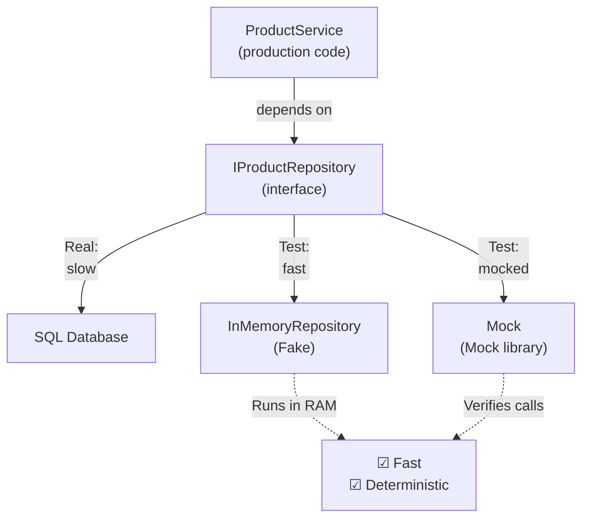

# C# Test Doubles and Mocking

A **test double** is a replacement for a real dependency (like a database or HTTP client) that makes tests fast, deterministic, and isolated. This note covers test double types, hand-written fakes, mocking libraries, and when to use them.

## The problem: untestable code

Consider this code:

```csharp
public class UserService
{
    public void SendWelcomeEmail(User user)
    {
        // Send email via real SMTP
        var smtp = new SmtpClient("smtp.gmail.com");
        smtp.Send(user.Email, "Welcome!");
        
        // Update a database
        using var db = new SqlConnection("connection-string");
        var cmd = new SqlCommand("UPDATE Users SET Welcomed = 1", db);
        cmd.ExecuteNonQuery();
    }
}
```

**Problems:**
- Tests are **slow**: each test makes a real SMTP call and database query.
- Tests are **brittle**: if the email server is down, all tests fail (even unrelated ones).
- Tests are **flaky**: order matters if the database shares state.
- Tests **need infrastructure**: test environment must have email/database set up.

## The solution: depend on interfaces

Refactor to depend on **interfaces**, not concrete implementations:

```csharp
public interface IEmailSender
{
    void SendEmail(string email, string subject, string body);
}

public interface IUserRepository
{
    void MarkAsWelcomed(int userId);
}

public class UserService
{
    private readonly IEmailSender emailSender;
    private readonly IUserRepository userRepository;

    public UserService(IEmailSender emailSender, IUserRepository userRepository)
    {
        this.emailSender = emailSender;
        this.userRepository = userRepository;
    }

    public void SendWelcomeEmail(User user)
    {
        emailSender.SendEmail(user.Email, "Welcome!", "...");
        userRepository.MarkAsWelcomed(user.Id);
    }
}
```

Now in tests, we can inject **fake implementations** that don't do real I/O.

## Test double types

| Type | Purpose | Example | Returns |
|------|---------|---------|---------|
| **Dummy** | Filler value that's never used | `new User() { }` passed to test | No value; exists so code doesn't crash |
| **Stub** | Hardcoded response for tests | Returns `true` for `IsAdmin()` | Fixed value or behavior |
| **Fake** | Working implementation, simplified | In-memory list instead of database | Real but simplified results |
| **Mock** | Records calls; verifies interaction | "Was SendEmail() called with this email?" | Recorded calls; throws if expectations aren't met |
| **Spy** | Records calls without breaking | Logs how many times a method was called | Same as real, but records calls |

## Hand-written fakes (without a library)

The simplest approach: write a fake class:

```csharp
// Real interfaces
public interface IEmailSender
{
    void SendEmail(string email, string subject, string body);
}

public interface IUserRepository
{
    void MarkAsWelcomed(int userId);
    User GetUser(int id);
}

// Fake implementations for tests
public class FakeEmailSender : IEmailSender
{
    public List<string> SentEmails { get; } = new();

    public void SendEmail(string email, string subject, string body)
    {
        SentEmails.Add(email);
    }
}

public class FakeUserRepository : IUserRepository
{
    private readonly Dictionary<int, User> users = new();

    public void MarkAsWelcomed(int userId)
    {
        if (users.TryGetValue(userId, out var user))
        {
            user.WelcomedAt = DateTime.UtcNow;
        }
    }

    public User GetUser(int id) => users.TryGetValue(id, out var user) ? user : null;
}

// Now test with fakes
[Fact]
public void SendWelcomeEmail_CallsEmailSender()
{
    // Arrange
    var fakeEmailSender = new FakeEmailSender();
    var fakeRepository = new FakeUserRepository();
    var service = new UserService(fakeEmailSender, fakeRepository);
    var user = new User { Id = 1, Email = "alice@example.com" };

    // Act
    service.SendWelcomeEmail(user);

    // Assert
    Assert.Contains("alice@example.com", fakeEmailSender.SentEmails);
}
```

**Benefits of hand-written fakes:**
- Full control over behavior
- No library to learn or maintain
- Simple and transparent

**Drawbacks:**
- More code to write and maintain
- Easy to miss edge cases

## In-memory fake repository

A common pattern: replace a database with an in-memory collection:

```csharp
public interface IProductRepository
{
    void Add(Product product);
    Product GetById(int id);
    List<Product> GetAll();
}

public class InMemoryProductRepository : IProductRepository
{
    private readonly Dictionary<int, Product> products = new();
    private int nextId = 1;

    public void Add(Product product)
    {
        product.Id = nextId++;
        products[product.Id] = product;
    }

    public Product GetById(int id) => products.TryGetValue(id, out var p) ? p : null;

    public List<Product> GetAll() => new List<Product>(products.Values);
}

// Test with the in-memory fake
[Fact]
public void GetTopProducts_ReturnsExpected()
{
    // Arrange
    var repository = new InMemoryProductRepository();
    repository.Add(new Product { Name = "Laptop", Price = 1000m });
    repository.Add(new Product { Name = "Mouse", Price = 25m });
    var service = new ProductService(repository);

    // Act
    var top = service.GetTopByPrice(2);

    // Assert
    Assert.Equal(2, top.Count);
    Assert.Contains("Laptop", top.Select(p => p.Name));
}
```

## Mocking libraries

Mocking libraries (like **Moq**, **NSubstitute**, **FakeItEasy**) automatically generate test doubles. Here's an example with **Moq**, the most common choice in .NET:

```csharp
using Moq;

[Fact]
public void SendWelcomeEmail_CallsEmailSenderWithCorrectEmail()
{
    // Arrange: create a mock
    var mockEmailSender = new Mock<IEmailSender>();
    var mockRepository = new Mock<IUserRepository>();
    var service = new UserService(mockEmailSender.Object, mockRepository.Object);
    var user = new User { Id = 1, Email = "alice@example.com" };

    // Act
    service.SendWelcomeEmail(user);

    // Assert: verify the mock was called with the correct arguments
    mockEmailSender.Verify(
        x => x.SendEmail("alice@example.com", It.IsAny<string>(), It.IsAny<string>()),
        Times.Once
    );
}

[Fact]
public void GetProduct_CachesResult()
{
    // Arrange: mock returns a specific value
    var mockRepository = new Mock<IProductRepository>();
    var product = new Product { Id = 1, Name = "Laptop" };
    mockRepository.Setup(x => x.GetById(1)).Returns(product);

    var service = new ProductService(mockRepository.Object);

    // Act
    var result1 = service.GetProduct(1);
    var result2 = service.GetProduct(1);

    // Assert: repository was called only once (cached)
    mockRepository.Verify(x => x.GetById(1), Times.Once);
}
```

**Setup and Verify patterns:**
- **Setup**: Configure what the mock should return: `mockRepo.Setup(x => x.GetById(1)).Returns(product)`
- **Verify**: Check if the mock was called as expected: `mockRepo.Verify(x => x.GetById(1), Times.Once)`

## Mocking libraries compared

| Library | Strengths | Style |
|---------|-----------|-------|
| **Moq** | Most popular, fluent API, well-documented | Setup then Verify |
| **NSubstitute** | Simple, readable syntax, minimalist | Setup then Verify |
| **FakeItEasy** | Very readable, natural language-like | Setup then Verify |

**All three are good choices; Moq is most common in enterprise .NET.**

## Testing with time and randomness

Code that depends on the current time or random numbers is hard to test:

```csharp
// ❌ Bad: depends on actual time and random
public class GameEngine
{
    public bool TryAttack()
    {
        int damage = new Random().Next(1, 20);  // Unpredictable
        return damage > 10;
    }

    public void LogAction()
    {
        Console.WriteLine($"Time: {DateTime.Now}");  // Can't test specific time
    }
}

// ✓ Good: inject time and random as dependencies
public class GameEngine
{
    private readonly TimeProvider timeProvider;
    private readonly IRandomNumberGenerator random;

    public GameEngine(TimeProvider timeProvider, IRandomNumberGenerator random)
    {
        this.timeProvider = timeProvider;
        this.random = random;
    }

    public bool TryAttack()
    {
        int damage = random.Next(1, 20);  // Testable
        return damage > 10;
    }

    public void LogAction()
    {
        Console.WriteLine($"Time: {timeProvider.GetUtcNow()}");  // Testable
    }
}

// In tests, inject fakes
[Fact]
public void TryAttack_HighDamage_ReturnsTrue()
{
    var mockRandom = new Mock<IRandomNumberGenerator>();
    mockRandom.Setup(x => x.Next(1, 20)).Returns(15);  // High damage
    var engine = new GameEngine(TimeProvider.System, mockRandom.Object);

    bool result = engine.TryAttack();

    Assert.True(result);
}
```

For time-dependent code, modern .NET provides `TimeProvider` as an abstraction; for random, define your own `IRandomNumberGenerator` interface.

## When NOT to mock

Avoid over-mocking; it makes tests fragile:

- **Don't mock simple value objects or records**: Just create real instances.

```csharp
// ✓ Good: no mocking needed
public class OrderTests
{
    [Fact]
    public void CalculateTotal_ReturnsSum()
    {
        var order = new Order { Items = new List<OrderItem> { new OrderItem { Price = 10m, Quantity = 2 } } };
        decimal total = order.CalculateTotal();
        Assert.Equal(20m, total);
    }
}

// ❌ Bad: unnecessary mocking
[Fact]
public void CalculateTotal_ReturnsSum()
{
    var mockItem = new Mock<OrderItem>();
    mockItem.Setup(x => x.Price).Returns(10m);
    // This is overkill; just create a real OrderItem
}
```

- **Don't mock your own pure logic**: Test it directly, not through mocks.

```csharp
// ✓ Good: test the calculator logic directly
var calculator = new DiscountCalculator();
decimal discount = calculator.CalculateDiscount(100m);
Assert.Equal(10m, discount);

// ❌ Bad: mocking your own code
var mockCalc = new Mock<DiscountCalculator>();
mockCalc.Setup(x => x.CalculateDiscount(100m)).Returns(10m);
```

- **Don't over-mock; focus on external dependencies**: Mock only I/O and slow operations (database, HTTP, file system, email).

## Diagram: test double patterns



## Common mistakes

- **Mocking too much**: Mock only external dependencies (database, HTTP, file, email). Don't mock your own simple classes.

```csharp
// ❌ Bad: mocking simple domain logic
var mockOrder = new Mock<Order>();
mockOrder.Setup(x => x.CalculateTotal()).Returns(100m);

// ✓ Good: test the real Order
var order = new Order { Items = [...] };
decimal total = order.CalculateTotal();
Assert.Equal(100m, total);
```

- **Testing mocks, not behavior**: A test that only verifies mock interactions but doesn't test actual behavior is worthless.

```csharp
// ❌ Bad: test verifies the mock, not the real behavior
var mockRepository = new Mock<IRepository>();
mockRepository.Setup(x => x.Save(It.IsAny<Entity>())).Returns(true);
var service = new Service(mockRepository.Object);
service.DoSomething();
mockRepository.Verify(x => x.Save(It.IsAny<Entity>()), Times.Once);
// ← This passes even if DoSomething() doesn't work correctly!

// ✓ Good: test behavior, then verify interactions
var mockRepository = new Mock<IRepository>();
var service = new Service(mockRepository.Object);
service.DoSomething(new Entity { Name = "Test" });
mockRepository.Verify(x => x.Save(It.Is<Entity>(e => e.Name == "Test")), Times.Once);
// ← Verifies the actual entity was saved with correct data
```

- **Not using `It.IsAny<T>()` when arguments don't matter**: Make tests more flexible.

```csharp
// Less flexible: test fails if argument changes
mockEmailSender.Setup(x => x.Send("alice@example.com", "Welcome", "...", "...")).Returns(true);

// More flexible: doesn't care about some arguments
mockEmailSender.Setup(x => x.Send(It.IsAny<string>(), It.IsAny<string>(), It.IsAny<string>())).Returns(true);
```

## Quick recap

- A test double replaces a slow or external dependency to make tests fast and deterministic.
- Types: Dummy (unused), Stub (fixed response), Fake (simplified working impl), Mock (records calls), Spy (records without breaking).
- Hand-written fakes are simple; mocking libraries (Moq, NSubstitute) automate mock generation.
- Inject dependencies through constructors via interfaces.
- Mock only external dependencies; test your own logic directly.
- Use in-memory repositories instead of real databases for fast tests.
- Abstract time and randomness into dependencies for testability.
- Don't over-mock; focus on behavior, not mock interactions.
