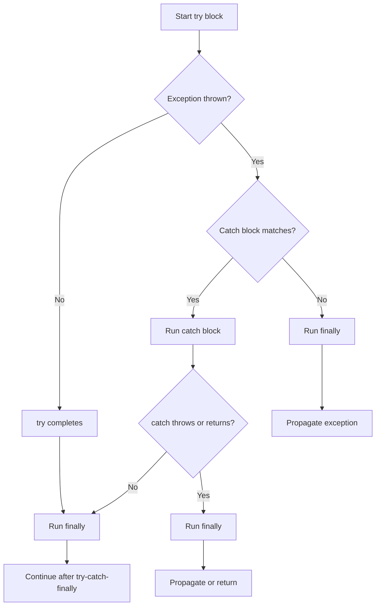

# Try-Catch-Finally in C#

The `try-catch-finally` statement lets you handle exceptions gracefully. `try` wraps code that might throw an exception; `catch` handles specific exceptions; `finally` runs cleanup code regardless of whether an exception occurred. This is the foundation of robust error handling.

## Syntax and flow

```csharp
try
{
    // Code that might throw an exception
    Console.WriteLine("Attempting operation...");
    int result = 10 / int.Parse("0");
}
catch (DivideByZeroException ex)
{
    // Handles DivideByZeroException only
    Console.WriteLine($"Cannot divide by zero: {ex.Message}");
}
catch (FormatException ex)
{
    // Handles FormatException only
    Console.WriteLine($"Invalid format: {ex.Message}");
}
finally
{
    // Always runs, even if no exception occurred or an exception was caught
    Console.WriteLine("Cleanup: Operation complete.");
}

// Output (if input is "0"):
// Attempting operation...
// Cannot divide by zero: Attempted to divide by zero.
// Cleanup: Operation complete.
```

## Catching specific exceptions

Always catch the **most specific exception type** you expect. This makes it clear what errors you anticipate and handle:

```csharp
try
{
    string input = userInput;
    int age = int.Parse(input);
    
    if (age < 0)
        throw new ArgumentOutOfRangeException(nameof(age), "Age cannot be negative");
    
    Console.WriteLine($"Age: {age}");
}
catch (FormatException ex)
{
    Console.WriteLine("Please enter a valid number.");
}
catch (ArgumentOutOfRangeException ex)
{
    Console.WriteLine($"Invalid age: {ex.Message}");
}
catch (Exception ex)  // Last resort: catches anything we didn't anticipate
{
    Console.WriteLine($"Unexpected error: {ex.Message}");
}
```

## Multiple catch blocks and order matters

When you have multiple `catch` blocks, **order them from most specific to most general**. The first matching catch block executes; the rest are ignored. If a general catch comes before a specific one, the specific one is unreachable, and the compiler raises **error CS0160**:

```csharp
// ❌ Error CS0160: catch for 'ArgumentOutOfRangeException' is unreachable
// because 'ArgumentException' catches it first
try
{
    // ...
}
catch (ArgumentException ex)        // ← Too general!
{
    Console.WriteLine("Argument error");
}
catch (ArgumentOutOfRangeException ex)  // ← Unreachable!
{
    Console.WriteLine("Out of range");
}

// ✓ Correct order: specific first, general last
try
{
    // ...
}
catch (ArgumentOutOfRangeException ex)
{
    Console.WriteLine("Out of range");
}
catch (ArgumentException ex)
{
    Console.WriteLine("Argument error");
}
catch (Exception ex)
{
    Console.WriteLine("Unexpected error");
}
```

## Catching `System.Exception` as a last resort

You can catch `System.Exception` to handle any exception, but **this is dangerous** because it hides bugs:

```csharp
// ❌ Bad: catches everything, including bugs you didn't anticipate
try
{
    ProcessData(userInput);
}
catch (Exception ex)
{
    Console.WriteLine("Error occurred");
    // A programming error (e.g., NullReferenceException) is silently hidden!
}

// ✓ Good: catch specific exceptions, let others bubble up
try
{
    ProcessData(userInput);
}
catch (FormatException ex)
{
    Console.WriteLine("Invalid format");
}
catch (FileNotFoundException ex)
{
    Console.WriteLine("File not found");
}
// Unexpected exceptions (bugs) will crash and alert you
```

**Never use an empty catch block** – this silently swallows the exception and makes debugging nearly impossible:

```csharp
// ❌ Absolutely avoid this
try
{
    // do something
}
catch (Exception ex)
{
    // Doing nothing hides all errors!
}

// ✓ At minimum, log the error
try
{
    // do something
}
catch (Exception ex)
{
    logger.LogError(ex, "Unexpected error");
    throw;  // Re-throw so the caller knows something went wrong
}
```

## Finally: always runs

The `finally` block executes **regardless** of whether an exception was thrown, caught, or if the try block completed normally. It even runs if the catch block throws or if there's a `return` statement:

```csharp
static string TestFinally(bool throwException)
{
    try
    {
        Console.WriteLine("Try block");
        if (throwException)
            throw new InvalidOperationException("Test error");
        return "Success from try";
    }
    catch (InvalidOperationException ex)
    {
        Console.WriteLine($"Catch block: {ex.Message}");
        return "Caught and handled";
    }
    finally
    {
        Console.WriteLine("Finally block (always runs)");
    }
}

Console.WriteLine(TestFinally(false));
// Output:
// Try block
// Finally block (always runs)
// Success from try

Console.WriteLine(TestFinally(true));
// Output:
// Try block
// Catch block: Test error
// Finally block (always runs)
// Caught and handled
```

Use `finally` for cleanup: closing files, releasing database connections, or freeing resources:

```csharp
StreamWriter? writer = null;
try
{
    writer = new StreamWriter("output.txt");
    writer.WriteLine("Data");
}
catch (IOException ex)
{
    Console.WriteLine($"Cannot write file: {ex.Message}");
}
finally
{
    // Always close, even if an exception occurred
    writer?.Dispose();
}
```

## Using statement as the alternative for IDisposable

For types that implement `IDisposable` (files, database connections, etc.), the `using` statement is a cleaner way to ensure cleanup:

```csharp
// Traditional try-finally
StreamWriter? writer = null;
try
{
    writer = new StreamWriter("output.txt");
    writer.WriteLine("Data");
}
finally
{
    writer?.Dispose();
}

// ✓ Cleaner: using statement (C# 7.0+)
using (StreamWriter writer = new StreamWriter("output.txt"))
{
    writer.WriteLine("Data");
}  // Dispose() is called automatically

// ✓ Even cleaner: using declaration (C# 8.0+)
using StreamWriter writer = new StreamWriter("output.txt");
writer.WriteLine("Data");
// Dispose() is called automatically at end of scope
```

For more details on `IDisposable` and resource cleanup, see [Common Built-in Interfaces in C#](/content/notes/csharp-common-built-in-interfaces.md).

## Exception filters

You can add a `when` clause to catch only if a condition is met. This runs the condition in the catch block's scope:

```csharp
try
{
    int result = int.Parse(userInput);
}
catch (FormatException ex) when (userInput.Length == 0)
{
    Console.WriteLine("Input is empty");
}
catch (FormatException ex) when (userInput.Contains("@"))
{
    Console.WriteLine("Input contains @, which is invalid for numbers");
}
catch (FormatException ex)
{
    Console.WriteLine("Invalid format (generic)");
}
```

Filters are useful when you want to handle the same exception type differently based on context.

## Variable scope in try-catch-finally

Variables declared in `try`, `catch`, or `finally` are visible only in those blocks:

```csharp
try
{
    int x = 10;
    Console.WriteLine(x);  // ✓ Visible in try
}
catch (Exception ex)
{
    Console.WriteLine(x);  // ❌ Compile error: x not visible here
    Console.WriteLine(ex.Message);  // ✓ ex is visible in catch
}
finally
{
    Console.WriteLine(x);  // ❌ Compile error: x not visible here
}

// ✓ Declare outside if you need it everywhere
int x = 10;
try
{
    x = 20;
    Console.WriteLine(x);  // 20
}
catch (Exception ex)
{
    Console.WriteLine(x);  // 20 (accessible here)
}
finally
{
    Console.WriteLine(x);  // 20 (accessible here)
}
```

For more on scope, see [Scope vs Accessibility in C#](/content/notes/csharp-scope-vs-accessibility.md).

## Flow diagram



## Common mistakes

- **Catching `Exception` too broadly and hiding bugs** – Be specific. Catch only exceptions you can actually handle.

```csharp
// ❌ Bad
try
{
    var user = GetUserFromDatabase(userId);
    int age = int.Parse(user.AgeString);  // Could throw FormatException
}
catch (Exception)  // Hides NullReferenceException if GetUserFromDatabase fails
{
    Console.WriteLine("Error");
}

// ✓ Good
try
{
    var user = GetUserFromDatabase(userId);  // Let errors bubble up
    int age = int.Parse(user.AgeString);
}
catch (FormatException ex)
{
    Console.WriteLine("Invalid age format");
}
```

- **Forgetting that `finally` runs even with `return`** – If you return from the try or catch block, `finally` still executes before the method exits.

```csharp
int GetValue()
{
    try
    {
        return 10;
    }
    finally
    {
        Console.WriteLine("Finally runs even with return!");
    }
}
Console.WriteLine(GetValue());
// Output:
// Finally runs even with return!
// 10
```

- **Not closing resources if an exception occurs** – Use `finally` or the `using` statement to guarantee cleanup.

## Quick recap

- `try` wraps code that might throw; `catch` handles specific exceptions; `finally` runs cleanup code regardless.
- Order multiple `catch` blocks from most specific to most general; general catch must come last.
- Never use an empty catch block; always log or handle the exception.
- `finally` runs even with `return` or `throw` statements; use it for cleanup or the cleaner `using` statement.
- Variables declared in `try` are not visible in `catch` or `finally`; declare outside if needed.
- Use exception filters (`when` clause) to catch the same exception type differently based on conditions.
- Catch only exceptions you can handle; let unexpected exceptions bubble up to alert you of bugs.
