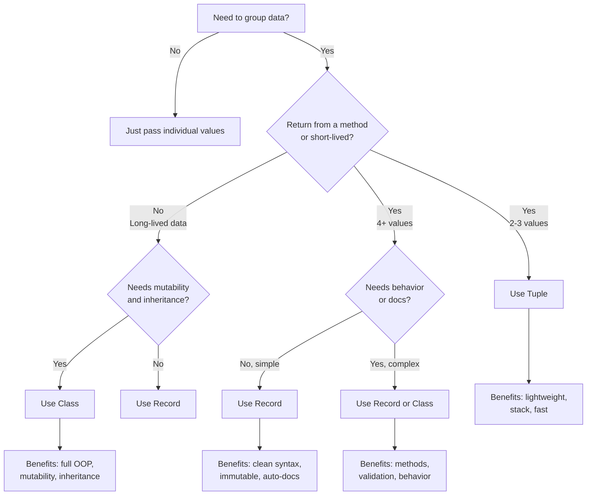

# C# Where to Use Tuples

Tuples are useful in specific scenarios but can harm readability and maintainability if overused. This note covers where tuples shine and where you should choose classes, records, or structs instead.

## Where tuples are useful

### Methods returning two or three related values

```csharp
public (int Min, int Max) GetRange(int[] numbers) { ... }

var (min, max) = GetRange(new[] { 1, 5, 3 });
```

Simple, temporary data is cleaner with tuples than dedicated classes.

### Small temporary groupings inside a method or class

```csharp
public void ProcessOrders(List<Order> orders)
{
    var orderStats = orders.Select(o => (o.Id, o.Total, o.Status)).ToList();
    // ...
}
```

Use tuples for data that doesn't leave the method.

### Dictionary keys with multiple parts

```csharp
// Game grid: map (X, Y) coordinates to tiles
Dictionary<(int X, int Y), Tile> gameMap = new();

gameMap[(0, 0)] = new Tile { Terrain = "Grass" };
gameMap[(1, 1)] = new Tile { Terrain = "Water" };

Console.WriteLine(gameMap[(0, 0)].Terrain);  // Grass
```

Tuples are ideal for composite keys; they're lightweight and comparable.

### LINQ results: selecting multiple fields

```csharp
var products = new List<Product>
{
    new Product { Id = 1, Name = "Widget", Price = 10m },
    new Product { Id = 2, Name = "Gadget", Price = 20m }
};

// Project into tuples for temporary analysis
var productSummary = products
    .Select(p => (p.Name, p.Price))
    .OrderBy(x => x.Price)
    .ToList();

// Then deconstruct in iteration
foreach (var (name, price) in productSummary)
{
    Console.WriteLine($"{name}: ${price}");
}
```

### Quick swaps and multiple assignment

```csharp
(a, b) = (b, a);  // Swap
(x, y, z) = (y, z, x);  // Rotate
```

Cleaner and more readable than temp variables.

### Unit tests and test data

```csharp
[Theory]
[InlineData(1, 2, 3)]      // Simple test values
[InlineData(100, 200, 300)]
public void TestAdd(int a, int b, int expected)
{
    Assert.Equal(expected, a + b);
}

// Or with xUnit Theory + MemberData
public static IEnumerable<object[]> GetTestData()
{
    yield return new object[] { (1, 2), 3 };
    yield return new object[] { (5, 5), 10 };
}
```

Tuples simplify test data (though not required).

## Where NOT to use tuples

### Public APIs and data passed between layers

If data crosses module boundaries or is part of a public API, use a **class or record**:

```csharp
// ❌ Bad: unclear and hard to document
public (string, int, decimal, bool) GetUserSummary(int userId) { ... }

// ✓ Better: named type with documentation
public record UserSummary(string Name, int Age, decimal Balance, bool IsActive);

public UserSummary GetUserSummary(int userId) { ... }
```

Named types provide **documentation, discoverability, and behavior**.

### Data with meaning and behavior

If data has business logic or validation, use a **class or struct**:

```csharp
// ❌ Bad: tuple with implicit meaning
var order = (CustomerId: 123, Total: 0m, Items: new List<OrderItem>());

// ✓ Better: class with methods and validation
public class Order
{
    public int CustomerId { get; set; }
    public decimal Total { get; private set; }
    public List<OrderItem> Items { get; } = new();

    public void AddItem(OrderItem item)
    {
        Items.Add(item);
        Total += item.Price * item.Quantity;
    }

    public decimal CalculateTax() => Total * 0.1m;
}
```

### Long-lived or mutable domain data

Use a **record** for immutable domain data or a **class** for mutable:

```csharp
// ❌ Bad: mutable tuple for long-lived data
var customer = (Id: 1, Name: "Alice", Email: "alice@example.com");
// Now scattered across the codebase; hard to change

// ✓ Better: named record
public record Customer(int Id, string Name, string Email);

var customer = new Customer(1, "Alice", "alice@example.com");
```

## Comparison table: tuple vs class vs struct vs record

| Feature | Tuple | Class | Struct | Record |
|---------|-------|-------|--------|--------|
| **Named members** | ✓ (compile-time) | ✓ | ✓ | ✓ |
| **Methods** | ✗ | ✓ | ✓ | ✓ |
| **Inheritance** | ✗ | ✓ | ✗ | ✓ (limited) |
| **Mutable** | ✓ | ✓ (default) | ✓ (default) | ✗ (immutable by default) |
| **Equality** | ✓ (by value) | ✗ (by reference) | ✓ (by value) | ✓ (by value) |
| **Memory** | Stack (value type) | Heap (reference) | Stack (value type) | Heap (reference) |
| **ToString** | ✗ (generic) | ✗ (generic) | ✗ (generic) | ✓ (generated) |
| **Best for** | Temporary data, return values (2–3 items) | Complex state, behavior | Lightweight value, mutable | Immutable domain data |

## Worked example: refactoring from tuple to record

As a tuple gets unwieldy or starts appearing in many places, refactor it:

```csharp
// Iteration 1: Simple tuple return
public (int Id, string Name, int Age) GetUser(int id)
{
    return (1, "Alice", 30);
}

var (userId, userName, userAge) = GetUser(1);

// Iteration 2: Tuple grows; decision point reached
public (int Id, string Name, int Age, string Email, DateTime Created) GetUserExtended(int id)
{
    // Too much data; hard to read
}

// Iteration 3: Refactor to record (cleaner, more maintainable)
public record UserInfo(int Id, string Name, int Age, string Email, DateTime Created);

public UserInfo GetUserExtended(int id)
{
    return new UserInfo(1, "Alice", 30, "alice@example.com", DateTime.Now);
}

var user = GetUserExtended(1);
Console.WriteLine(user.Name);  // Alice
```

## Decision flow: Tuple, record, struct, or class?



## Common mistakes

- **Item1/Item2 everywhere** – Using positional access in complex code hurts readability. Name tuple elements or refactor to a class/record.

```csharp
// ❌ Hard to read
var data = GetData();
Console.WriteLine(data.Item1);
Console.WriteLine(data.Item2);

// ✓ Clear
var (name, age) = GetData();
Console.WriteLine(name);
Console.WriteLine(age);

// ✓ Or name the tuple
var result = (Name: "Alice", Age: 30);
Console.WriteLine(result.Name);
```

- **Using tuples for long-living domain data** – Data that moves between methods or modules should be a named type.

```csharp
// ❌ Bad: tuple for domain data
public static (int Id, string Name, List<Order> Orders) GetCustomer(int id) { ... }

// ✓ Better: class or record
public record Customer(int Id, string Name, List<Order> Orders);
```

- **Mutable tuples in shared state** – If tuple elements are changed in multiple places, a class/record is clearer.

```csharp
// ❌ Confusing mutation
var point = (X: 10, Y: 20);
point.X = 30;
point.Y = 40;
// Is this intentional? Hard to track changes.

// ✓ Class makes intent clear
public class Point
{
    public int X { get; set; }
    public int Y { get; set; }
}
```

## Quick recap

- **Tuples are best for:** temporary groupings, method return values (2–3 items), dictionary keys, LINQ projections, swaps, test data.
- **Don't use tuples for:** public APIs, data with behavior, long-lived domain data, immutable data (use records instead).
- **Refactor to a record when:** the tuple appears in many places, has more than 4 elements, or needs to be documented.
- **Use records for:** immutable domain data with clear meaning.
- **Use classes for:** complex state, inheritance, or mutable business logic.
- When in doubt, ask: *Does this data have meaning and behavior?* If yes, use a named type.
