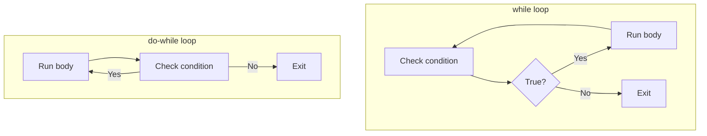

# C# while and do-while Loops

The `while` loop repeats a block of code **as long as a condition is true**. It checks the condition **before** each run. The `do-while` loop is similar but checks the condition **after** the first run, guaranteeing at least one execution. Both are useful when you don't know in advance how many times the loop will run.

## while loop: syntax and how it works

A `while` loop has a simple structure:

```csharp
while (condition)
{
    // Code runs here as long as condition is true
}
```

**Step-by-step execution:**

1. Check the condition.
2. If true, run the body.
3. Go back to step 1.
4. If false, skip the body and continue after the loop.

**Example: counting from 0 to 4**

```csharp
int count = 0;
while (count < 5)
{
    Console.WriteLine($"count = {count}");
    count++;
}
// Output:
// count = 0
// count = 1
// count = 2
// count = 3
// count = 4
```

**Example: summing user input**

```csharp
int sum = 0;
int number = 0;

while (number >= 0)
{
    sum += number;
    Console.Write("Enter a number (or -1 to stop): ");
    number = int.Parse(Console.ReadLine());
}

Console.WriteLine($"Total: {sum}");
// Output (example):
// Enter a number (or -1 to stop): 10
// Enter a number (or -1 to stop): 20
// Enter a number (or -1 to stop): -1
// Total: 30
```

**Example: waiting for valid input**

```csharp
Console.Write("Enter an age between 0 and 120: ");
int age = int.Parse(Console.ReadLine());

while (age < 0 || age > 120)
{
    Console.WriteLine("Invalid age. Try again.");
    Console.Write("Enter an age between 0 and 120: ");
    age = int.Parse(Console.ReadLine());
}

Console.WriteLine($"Age accepted: {age}");
// Output (example):
// Enter an age between 0 and 120: -5
// Invalid age. Try again.
// Enter an age between 0 and 120: 150
// Invalid age. Try again.
// Enter an age between 0 and 120: 25
// Age accepted: 25
```

## do-while loop: syntax and how it works

A `do-while` loop runs the body first, **then** checks the condition. This guarantees at least one execution:

```csharp
do
{
    // Code runs here at least once
} while (condition);  // Note the semicolon!
```

**Step-by-step execution:**

1. Run the body.
2. Check the condition.
3. If true, go back to step 1.
4. If false, exit the loop.

**Example: simple counter**

```csharp
int count = 0;
do
{
    Console.WriteLine($"count = {count}");
    count++;
} while (count < 5);
// Output:
// count = 0
// count = 1
// count = 2
// count = 3
// count = 4
```

Notice the **semicolon after `while(...)`**—it's required in `do-while`.

**Example: input validation (menu)**

```csharp
string choice;

do
{
    Console.WriteLine("=== Menu ===");
    Console.WriteLine("1. Start");
    Console.WriteLine("2. Settings");
    Console.WriteLine("3. Exit");
    Console.Write("Choose an option: ");
    choice = Console.ReadLine();

    if (choice != "1" && choice != "2" && choice != "3")
    {
        Console.WriteLine("Invalid choice. Try again.");
    }
} while (choice != "1" && choice != "2" && choice != "3");

Console.WriteLine($"You selected: {choice}");
// Output (example):
// === Menu ===
// 1. Start
// 2. Settings
// 3. Exit
// Choose an option: 5
// Invalid choice. Try again.
// === Menu ===
// 1. Start
// 2. Settings
// 3. Exit
// Choose an option: 2
// You selected: 2
```

**Example: password validation**

```csharp
string password;

do
{
    Console.Write("Enter password: ");
    password = Console.ReadLine();

    if (password.Length < 8)
    {
        Console.WriteLine("Password too short. Must be 8+ characters.");
    }
} while (password.Length < 8);

Console.WriteLine("Password accepted!");
// Output (example):
// Enter password: hi
// Password too short. Must be 8+ characters.
// Enter password: hello123
// Password accepted!
```

## Infinite loops: why they happen and how to handle them

An **infinite loop** never ends because the condition is always true or never changes:

### Accidental infinite loops

**Forgetting to update the loop variable:**

```csharp
int x = 0;
while (x < 5)
{
    Console.WriteLine(x);
    // ❌ x never changes—infinite loop!
}

// ✓ Fix: increment x
while (x < 5)
{
    Console.WriteLine(x);
    x++;
}
```

**Wrong comparison operator:**

```csharp
int x = 0;
while (x <= 5)
{
    Console.WriteLine(x);
    x++;
}
// This is fine, but if you swap < and >:

while (x > 5)  // x starts at 0, so 0 > 5 is false—loop never runs
{
    Console.WriteLine(x);
}
```

### Intentional infinite loops

Sometimes you want a loop to run forever (until you explicitly break out):

```csharp
while (true)
{
    Console.Write("Enter a command (or 'exit' to quit): ");
    string cmd = Console.ReadLine();

    if (cmd == "exit")
    {
        break;  // Exit the loop
    }

    Console.WriteLine($"You entered: {cmd}");
}
Console.WriteLine("Goodbye!");
// Output (example):
// Enter a command (or 'exit' to quit): hello
// You entered: hello
// Enter a command (or 'exit' to quit): test
// You entered: test
// Enter a command (or 'exit' to quit): exit
// Goodbye!
```

### Stopping a running infinite loop

If you accidentally create an infinite loop, stop it:

- **In the console**: Press **Ctrl+C** to terminate the program.
- **In Rider or Visual Studio**: Click the red **Stop** button in the debug toolbar.

## Flow diagram: how while and do-while work



## Common mistakes

- **Forgetting to update the loop variable** – This creates an infinite loop. Always ensure the condition will eventually become false.

```csharp
// ❌ Infinite loop
int x = 0;
while (x < 10)
{
    Console.WriteLine(x);
}

// ✓ Fix: update x
while (x < 10)
{
    Console.WriteLine(x);
    x++;
}
```

- **Using `=` (assignment) instead of `==` (comparison)** – This assigns a value instead of checking equality, often causing unexpected behavior.

```csharp
// ❌ Wrong: assigns 5 to x
if (x = 5)  // Compiler may warn or error
{
    // ...
}

// ✓ Correct: checks if x equals 5
if (x == 5)
{
    // ...
}
```

- **Forgetting the semicolon after `do-while`** – The semicolon is required at the end of the `while(...)` in `do-while` loops.

```csharp
// ❌ Syntax error: missing semicolon
do
{
    Console.WriteLine("Hi");
} while (true)

// ✓ Correct: semicolon is required
do
{
    Console.WriteLine("Hi");
} while (true);
```

## Quick recap

- **while** checks the condition before each run; the body may never execute.
- **do-while** runs the body at least once, then checks the condition.
- Use `while` for unknown repetitions when the body might not run at all.
- Use `do-while` for input validation, menus, or when the body must run at least once.
- Always update loop variables to avoid infinite loops.
- `while (true)` with `break` creates an intentional infinite loop you can exit conditionally.
- Stop runaway loops with Ctrl+C in the console or the Stop button in your IDE.
