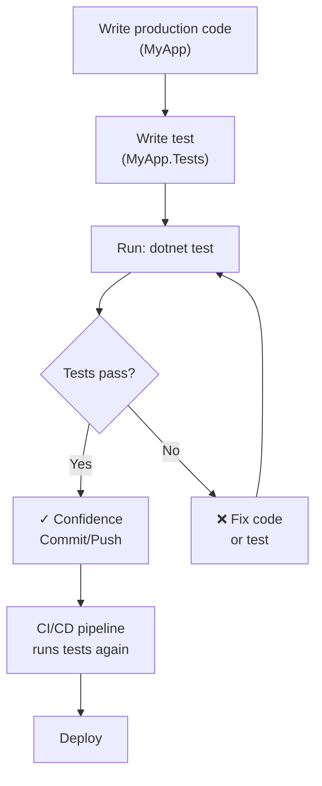

# C# xUnit First Test Project

This note walks you through setting up a .NET test project with xUnit, writing your first test, and running it. xUnit is the most common testing framework in modern .NET development; it's fast, clean, and integrates seamlessly with CI/CD pipelines.

## Project setup with the dotnet CLI

### Create a solution with two projects

A typical setup has two projects: one for your production code and one for tests. Here's how to create them:

```bash
# Create a solution directory
mkdir MyApp
cd MyApp

# Create the solution file
dotnet new sln -n MyApp

# Create the production project
dotnet new classlib -n MyApp
dotnet sln add MyApp/MyApp.csproj

# Create the xUnit test project
dotnet new xunit -n MyApp.Tests
dotnet sln add MyApp.Tests/MyApp.Tests.csproj

# Add a reference from tests to production code
dotnet add MyApp.Tests/MyApp.Tests.csproj reference MyApp/MyApp.csproj
```

After these commands, your folder structure looks like:

```
MyApp/
├── MyApp.sln                      (solution file)
├── MyApp/
│   ├── MyApp.csproj              (production project)
│   ├── Class1.cs                 (delete this after creating your own)
│   └── [your code here]
└── MyApp.Tests/
    ├── MyApp.Tests.csproj        (test project, references MyApp)
    ├── UnitTest1.cs              (delete and replace with your tests)
    └── [your tests here]
```

### Setup in Rider or Visual Studio

Both IDEs have built-in support for creating test projects:

**In Rider:**
1. Create a new solution (File → New → Solution)
2. Right-click the solution → Add → New Project
3. Choose "xUnit Test Project" for the test project
4. Right-click the test project → Add → Reference, select the production project

**In Visual Studio:**
1. File → New → Project
2. Search for "xUnit Test Project"
3. Create it, then right-click → Add Project Reference to the production project

## Understanding the test project file

A test project created with `dotnet new xunit` has this `.csproj` structure (simplified):

```xml
<Project Sdk="Microsoft.NET.Sdk">

  <PropertyGroup>
    <TargetFramework>net9.0</TargetFramework>
  </PropertyGroup>

  <ItemGroup>
    <!-- xUnit testing framework -->
    <PackageReference Include="xunit" Version="2.8.0" />
    <!-- Test runner for dotnet test command -->
    <PackageReference Include="xunit.runner.visualstudio" Version="2.5.4" />
  </ItemGroup>

  <ItemGroup>
    <!-- Reference to the project under test -->
    <ProjectReference Include="../MyApp/MyApp.csproj" />
  </ItemGroup>

</Project>
```

**Key parts:**
- **`xunit` package**: The testing framework (attributes, assertions, etc.)
- **`xunit.runner.visualstudio` package**: Integrates with IDE test runners and `dotnet test`
- **`ProjectReference`**: Links to the code you're testing

## Writing and running your first test

### Step 1: Create a simple class to test

In `MyApp/Calculator.cs`:

```csharp
namespace MyApp;

public class Calculator
{
    public int Add(int a, int b) => a + b;
}
```

### Step 2: Write a test

In `MyApp.Tests/CalculatorTests.cs`:

```csharp
using MyApp;
using Xunit;

namespace MyApp.Tests;

public class CalculatorTests
{
    [Fact]
    public void Add_TwoNumbers_ReturnsSum()
    {
        // Arrange
        var calculator = new Calculator();
        int a = 2;
        int b = 3;

        // Act
        int result = calculator.Add(a, b);

        // Assert
        Assert.Equal(5, result);
    }
}
```

### Step 3: Run the test

**From the command line:**

```bash
dotnet test

# Output:
# Test run successful.
# Total tests: 1. Passed: 1. Failed: 0. Skipped: 0.
```

**From Rider or Visual Studio:**
- Click the green ▶ play button next to the test method, or
- Use the **Test Explorer** (usually on the right side):
  - Rider: View → Tool Windows → Run (or press Ctrl+Shift+F10)
  - Visual Studio: Test → Test Explorer (or Ctrl+E, T)
- Double-click a test to run it, right-click to debug it

### Step 4: Read the test output

**When a test passes:**

```
Test run successful.
Total tests: 1. Passed: 1. Failed: 0. Skipped: 0.
```

**When a test fails** (example: if `Add` returned 4 instead of 5):

```
Test run failed.
Total tests: 1. Passed: 0. Failed: 1. Skipped: 0.

Failed     CalculatorTests.Add_TwoNumbers_ReturnsSum
Expected: 5
Actual:   4
Stack Trace:
   at MyApp.Tests.CalculatorTests.Add_TwoNumbers_ReturnsSum() in CalculatorTests.cs:line 20
```

The failure message shows:
- **Test name**: Which test failed
- **Expected vs Actual**: What you expected vs what actually happened
- **Stack trace**: Where in the test the assertion failed

## Making code testable: public classes

Your test code needs to access the classes it tests. By default, classes are `internal` (accessible only within their project), so tests can't see them.

**Solution**: Make classes and their members `public`:

```csharp
// ✓ This is accessible to tests
public class Calculator
{
    public int Add(int a, int b) => a + b;
}

// ❌ This is not accessible to tests (error CS0122: inaccessible due to protection level)
internal class Calculator
{
    public int Add(int a, int b) => a + b;
}
```

### InternalsVisibleTo for limited test access

If you have truly internal classes that only tests should access, you can use `InternalsVisibleTo` in `AssemblyInfo.cs` or the `.csproj` file:

```csharp
// In MyApp/AssemblyInfo.cs or at the top of MyApp/GlobalUsings.cs
[assembly: System.Runtime.CompilerServices.InternalsVisibleTo("MyApp.Tests")]
```

This allows `MyApp.Tests` to access `internal` members in `MyApp`. Use this sparingly; prefer `public` classes and test through the public API.

## Common beginner problems

**Tests not discovered:**
- Make sure the test class is `public` and test methods are `public`
- Verify test methods are decorated with `[Fact]` or `[Theory]`
- Confirm the test project references xUnit correctly (check `.csproj`)

**Missing project reference (error CS0103):**
- After creating the test project, run: `dotnet add MyApp.Tests reference MyApp`
- Or use the IDE: Right-click test project → Add Project Reference

**Class not public (error CS0122):**
- The class under test must be `public`, or use `InternalsVisibleTo`
- Error message: "… inaccessible due to protection level"

**Wrong target framework:**
- Ensure both projects target the same .NET version (or at least compatible ones)
- Check the `<TargetFramework>` in both `.csproj` files (e.g., both should be `net9.0`)

## Running tests in CI/CD (GitHub Actions example)

A typical GitHub Actions workflow runs tests on every push:

```yaml
name: Tests

on: [push, pull_request]

jobs:
  test:
    runs-on: ubuntu-latest
    steps:
      - uses: actions/checkout@v3
      - uses: actions/setup-dotnet@v3
        with:
          dotnet-version: '9'
      - run: dotnet restore
      - run: dotnet build
      - run: dotnet test
```

This ensures every commit is tested automatically. See [CI/CD](/glossary/ci-cd) for more.

## Test project workflow diagram



## Common mistakes

- **Forgetting the project reference**: Tests can't see the production code without `dotnet add reference` or the IDE equivalent. Error: `CS0103: The name 'Calculator' does not exist in the current context`.

- **Trying to access `internal` classes without permission**: Make classes `public`, or use `InternalsVisibleTo` sparingly.

```csharp
// ❌ Error CS0122
internal class PrivateCalculator { }

// ✓ Accessible
public class PublicCalculator { }
```

- **Running tests from the wrong directory**: Always run `dotnet test` from the solution root (where the `.sln` file is), or specify the test project: `dotnet test MyApp.Tests/MyApp.Tests.csproj`.

## Quick recap

- Use `dotnet new xunit` to create a test project; use `dotnet add reference` to link it to production code.
- Test projects contain `xunit` and `xunit.runner.visualstudio` NuGet packages.
- Write tests in public classes with public test methods decorated with `[Fact]`.
- Run tests with `dotnet test` or via the IDE's test runner (play button, Test Explorer).
- Read failure messages carefully: they show expected vs actual and the exact line where the assertion failed.
- Make production classes `public` so tests can access them.
- Always run from the solution root (where the `.sln` file is) for predictable behavior.
