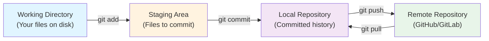

# What is Git and Why Version Control?

Version control is a system that tracks changes to your files over time. Git is a distributed version-control system that lets you save snapshots of your code, undo changes, work on features in parallel, and collaborate with others. GitHub is a cloud platform where you host Git repositories and collaborate with your team.

Think of Git like a detailed history journal for your project—every change is recorded with who made it, when, and why. This lets you experiment safely, review changes before merging them, and recover old versions if something breaks.

## Working directory vs. staging area vs. local repo vs. remote

Git manages your code across four key areas:



- **Working Directory**: Your actual files on disk. You edit them in your text editor.
- **Staging Area**: A holding area where you mark changes to include in the next commit. Use `git add` to stage files.
- **Local Repository**: Your `.git` folder that stores your full commit history on your computer.
- **Remote Repository**: A copy of your repository hosted on GitHub (or another service). You use `git push` and `git pull` to sync.

## Git vs. GitHub

**Git** is the tool that runs locally on your computer. It manages version control—tracking changes, creating commits, and managing branches.

**GitHub** is a cloud platform (owned by Microsoft) that:
- Hosts your Git repositories
- Provides a web interface to view code, history, and changes
- Enables collaboration with pull requests and code reviews
- Offers CI/CD automation (Actions), issue tracking, and discussions

You can use Git without GitHub (store your repository only locally), but GitHub makes collaboration easy.

## What is a repository?

A repository (or "repo") is a folder that Git tracks. It contains:
- Your project files
- A `.git` folder (created by `git init`) that stores all history and metadata
- Optional configuration files like `.gitignore`, `README.md`

When you `git clone` a repository from GitHub, you download the entire history and all files to your computer.

## What is a commit?

A commit is a snapshot of your code at a point in time. Each commit has:
- A unique ID (a 40-character hash like `a1b2c3d...`)
- A message describing what changed
- Author and timestamp
- A reference to the previous commit (forming a chain of history)

Commits are the building blocks of your project history. Rather than storing entire copies of every file, Git stores changes (deltas) between commits, making it efficient.

```bash
# See all commits in your project
git log

# Create a new commit
git add .
git commit -m "Add user authentication"
```

## Why version control matters

- **Undo mistakes**: Revert to a previous working version if something breaks.
- **Collaborate safely**: Work on features in parallel without overwriting each other's changes.
- **Code review**: Review changes before they go into production via pull requests.
- **History and accountability**: See who changed what, when, and why.
- **Branching**: Experiment without affecting the main (stable) version of your code.

## Common mistakes

- Using Git only to backup code, not to track meaningful changes. Commits should represent logical units of work (e.g., "fix bug" or "add feature"), not random checkpoints.
- Staging and committing everything without reviewing changes. Always run `git status` and `git diff` to see what you're about to commit.
- Ignoring the `.gitignore` file. Secret files (like `.env` with API keys), dependencies (`node_modules`), and build artifacts should never be committed.

## Quick recap

- Version control tracks changes to your code over time.
- **Git** is the local tool; **GitHub** is the cloud platform for collaboration.
- A repository is a folder that Git tracks, containing your code and a `.git` history folder.
- The four areas are: working directory, staging area, local repository, remote repository.
- A commit is a snapshot of your code with a message, author, and timestamp.
- Use commits to undo mistakes, collaborate safely, review code, and maintain a clear history.
