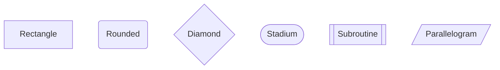
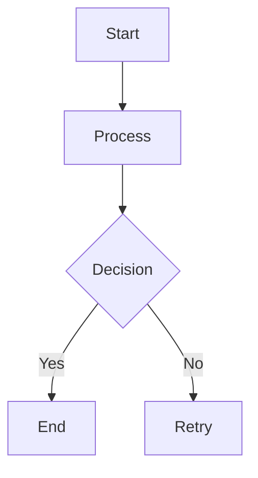
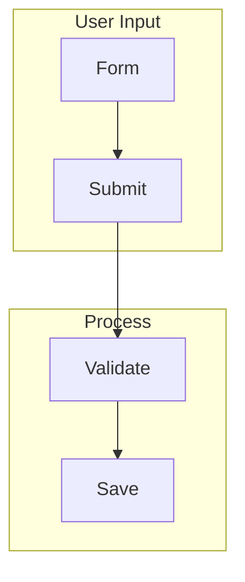
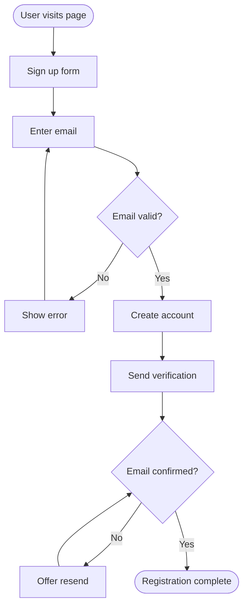
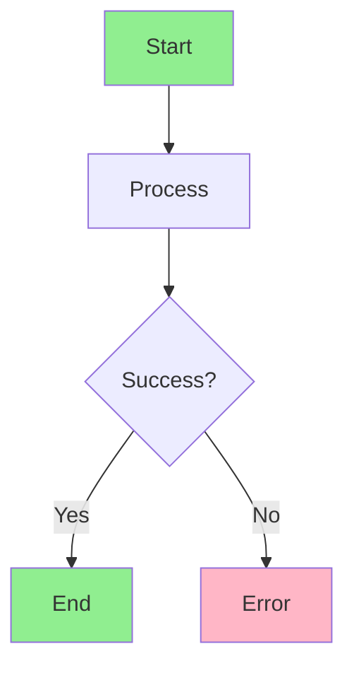

# Mermaid Flowcharts

Flowcharts visualize processes, workflows, and decision trees. They show how actions flow from one step to the next, with branches for different outcomes. Mermaid makes it easy to draw flowcharts with a few lines of text.

## Basic nodes and shapes

Nodes represent steps or decisions. Different shapes convey different meanings:

```markdown
graph TD
    A[Rectangle]
    B(Rounded)
    C{Diamond}
    D([Stadium])
    E[[Subroutine]]
    F[/Parallelogram/]
```

Rendered:



## Arrows and labels

Connect nodes with arrows. Add labels on arrows with pipes or square brackets.



## Subgraphs

Group related nodes in subgraphs to organize complex diagrams.



## A complete workflow example

Here's a real-world example: a user registration flow.



## Styling nodes

Use `style` to customize node appearance (background, text color, stroke).



## Common mistakes

- Using invalid node IDs (spaces, special characters); use underscores or numbers.
- Forgetting arrow syntax; `A B` won't connect, but `A --> B` will.
- Mixing node shapes in ways that confuse the diagram's purpose; use consistent shapes for similar steps.

## Quick recap

- Rectangles `[]`, rounded `()`, diamonds `{}` for decisions
- Connect with `-->`, `<-->`, or `---`
- Add labels with `-->|label|` syntax
- Group with `subgraph`
- Style nodes with `style nodeId fill:#color`
