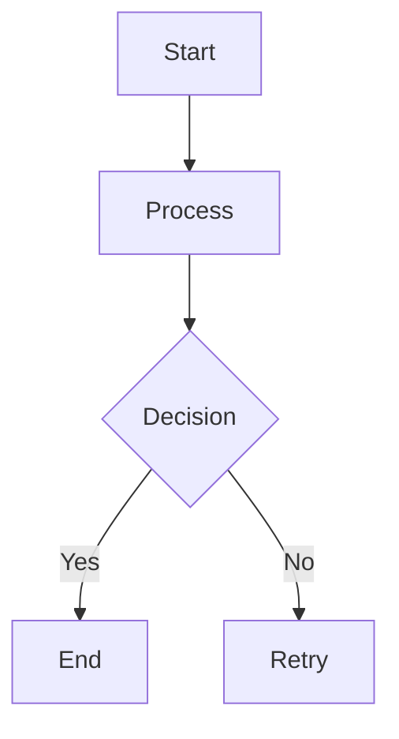
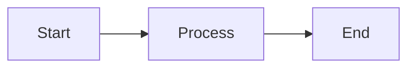

# Mermaid Introduction

Mermaid is a JavaScript-based diagramming and charting tool that uses a simple, Markdown-like syntax to create diagrams. Instead of drawing by hand or using complex tools, you describe your diagram in plain text and Mermaid renders it as SVG. It works in GitHub, VS Code, this site, and many other platforms.

## What is Mermaid?

Mermaid turns text into visual diagrams. This means you can:
- Keep diagrams in version control (they're just text)
- Generate diagrams programmatically
- Use the same syntax across multiple platforms
- Update diagrams without opening design tools

## Mermaid syntax basics

Write Mermaid diagrams in fenced code blocks with the language set to `mermaid`:

Every diagram starts with a diagram type (like `graph`, `sequence`, `classDiagram`) followed by the content.

## Diagram direction

For flowcharts and similar diagrams, specify the direction:
- `TD` or `DF`: Top to Down (default, vertical flow)
- `BT`: Bottom to Top
- `LR`: Left to Right (horizontal flow)
- `RL`: Right to Left

## Diagram types

Mermaid supports many diagram types:

| Type | Use case |
|------|----------|
| `graph` | Flowcharts, processes, workflows |
| `sequence` | Interactions between actors over time |
| `class` | Object-oriented structures and relationships |
| `state` | State machines and lifecycle flows |
| `er` | Entity-relationship databases |
| `gantt` | Project timelines and schedules |
| `pie` | Proportions and percentages |

## Where Mermaid works

- **GitHub**: Renders automatically in README and markdown files
- **VS Code**: Shows diagrams with Markdown preview extensions
- **This site**: Renders live in note and cheat sheet detail pages
- **Obsidian, Notion**: Popular note-taking apps support Mermaid
- **GitLab, Gitea**: Other platforms with Markdown support

## Common mistakes

- Forgetting to use a code block; just writing `graph TD` won't render.
- Using unsupported characters in node IDs; stick to alphanumeric and underscores.
- Incorrect direction keywords; use `TD`, `LR`, etc., not `vertical` or `horizontal`.

## Quick recap

- Mermaid renders diagrams from text syntax
- Use fenced code blocks with `mermaid` language
- Specify direction: `TD`, `LR`, `BT`, `RL`
- Many diagram types: flowchart, sequence, class, state, ER, Gantt, pie
- Works on GitHub, VS Code, and this site
