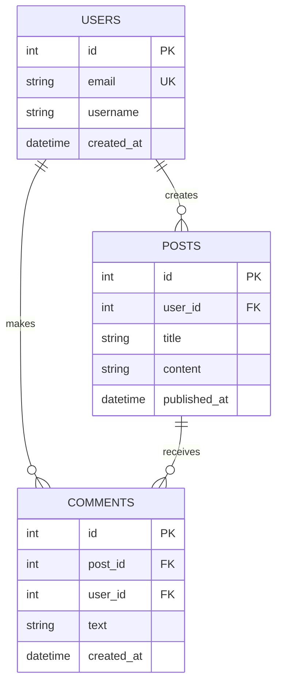
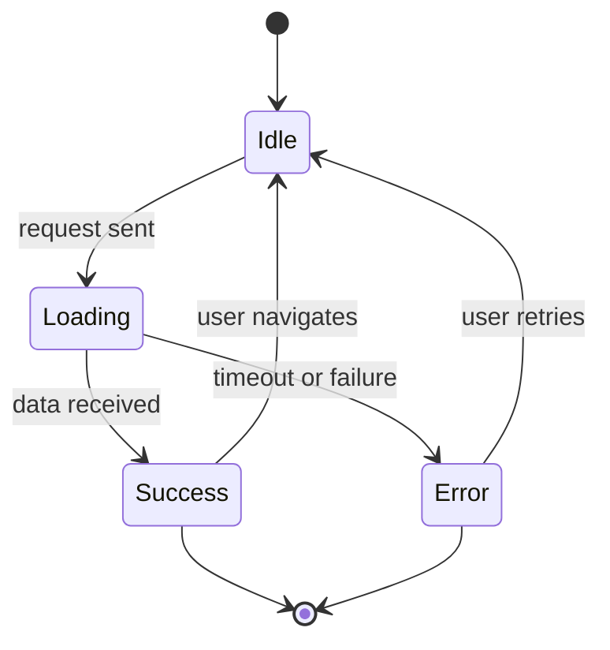
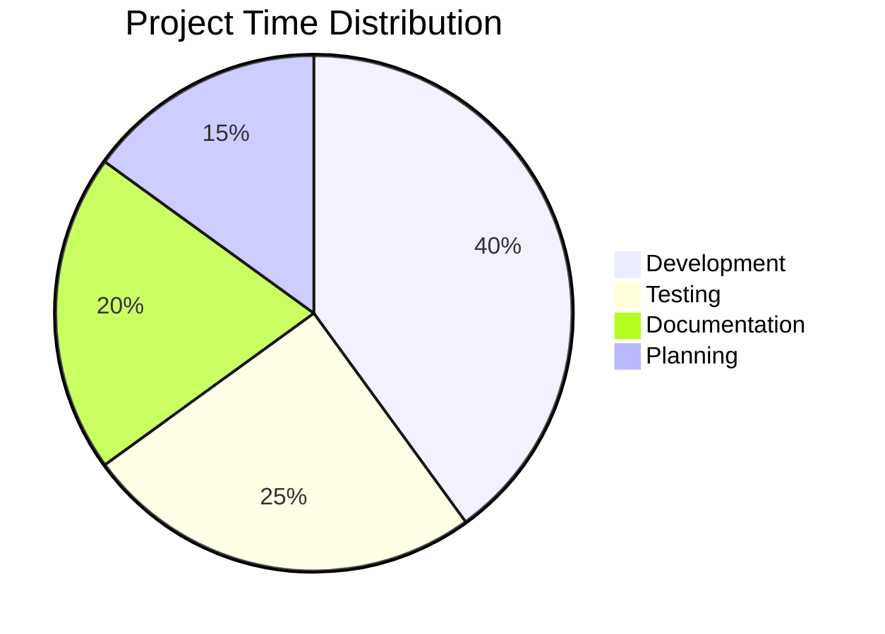

# Mermaid Other Diagrams

Beyond flowcharts and sequences, Mermaid supports entity-relationship diagrams for databases, state diagrams for machines and workflows, Gantt charts for project planning, and pie charts for data visualization. Each diagram type excels at communicating a specific kind of information.

## Entity-Relationship (ER) diagrams

Show database tables, columns, and relationships.



Relationship symbols:
- `|o` one (optional)
- `||` one (required)
- `o{` many (optional)
- `|{` many (required)

## State diagrams

Visualize states and transitions in systems or workflows.



## Gantt charts

Display project timelines with tasks and milestones.

```mermaid
gantt
    title Project Timeline
    dateFormat YYYY-MM-DD
    
    section Planning
    Requirements :req, 2026-10-01, 14d
    Design :des, after req, 21d
    
    section Development
    Backend :back, 2026-10-22, 30d
    Frontend :front, after back, 25d
    
    section Testing
    QA :qa, after front, 14d
    
    section Deployment
    Release :rel, after qa, 7d
    Milestone :milestone, rel, 1d
```

## Pie charts

Show proportions of a whole.



## Common mistakes

- Using the wrong relationship symbols in ER diagrams; `||--o{` means one-to-many, not many-to-one.
- Gantt chart dates without the correct format; specify `dateFormat` clearly.
- Pie chart values that don't represent proportions meaningfully; consider what totals 100%.

## Quick recap

- ER diagrams: define entities, attributes, and relationships (PK = primary key, FK = foreign key)
- State diagrams: states and transitions, `[*]` for start/end
- Gantt: tasks with dates, dependencies, and milestones
- Pie charts: simple key-value pairs for proportions
