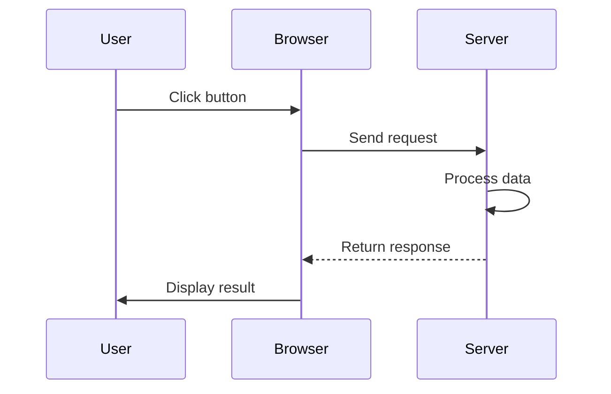
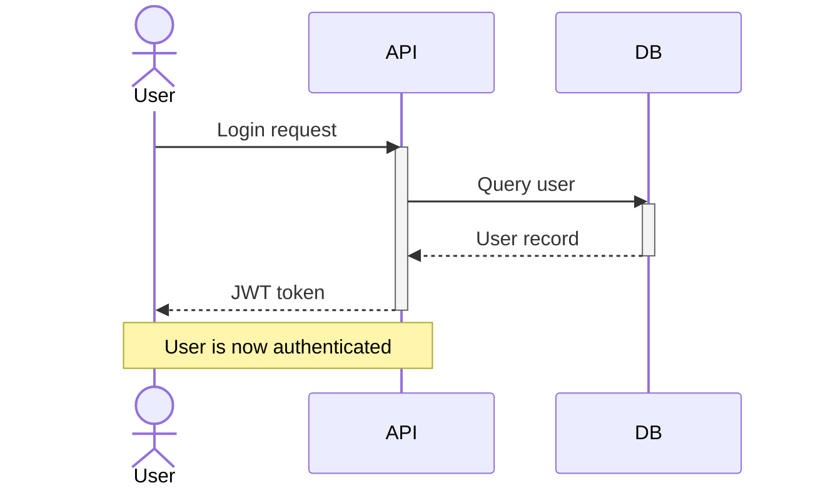
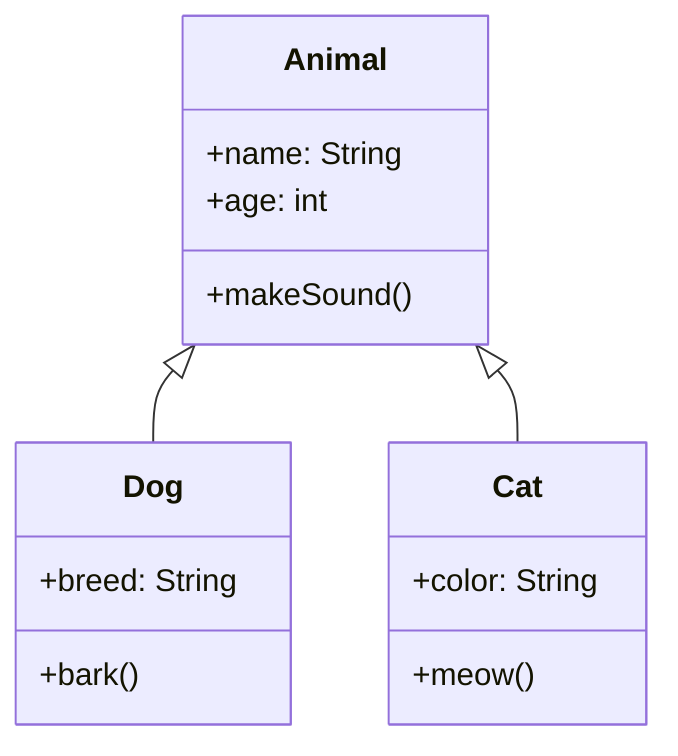
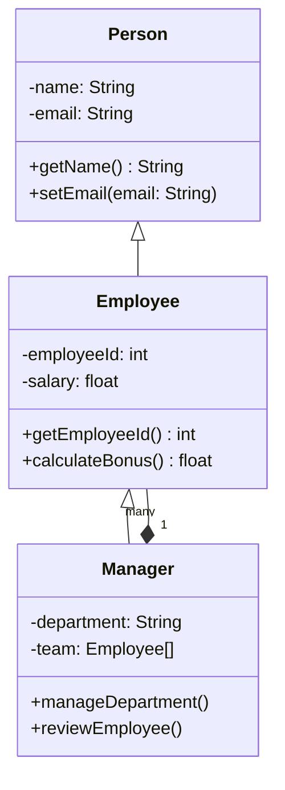

# Mermaid Sequence and Class Diagrams

Sequence diagrams show interactions between participants over time, perfect for documenting APIs or multi-actor workflows. Class diagrams visualize object-oriented structures, including classes, properties, and relationships. Both diagram types help communicate system design clearly.

## Sequence diagrams

Show how different actors exchange messages in order.

### Sequence diagram elements

- **Participants**: the actors in the sequence (user, service, database, etc.)
- **Messages**: interactions between participants
  - `->` solid arrow (call)
  - `-->` dashed arrow (return)
  - `>>` self-call (message to self)
- **Notes**: explanatory text

### Adding notes and actors

## Class diagrams

Show the structure of classes and their relationships.

### Class relationships

- `<|--` inheritance (is-a)
- `*--` composition (has-a, owns)
- `o--` aggregation (has-a, shared)
- `-->` association (uses)

### Complete class example

Symbols:
- `+` public
- `-` private
- `#` protected
- `~` package

## Common mistakes

- Forgetting to list participants in sequence diagrams; they must be declared first.
- Confusing relationship arrows; `<|--` means inheritance, not composition.
- Placing long class names or methods without line breaks, making the diagram hard to read.

## Quick recap

- Sequence: participants, messages, interactions over time
- Messages: `->` solid, `-->` dashed, `>>` self
- Activation: `activate` and `deactivate` show process duration
- Class relationships: `<|--` inherit, `*--` compose, `o--` aggregate
- Visibility: `+` public, `-` private, `#` protected
